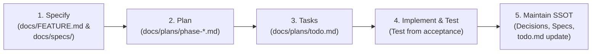

# Cloud Bookstore Agent Instructions

Instructions and guidelines for AI coding agents operating on the **Cloud Bookstore** repository.

---

## 1. Project Overview & Architecture

**Cloud Bookstore** is an internal bookstore management system supporting physical inventory, retail POS sales, rentals, customer membership, staff payroll/attendance, and store administration.

### Technology Stack
- **Backend (`app/backend`)**: ASP.NET Core 10.0, Entity Framework Core 10.0, PostgreSQL (Npgsql), MailKit (local SMTP via Mailpit), Cloudinary for image storage (direct signed upload), Redis for CSRF token & session management.
- **Frontend (`app/frontend`)**: React 19, TypeScript, Vite, Tailwind CSS v4, TanStack Query (v5), React Router (v7), Bun, oxlint, Node test runner.
- **Local Infrastructure (`docker-compose.yaml`)**:
  - `mailpit`: SMTP port `1025`, Web UI `http://localhost:8025`.

---

## 2. Documentation Map (`docs/`) & Single Source of Truth (SSOT)

The `docs/` directory is the **authoritative Single Source of Truth** for the entire project. All requirements, architecture, rules, and plans are formally documented here.

### Where to Look
| Directory / File | Description & Agent Usage |
| :--- | :--- |
| [`docs/guides/SDD_WORKFLOW.md`](file:///home/phamhoangthai/Documents/project/cloud-bookstore/docs/guides/SDD_WORKFLOW.md) | **MANDATORY**: The 5-step Spec-Driven Development workflow. Read before planning or coding. |
| [`docs/FEATURE.md`](file:///home/phamhoangthai/Documents/project/cloud-bookstore/docs/FEATURE.md) | Canonical Feature Catalog & Feature IDs (`AUTH-*`, `RBAC-*`, `CAT-*`, `EDITION-*`, `BOOK-*`, `RENT-*`, `SALE-*`, etc.). Always reference these IDs in plans, specs, and commits. |
| [`docs/decisions/`](file:///home/phamhoangthai/Documents/project/cloud-bookstore/docs/decisions/README.md) | **Decision Records**: Immutable records of binding decisions.<br>• `PDR-001` to `PDR-007`: Product Decision Records (scope, roles, rental policy, book hierarchy).<br>• `ADR-001` to `ADR-004`: Architecture Decision Records (PostgreSQL, ASP.NET Core, Cookie/CSRF Auth, Session Lockout). |
| [`docs/requirements/`](file:///home/phamhoangthai/Documents/project/cloud-bookstore/docs/requirements/BUSINESS_RULES.md) | Detailed requirements:<br>• `BUSINESS_RULES.md`: Core domain rules.<br>• `WORKFLOWS.md`: POS, rental, return, audit flows.<br>• `QUALITY.md`: Definition of Ready (DoR), Definition of Done (DoD), and test pyramid. |
| [`docs/architecture/`](file:///home/phamhoangthai/Documents/project/cloud-bookstore/docs/architecture/DOMAIN_MODEL.md) | System & domain architecture:<br>• `DOMAIN_MODEL.md`: Domain entity relationships & Mermaid diagrams.<br>• `SYSTEM_CONTEXT.md`: System boundary and integration points. |
| [`docs/product/`](file:///home/phamhoangthai/Documents/project/cloud-bookstore/docs/product/GLOSSARY.md) | Product context:<br>• `GLOSSARY.md`: Canonical Vietnamese domain terminology definitions.<br>• `ROLES.md`: The 3 system roles and permissions.<br>• `SCOPE.md` & `VISION.md`: Scope boundaries. |
| [`docs/specs/`](file:///home/phamhoangthai/Documents/project/cloud-bookstore/docs/specs/README.md) | Accepted Feature Specifications with testable acceptance criteria. |
| [`docs/plans/`](file:///home/phamhoangthai/Documents/project/cloud-bookstore/docs/plans/README.md) | Implementation plans by phase (`phase-*.md`, `AUTH-001*.md`). |
| [`docs/plans/todo.md`](file:///home/phamhoangthai/Documents/project/cloud-bookstore/docs/plans/todo.md) | **Official Task Tracker**: Check and update task statuses (`TODO`, `IN_PROGRESS`, `IN_REVIEW`, `DONE`) and evidence here. Do not create external task lists or duplicate into `tasks/`. |
| [`docs/OPEN_QUESTIONS.md`](file:///home/phamhoangthai/Documents/project/cloud-bookstore/docs/OPEN_QUESTIONS.md) | Unresolved questions (`P0`, `P1`, `P2`). **BLOCKER**: Never implement areas affected by an open `P0` question. |
| [`docs/guides/`](file:///home/phamhoangthai/Documents/project/cloud-bookstore/docs/guides) | Technical guides: `cookie-authorization.md`, `email-authentication.md`, etc. |

### ⚠️ STRICT WARNING ON `docs/legacy/`
- Files in [`docs/legacy/`](file:///home/phamhoangthai/Documents/project/cloud-bookstore/docs/legacy/README.md) are **historical artifacts only** (pre-refactor 2026-10-20).
- **NEVER** use `docs/legacy/` as a requirement or cite it in new specs.
- **NEVER** edit legacy files to "fix" obsolete statements; preserve them strictly for historical tracing.

---

## 3. Core Domain Rules & Non-Negotiable Constraints

Agents must follow these product constraints (from `PDR-001` through `PDR-007` and `BUSINESS_RULES.md`):

1. **Book Domain Hierarchy (`PDR-005`, `DOMAIN_MODEL.md`)**:
   ```text
   Bộ sách (BookSeries)
     └── Đầu sách / tập (BookTitle)
           └── Ấn bản (BookEdition) [Optional ISBN, Publisher, Year, Reprint]
                 └── Bản sách vật lý (BookCopy) [Unique CopyBarcode]
   ```
   - **`ISBN` is NOT a primary key** and does NOT identify a physical book copy. It identifies an edition. Multiple reprints/editions may share an ISBN or have no ISBN.
   - **`CopyBarcode`** is the internal unique identifier for a physical book copy (`BookCopy`). POS sales, rentals, returns, and inventory scanning **MUST** use `CopyBarcode`, not ISBN.
   - **Barcode ISBN (EAN-13)** is scanned only to look up or select an `Edition`.
2. **Internal Store Only (`PDR-001`)**:
   - The system is exclusively for store staff at physical counters. There is no public customer web portal, online reservation, or self-service rental extension.
3. **Three Roles Only (`PDR-002`, `ROLES.md`)**:
   - Exactly 3 business roles: `Admin`, `Employee` (Nhân viên), `Warehouse` (Quản lý kho).
   - Sensitive exceptions (inventory/cash variance approval, payroll manual adjustments, account unlocking) **require Admin approval**.
4. **Rental & Membership Policy (`PDR-003`)**:
   - **Deposit (`Tiền cọc`) = 100% of the copy's actual selling price (`Giá bán thực tế`)**, NOT the cover price (`Giá bìa`).
   - Rental fees are calculated by unit rate and duration, and settled when the book is returned.
   - Membership tiers (`Thường`, `Bạc`, `Vàng`) are computed automatically from valid cumulative spending (`Tổng chi tiêu hợp lệ`).
5. **Dual Channel Availability (`PDR-007`)**:
   - Physical copies are default available for both Sale and Rental, unless explicitly restricted to Sale-only or Rental-only by warehouse staff.

---

## 4. Spec-Driven Development (SDD) Workflow for Agents

Follow the 5-step SDD cycle defined in [`docs/guides/SDD_WORKFLOW.md`](file:///home/phamhoangthai/Documents/project/cloud-bookstore/docs/guides/SDD_WORKFLOW.md):



1. **Specify**:
   - Identify the `Feature ID` in [`docs/FEATURE.md`](file:///home/phamhoangthai/Documents/project/cloud-bookstore/docs/FEATURE.md).
   - Review relevant ADRs, PDRs, business rules, and ensure no blocking `P0` exists in [`docs/OPEN_QUESTIONS.md`](file:///home/phamhoangthai/Documents/project/cloud-bookstore/docs/OPEN_QUESTIONS.md).
   - Ensure an accepted spec exists in [`docs/specs/`](file:///home/phamhoangthai/Documents/project/cloud-bookstore/docs/specs/README.md).
2. **Plan**:
   - Break work into vertical, testable slices.
   - Plans reside exclusively in [`docs/plans/`](file:///home/phamhoangthai/Documents/project/cloud-bookstore/docs/plans/README.md). Do not create duplicate plans elsewhere.
3. **Tasks**:
   - Track progress in [`docs/plans/todo.md`](file:///home/phamhoangthai/Documents/project/cloud-bookstore/docs/plans/todo.md).
   - Update statuses (`TODO` → `IN_PROGRESS` → `IN_REVIEW` → `DONE`) with verification evidence.
4. **Implement**:
   - Write tests derived directly from acceptance criteria.
   - Implement only the scoped slice.
   - Run builds, linters, and test suites.
5. **Maintain Single Source of Truth**:
   - If an architectural or business decision changes, create a new ADR/PDR (never silently change code contrary to docs).
   - Update `todo.md`, feature specs, and schemas accordingly.

---

## 5. Codebase Structure & Conventions

### Backend (`app/backend`)
```text
app/backend/
├── Program.cs                 # App entry point, DI, middleware pipeline
├── backend.csproj             # .NET 10 project dependencies
└── src/
    ├── Bases/                 # Shared base enums/constants
    ├── Configurations/        # Cookie auth, CSRF middleware, settings classes
    ├── Controllers/           # ASP.NET Core REST API controllers
    ├── Data/                  # DbContext, EF Core migrations, seed data (data.json)
    ├── Dto/                   # Request/Response data transfer objects
    ├── Exceptions/            # Domain exceptions & global exception handlers
    ├── Helpers/               # Validators and small helpers
    ├── Infrastructure/        # Redis, MailKit, Cloudinary services
    ├── Models/                # EF Core entities and domain enums
    └── Services/              # Core business logic services
```
- **Authentication**: JWT stored in HttpOnly cookies (`cloudbook_access`, `cloudbook_refresh`) with Redis-backed synchronizer CSRF token validation for unsafe HTTP methods (`POST`, `PUT`, `DELETE`). See [`docs/guides/cookie-authorization.md`](file:///home/phamhoangthai/Documents/project/cloud-bookstore/docs/guides/cookie-authorization.md).
- **API Versioning & OpenAPI**: OpenAPI spec is served at `/openapi/v1.json` when running locally on port `4000`.

### Frontend (`app/frontend`)
- **Important**: Whenever working on frontend code, you **MUST** read and follow [`app/frontend/AGENTS.md`](file:///home/phamhoangthai/Documents/project/cloud-bookstore/app/frontend/AGENTS.md).
- **Feature-driven architecture**: Put feature code under `src/features/<feature>/` (pages, components, hooks, services, types).
- **API Contract**: `src/contract/api-contract.ts` is generated from backend OpenAPI. **Never manually edit this file.**
- **Remote state**: Managed via TanStack Query. Global state in `src/store/`.

---

## 6. Common Commands & Verification

### Backend Commands (run from root or `app/backend`)
```bash
# Build the backend solution
dotnet build backend.sln

# Run backend locally (default port 4000)
dotnet run --project app/backend

# Apply EF Core migrations
dotnet ef database update --project app/backend

# Add new migration
dotnet ef migrations add <MigrationName> --project app/backend --output-dir src/Data/Migrations
```

### Frontend Commands (run from `app/frontend`)
```bash
# Install dependencies
bun install

# Run dev server
bun run dev

# Run unit/node tests
bun run test

# Run linter
bun run lint

# Typecheck and build
bun run build

# Regenerate API contract from running backend (backend must be on port 4000)
bun run generate:api
```

### Docker & Infrastructure Commands
```bash
# Start background services (Mailpit)
docker compose up -d mailpit

# View service status
docker compose ps
```

---

## 7. Safety, Refactoring & Handoff Checklist

Before concluding any task:
1. **Scope Check**: Keep changes tightly focused on the requested task. Do not mix unrelated refactors or formatting changes.
2. **Git Hygiene**: Run `git status --short` and `git diff --check`. Ensure no unwanted files, secrets, or temporary files (`.tmp`, etc.) are left behind.
3. **Verification**:
   - Backend changes: `dotnet build backend.sln` must pass without warnings/errors.
   - Frontend changes: `bun run test`, `bun run lint`, and `bun run build` must pass.
4. **Contract Sync**: If backend endpoints or DTOs changed, regenerate the frontend contract via `bun run generate:api` and update consuming frontend services.
5. **SSOT Update**: Update task status and evidence in [`docs/plans/todo.md`](file:///home/phamhoangthai/Documents/project/cloud-bookstore/docs/plans/todo.md).
