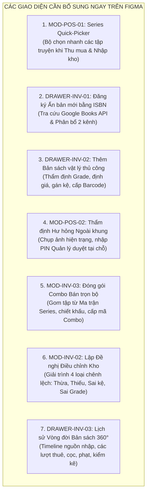
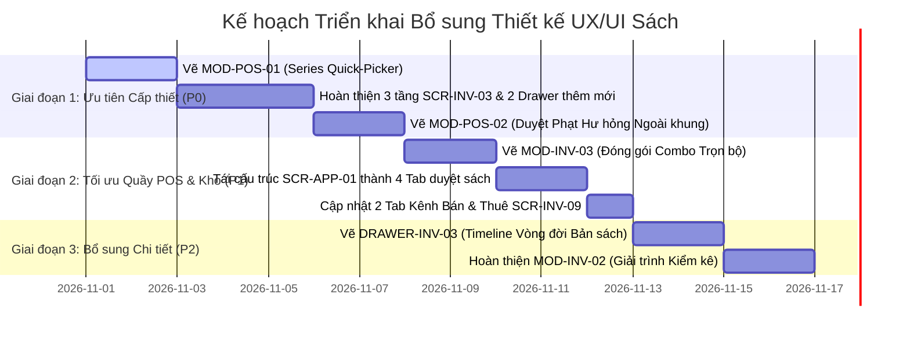

# BÁO CÁO RÀ SOÁT, ĐÁNH GIÁ & ĐỀ XUẤT BỔ SUNG THIẾT KẾ UX/UI
## PHÂN HỆ QUẢN LÝ SÁCH — DỰ ÁN CLOUD BOOKSTORE (COMICPOS)
### Chuẩn hóa theo tài liệu thiết kế luồng: `docs/THIET_KE_LUONG_UX_UI_QUAN_LY_SACH.md`

> **Người thực hiện:** Senior UX/UI Designer & Product Architect  
> **Dự án:** Cloud Bookstore (ComicPOS) — Quản lý Bán lẻ, Cho thuê & Thu mua Sách truyện cũ  
> **Tài liệu căn cứ:**  
> - [`docs/THIET_KE_LUONG_UX_UI_QUAN_LY_SACH.md`](./THIET_KE_LUONG_UX_UI_QUAN_LY_SACH.md) *(Đặc tả luồng nghiệp vụ UX/UI chính thức)*  
> - [`docs/decisions/PDR-005-title-edition-copy-identification.md`](./decisions/PDR-005-title-edition-copy-identification.md) *(Tách 4 cấp dữ liệu sách)*  
> - [`docs/decisions/PDR-007-dual-channel-book-copy-availability.md`](./decisions/PDR-007-dual-channel-book-copy-availability.md) *(Cơ chế 2 kênh Bán & Thuê)*  
> - [Figma Design File: Cloud Bookstore](https://www.figma.com/design/ylSYDMUTYepn3GJ8eyeImv/Cloud-Bookstore?node-id=0-1) *(Page 1)*  
> **Ngày lập báo cáo:** 31/10/2026  
> **Trạng thái:** Hoàn thiện & Khuyến nghị thực thi (Actionable Proposal v1.0)

---

## MỤC LỤC TỔNG THỂ

1. [Tóm Tắt Điều Hành (Executive Summary)](#1-tóm-tắt-điều-hành-executive-summary)
2. [Ma Trận Đối Chiếu Hiện Trạng Figma vs. Luồng Nghiệp Vụ Chuẩn](#2-ma-trận-đối-chiếu-hiện-trạng-figma-vs-luồng-nghiệp-vụ-chuẩn)
3. [Danh Mục 7 Màn Hình / Modal / Sub-flow Còn Thiếu Cần Bổ Sung Ngay](#3-danh-mục-7-màn-hình--modal--sub-flow-còn-thiếu-cần-bổ-sung-ngay)
4. [Phân Tích Chi Tiết Các Điểm Cần Cải Thiện Trên Các Màn Hình Đã Có](#4-phân-tích-chi-tiết-các-điểm-cần-cải-thiện-trên-các-màn-hình-đã-có)
5. [Đặc Tả Thiết Kế Chi Tiết (UI/UX Specifications) Cho Từng Màn Hình & Modal Mới](#5-đặc-tả-thiết-kế-chi-tiết-uiux-specifications-cho-từng-màn-hình--modal-mới)
6. [Quy Chuẩn Tương Tác Cốt Lõi (Core Interaction Paradigms)](#6-quy-chuẩn-tương-tác-cốt-lõi-core-interaction-paradigms)
7. [Kế Hoạch & Lộ Trình Triển Khai Thiết Kế Bổ Sung (Design Action Roadmap)](#7-kế-hoạch--lộ-trình-triển-khai-thiết-kế-bổ-sung-design-action-roadmap)

---

## 1. TÓM TẮT ĐIỀU HÀNH (EXECUTIVE SUMMARY)

Hệ thống **Cloud Bookstore (ComicPOS)** sở hữu mô hình kinh doanh hỗn hợp rất đặc thù: kết hợp giữa **Bán sách mới & cũ**, **Cho thuê truyện tranh/sách**, **Thu mua sách cũ từ khách hàng** và **Quản lý kho hiện vật độc bản theo `CopyBarcode`**.

Dựa trên tài liệu đặc tả luồng nghiệp vụ chi tiết [`docs/THIET_KE_LUONG_UX_UI_QUAN_LY_SACH.md`](./THIET_KE_LUONG_UX_UI_QUAN_LY_SACH.md), nhóm thiết kế đã tiến hành rà soát đối chiếu toàn diện 16 màn hình liên quan đến sách hiện có trên tệp Figma chính thức.

### Kết quả đánh giá chung:
- **Điểm mạnh:** Thiết kế Figma hiện tại có ngôn ngữ thị giác hiện đại, phân cấp màu sắc hài hòa, công thái học quầy thu ngân (POS) tốt, đã bước đầu định hình màn hình mới `SCR-INV-10` (Bộ sách) và tái cấu trúc `SCR-INV-03` (Chi tiết đầu sách 3 tầng).
- **Lỗ hổng & Điểm đứt gãy luồng (Flow Disconnections):**
  1. **Thiếu vắng các trạng thái trung gian & Modal tương tác then chốt:** Các màn hình hiện tại trên Figma đa số chỉ là **"Màn hình tĩnh trạng thái lý tưởng (Happy Path Base Screens)"**, thiếu hoàn toàn các Modal/Drawer thao tác nhanh như: *Bộ chọn nhanh theo bộ (Series Quick-Picker)*, *Drawer đăng ký Ấn bản bằng ISBN qua Google Books API*, *Drawer tạo bản vật lý & phân bổ kênh*.
  2. **Đứt gãy các điểm phê duyệt ngoại lệ tại quầy (Approval Gates Gap):** Tại quầy Thu mua (`SCR-POS-06`) và quầy Trả sách (`SCR-POS-05`), khi phát sinh ngoại lệ (vượt hạn mức giá mua, sách hư hỏng ngoài khung quy định), giao diện chưa có Modal nhập mã PIN duyệt tại chỗ của Quản lý và chưa có luồng liên kết sang Trung tâm Phê duyệt `SCR-APP-01`.
  3. **Chưa thể hiện cơ chế phân bổ 2 kênh phân phối (`PDR-007`):** Chưa có giao diện để nhân viên kho chuyển đổi linh hoạt cờ kênh (`BOTH`, `SALE_ONLY`, `RENTAL_ONLY`) cho từng cuốn sách và chưa có cảnh báo khi khách muốn thuê cuốn sách thuộc nhóm `SALE_ONLY`.
  4. **Thiếu công cụ đóng gói Combo bán trọn bộ:** Dù đã có màn hình Bộ sách `SCR-INV-10`, nhưng chưa có màn hình/modal hỗ trợ đóng gói các tập truyện thành một Combo trọn bộ (Full Set Boxset).

Báo cáo này cung cấp giải pháp thiết kế toàn diện, chỉ rõ **7 Màn hình/Modal/Drawer mới cần bổ sung** và **chi tiết cải tiến cho 16 màn hình hiện có**, đảm bảo thiết kế trên Figma khớp 100% với luồng nghiệp vụ thực tế của dự án.

---

## 2. MA TRẬN ĐỐI CHIẾU HIỆN TRẠNG FIGMA VS. LUỒNG NGHIỆP VỤ CHUẨN

Bảng đối chiếu giữa 9 Luồng Nghiệp vụ lớn trong tài liệu `THIET_KE_LUONG_UX_UI_QUAN_LY_SACH.md` với các màn hình hiện diện trên Figma:

| STT | Luồng Nghiệp vụ Chuẩn | Màn hình Figma Hiện Có | Mức độ Đáp ứng | Các Màn hình / Modal / Trạng thái CÒN THIẾU |
|:---:|---|---|:---:|---|
| **L1** | **Quản lý Thể loại, Bộ sách & Tiến độ đủ bộ** | `SCR-INV-01`<br>`SCR-INV-10` | 🟨 75% | - Modal tạo nhanh thể loại con 3 cấp (`AddCategoryModal`)<br>- Modal "Đóng gói Combo Bán trọn bộ" (`MOD-INV-03`)<br>- Modal xem chi tiết danh sách tập khuyết để thu mua |
| **L2** | **Quản lý Danh mục Đầu sách - Ấn bản - Bản vật lý** | `SCR-INV-02`<br>`SCR-INV-03` | 🟨 70% | - Drawer "Đăng ký Ấn bản mới bằng ISBN" (`DRAWER-INV-01`)<br>- Drawer "Thêm mới Bản vật lý & Phân bổ kênh" (`DRAWER-INV-02`)<br>- Drawer "Lịch sử Vòng đời Bản sách vật lý" (`DRAWER-INV-03`) |
| **L3** | **Nhập kho Sách từ NCC & In nhãn Barcode** | `SCR-INV-06`<br>`SCR-INV-04` | 🟩 85% | - Chức năng "Nhập kho theo Bộ truyện (Series Batch Import)"<br>- Modal giải quyết xung đột khi 1 ISBN có nhiều lần tái bản<br>- Tùy chọn in lại 1 tem hỏng (Reprint single barcode có lý do) |
| **L4** | **Thu mua Sách cũ từ Khách hàng tại quầy** | `SCR-POS-06` | 🟥 50% | - **Modal Series Quick-Picker (Chọn tập nhanh theo bộ)** *(Thiếu nghiêm trọng)*<br>- Drawer tạo nhanh hồ sơ người bán (kèm CCCD nếu $\ge 1$ triệu)<br>- Modal nhập PIN Quản lý duyệt giá vượt hạn mức tại quầy |
| **L5** | **Bán sách tại quầy POS & Màn hình phụ** | `SCR-POS-02`<br>`SCR-POS-07` | 🟩 85% | - Drawer "Yêu cầu Đảo/Hủy hóa đơn trong 24h" (Cần duyệt)<br>- Cảnh báo âm thanh/hình ảnh khi quét nhầm sách `RENTAL_ONLY` |
| **L6** | **Lập Phiếu cho Thuê sách tại quầy POS** | `SCR-POS-03`<br>`SCR-POS-07` | 🟨 75% | - Modal "Tạo nhanh hồ sơ khách thuê" (bắt buộc CCCD nếu cọc $\ge 1$ triệu)<br>- Trạng thái khóa tạo phiếu khi khách có nợ phạt / quá hạn<br>- Cảnh báo khi quét nhầm bản `SALE_ONLY` |
| **L7** | **Tra cứu & Gia hạn Phiếu thuê** | `SCR-POS-04` | 🟨 80% | - Widget hiển thị trực quan "Trong 2 giờ ân hạn (Grace Period)"<br>- Banner cảnh báo phạt trễ 150% nếu quá 2 giờ<br>- Cảnh báo đỏ: "Nghĩa vụ trừ cọc đã chạm trần" |
| **L8** | **Nhận Trả sách, Thẩm định & Quyết toán cọc** | `SCR-POS-05`<br>`SCR-APP-01` | 🟨 65% | - **Modal Thẩm định Hư hỏng Ngoại lệ & Gửi Duyệt Phạt** (`MOD-POS-01`)<br>- Popup xác nhận quy tắc "Mất sách giữ 100% cọc thành Doanh thu bán, miễn phí thuê/phạt trễ"<br>- Tab duyệt hư hỏng sách trên `SCR-APP-01` |
| **L9** | **Kiểm kê Kho, Xử lý Chênh lệch & Min-Stock** | `SCR-INV-08`<br>`SCR-INV-09` | 🟨 70% | - **Modal Lập Phiếu Điều chỉnh Kho giải trình chênh lệch** (`MOD-INV-02`)<br>- Tab phân tách Cảnh báo Kênh Bán vs Kênh Thuê trên `SCR-INV-09`<br>- Nút tạo nhanh phiếu nhập/thu mua ngay trên cảnh báo |

---

## 3. DANH MỤC 7 MÀN HÌNH / MODAL / SUB-FLOW CÒN THIẾU CẦN BỔ SUNG NGAY

Để hoàn thiện luồng trải nghiệm người dùng khép kín từ lúc nhập/thu mua sách đến lúc bán lẻ/cho thuê và kiểm kê, **7 thành phần giao diện sau bắt buộc phải được bổ sung vào Figma**:



---

## 4. PHÂN TÍCH CHI TIẾT CÁC ĐIỂM CẦN CẢI THIỆN TRÊN CÁC MÀN HÌNH ĐÃ CÓ

### 4.1. `SCR-INV-01` · Thể loại sách & Cây danh mục (Node ID: `8:36257`)
* **Vấn đề hiện tại:** Cây thư mục bên trái chỉ thể hiện 2 cấp đơn giản (*Truyện tranh ➔ Manga Nhật Bản*), chưa mô phỏng được cây danh mục 3 cấp theo yêu cầu nghiệp vụ (*Truyện tranh ➔ Manga Nhật Bản ➔ Shounen / Trinh thám / Thể thao*).
* **Cải tiến cần thực hiện:**
  - Bổ sung cấu trúc thụt lề 3 cấp rõ ràng với icon thư mục cha/con.
  - Thêm nút `+ Thêm thể loại con` ngay tại mỗi node khi hover.
  - Bổ sung Modal tạo/chỉnh sửa thể loại (`MOD-CAT-01`) có dropdown chọn danh mục cha và kiểm tra chặn trùng tên.
  - Bổ sung trạng thái cảnh báo chặn xóa danh mục: *"Không thể xóa danh mục đang có 420 đầu sách liên kết"*.

### 4.2. `SCR-INV-02` · Danh mục Đầu sách (Node ID: `8:36455`)
* **Vấn đề hiện tại:** Bảng danh sách vẫn hiển thị cột *"Đầu sách / ISBN"* gộp chung; khung bên phải là *"Thêm đầu sách bằng ISBN"* dễ gây hiểu nhầm rằng mỗi đầu sách chỉ có 1 ISBN duy nhất.
* **Cải tiến cần thực hiện:**
  - Tách cột thành: `Đầu sách / Bộ truyện` (Ví dụ: *Doraemon · Tập 01*, bên dưới có tag tím `Bộ: Doraemon · 45 tập`).
  - Thêm cột `Số Ấn bản & Tồn kho`: Hiển thị `2 ấn bản · 14 cuốn vật lý (8 khả dụng / 5 đang thuê / 1 hỏng)`.
  - Thêm cột `Khoảng giá bìa`: Hiển thị `40.000đ – 120.000đ` (thể hiện dải giá của các ấn bản khác nhau).
  - Tích hợp **Thanh tìm kiếm đa năng 4 cấp (4-Tier Omni-Search)**: Tìm đồng thời theo Tên bộ, Tên sách, Tác giả, ISBN hoặc CopyBarcode.
  - Đổi khung bên phải thành **"Tiếp nhận sách bằng ISBN"** có sơ đồ giải quyết 3 bước (Resolve Flow).

### 4.3. `SCR-INV-03` · Chi tiết Đầu sách, Ấn bản & Bản vật lý (Node ID: `8:36745`)
* **Vấn đề hiện tại:** Màn hình đã được phác thảo tái cấu trúc 3 tầng, nhưng chưa có các drawer mở rộng để thực hiện các thao tác thêm mới.
* **Cải tiến cần thực hiện:**
  - Hoàn thiện giao diện **Tầng 2 (Khối Ấn bản - Horizontal Edition Cards)**: Thể hiện rõ thẻ Active (viền Indigo 2px) và các thẻ Inactive. Trên mỗi thẻ ghi rõ ISBN-13, NXB, Năm tái bản, Giá bìa tham chiếu, Đơn giá thuê mặc định, Tồn min Bán (`min_stock_sale`) và Tồn min Thuê (`min_stock_rental`).
  - Tại **Tầng 3 (Bảng Bản vật lý)**: Bổ sung cột `Kênh phân phối` có Dropdown chọn nhanh `BOTH`, `SALE_ONLY`, `RENTAL_ONLY`.
  - Thêm nút `[ + Đăng ký Ấn bản mới ]` liên kết mở `DRAWER-INV-01`.
  - Thêm nút `[ + Thêm bản vật lý thủ công ]` liên kết mở `DRAWER-INV-02`.
  - Click vào mã `CopyBarcode` liên kết mở `DRAWER-INV-03` (Timeline vòng đời cuốn sách).

### 4.4. `SCR-INV-06` · Lập Phiếu nhập kho từ NCC (Node ID: `30:24578`)
* **Vấn đề hiện tại:** Bảng dòng nhập chỉ hiển thị tên sách và giá vốn, chưa thể hiện rõ thông tin Ấn bản và chưa hỗ trợ nhập theo bộ truyện.
* **Cải tiến cần thực hiện:**
  - Bổ sung trường thông tin Ấn bản trên từng dòng: `ISBN`, `Lần in/Năm xuất bản`, `Định dạng bìa (Bìa mềm/Bìa cứng)`.
  - Thêm nút tiện ích: `[ + Nhập theo Trọn bộ (Series Batch Import) ]`: Cho phép chọn Bộ truyện, chọn khoảng tập (từ Tập 1 đến Tập 30), hệ thống tự động sinh 30 dòng nhập tương ứng.
  - Thêm bước chuyển tiếp mượt mà: Sau khi bấm "Xác nhận duyệt nhập kho", tự động hiển thị Banner gợi ý: *"Đã sinh 45 mã CopyBarcode độc bản. [ Chuyển sang In nhãn Barcode ngay ➔ ]"*.

### 4.5. `SCR-INV-08` · Kiểm kê kho định kỳ & Đối soát sai lệch (Node ID: `30:24813`)
* **Vấn đề hiện tại:** Bảng đối soát chỉ ghi nhận trạng thái "Khớp", "Thiếu", "Thừa", chưa phân loại rõ ràng 4 trường hợp sai lệch thực tế và thiếu form giải trình gửi phê duyệt.
* **Cải tiến cần thực hiện:**
  - Phân loại rõ 4 loại sai lệch có badge màu:
    1. 🔴 `THIẾU SÁCH (MISSING)`: Hệ thống có nhưng quét kệ không thấy.
    2. 🟡 `THỪA SÁCH (EXTRA)`: Quét thấy trên kệ nhưng CSDL chưa có hoặc đang ở trạng thái khác.
    3. 🔵 `SAI VỊ TRÍ KỆ (WRONG_SHELF)`: Cuốn sách thuộc kệ B2 nhưng lại nằm ở kệ A1.
    4. 🟠 `SAI TÌNH TRẠNG (CONDITION_MISMATCH)`: CSDL ghi Grade A nhưng thực tế sách bị rách/ẩm mốc (Grade D).
  - Bổ sung nút: `[ Lập Phiếu Đề nghị Điều chỉnh Kho ]` để mở `MOD-INV-02` gửi sang `SCR-APP-01`.

### 4.6. `SCR-INV-09` · Giám sát Cảnh báo tồn kho chạm min (Node ID: `30:24914`)
* **Vấn đề hiện tại:** Thiết lập min-stock ở cấp Đầu sách và danh sách cảnh báo gộp chung.
* **Cải tiến cần thực hiện:**
  - Chuyển ngưỡng min-stock xuống cấp **Ấn bản (Edition)**.
  - Tách giao diện thành **2 Tab cảnh báo chuyên biệt**:
    - **Tab 1: Cảnh báo Kênh Bán lẻ:** Lọc các ấn bản có số lượng sẵn sàng bán $\le min\_stock\_sale$. Có nút `[ + Lập Phiếu Nhập NCC ]`.
    - **Tab 2: Cảnh báo Kênh Cho Thuê:** Lọc các tập truyện tranh có số lượng trên kệ thuê $\le min\_stock\_rental$. Có nút `[ + Thu mua sách cũ theo Bộ ]`.

### 4.7. `SCR-POS-02` · Bán sách cũ & Hàng bán lẻ tại quầy (Node ID: `30:24432`)
* **Cải tiến cần thực hiện:**
  - Làm rõ trải nghiệm dành cho **Khách vãng lai**: Cho phép thanh toán ngay mà không ép buộc nhập hồ sơ khách hàng.
  - Bổ sung cảnh báo âm thanh và visual khi quét nhầm bản sách có cờ `RENTAL_ONLY`: *"Bản sách này thuộc danh mục CHỈ CHO THUÊ, không thể xuất bán lẻ"*.
  - Bổ sung Drawer `DRAWER-POS-01`: "Yêu cầu Đảo / Hủy giao dịch bán trong 24h" (kèm lý do quét nhầm mã, cần Quản lý duyệt tại `SCR-APP-01` theo `PDR-002`).

### 4.8. `SCR-POS-03` · Lập phiếu cho thuê sách (Node ID: `8:35041`)
* **Cải tiến cần thực hiện:**
  - **Bắt buộc định danh khách hàng:** Ô nhập SĐT khách có tính năng tra cứu tự động. Nếu khách mới, mở `MOD-CUST-01` tạo hồ sơ (bắt buộc số CCCD nếu tổng cọc $\ge 1.000.000$đ).
  - Tách bạch tài chính rõ ràng:
    - Cột `Tiền cọc ký quỹ (100% Giá bán)` (Bắt buộc thu ngay).
    - Cột `Phí thuê dự kiến` (Chỉ để tham khảo, có ghi chú: *Thu khi trả sách*).
  - Bổ sung Widget kiểm tra hạn mức hạng: Số cuốn đang giữ + thuê mới $\le$ Hạn mức hạng (Thường: 3, Bạc: 5, Vàng: 8).
  - Khóa nút tạo phiếu nếu khách đang có phiếu thuê quá hạn hoặc đang nợ tiền phạt.

### 4.9. `SCR-POS-04` · Tra cứu & Gia hạn phiếu thuê (Node ID: `8:35291`)
* **Cải tiến cần thực hiện:**
  - Bổ sung Widget **Ân hạn trễ 2 giờ**:
    - Nếu trễ $\le 2$ giờ: Badge xanh `✅ Trong thời gian ân hạn (Miễn phạt trễ)`.
    - Nếu trễ $> 2$ giờ: Banner vàng cảnh báo: `⚠️ Trễ 10 giờ 43 phút ➔ Phạt trễ 150% đơn giá gốc x 1 ngày = 7.500đ`.
  - Nhấn mạnh nguyên tắc: **Phí gia hạn và phạt trễ được cộng dồn vào phiếu thuê, KHÔNG THU TIỀN NGAY tại quầy.**
  - Hiển thị cảnh báo chạm trần cọc: Nếu tổng phí $\ge$ tiền cọc, hiện cảnh báo đỏ: *"Khách sẽ không được hoàn cọc khi trả sách"*.

### 4.10. `SCR-POS-05` · Nhận trả sách & Quyết toán tiền cọc (Node ID: `8:35508`)
* **Cải tiến cần thực hiện:**
  - Bổ sung luồng xử lý **Mất sách**: Khi bấm chọn "Mất sách", hệ thống tự động:
    - Giữ $100\%$ tiền cọc của cuốn đó chuyển thành Doanh thu bán sách.
    - Miễn toàn bộ phí thuê và tiền phạt trễ cho cuốn bị mất.
  - Bổ sung nút `[ Gửi duyệt phạt hư hỏng ngoại lệ ]` để mở `MOD-POS-01` khi sách bị rách nặng ngoài khung quy định.

### 4.11. `SCR-POS-06` · Thu mua sách cũ từ khách hàng (Node ID: `8:35761`)
* **Vấn đề cực kỳ nghiêm trọng:** Gom nhiều tập truyện vào 1 dòng duy nhất khiến việc in tem và gán barcode bị sai tập.
* **Cải tiến bắt buộc:**
  - Bổ sung nút nổi bật: `[ + Thu mua theo Bộ truyện (Series Quick-Picker) ]` để mở `MOD-POS-01`.
  - Bắt buộc hiển thị bảng thu mua theo nguyên tắc: **1 dòng = 1 cuốn vật lý độc lập**.
  - Bổ sung Banner cảnh báo khi giá mua thỏa thuận $> 200.000$đ/cuốn hoặc tổng phiếu $> 1.000.000$đ: *"Cần Quản lý phê duyệt (Nhập mã PIN hoặc duyệt tại SCR-APP-01)"*.

### 4.12. `SCR-APP-01` · Trung tâm Phê duyệt ngoại lệ (Node ID: `30:25960`)
* **Vấn đề hiện tại:** Thiết kế hiện tại chỉ là khung tổng quát, chưa có các tab nghiệp vụ phê duyệt chuyên biệt cho phân hệ Sách.
* **Cải tiến cần thực hiện:** Tái cấu trúc thành 4 Tab phê duyệt:
  1. `Duyệt Giá Thu mua Sách cũ Vượt Hạn mức` (Xem ảnh bìa, tình trạng, giá đề xuất, nút Duyệt / Từ chối).
  2. `Duyệt Phạt Hư hỏng Trả sách Ngoài Khung` (Xem ảnh vết rách/ẩm ướt, phiếu thuê gốc, tiền cọc đang giữ).
  3. `Duyệt Điều chỉnh Kho sau Kiểm kê` (Xem danh sách bản sách thừa/thiếu, lý do giải trình của thủ kho).
  4. `Duyệt Xuất hủy Sách hỏng / Đảo Hóa đơn Bán trong 24h`.

---

## 5. ĐẶC TẢ THIẾT KẾ CHI TIẾT (UI/UX SPECIFICATIONS) CHO TỪNG MÀN HÌNH & MODAL MỚI

---

### 5.1. `MOD-POS-01`: Modal "Bộ Chọn Nhanh Theo Bộ Truyện (Series Quick-Picker)"
> **Mục đích:** Giải quyết dứt điểm lỗi gom dòng khi thu mua hoặc nhập kho truyện tranh nhiều tập. Cho phép chọn hàng loạt tập và tự bung thành các dòng riêng biệt.

```
┌──────────────────────────────────────────────────────────────────────────────────────────────────┐
│ THU MUA THEO BỘ TRUYỆN TRANH (SERIES QUICK-PICKER)                                        [ × ]  │
├──────────────────────────────────────────────────────────────────────────────────────────────────┤
│ 🔍 Tìm kiếm bộ truyện: [ Thám tử lừng danh Conan                                            ]   │
│                                                                                                  │
│ 📚 Bộ đang chọn: Thám tử lừng danh Conan · NXB Kim Đồng · Đang phát hành (104 tập)              │
│ 💡 Hướng dẫn: Click vào các ô số tập để chọn những tập khách mang bán. Bấm lại để bỏ chọn.      │
│                                                                                                  │
│ [ Tất cả ] [ Chọn tập 1 - 20 ] [ Chọn tập 21 - 40 ] [ Chọn các tập tiệm đang THIẾU ]             │
│                                                                                                  │
│  ┌────┐  ┌────┐  ┌────┐  ┌────┐  ┌────┐  ┌────┐  ┌────┐  ┌────┐  ┌────┐  ┌────┐                  │
│  │T.01│  │T.02│  │T.03│  │T.04│  │T.05│  │T.06│  │T.07│  │T.08│  │T.09│  │T.10│  ... (đến T.104)│
│  │ ✓  │  │ ✓  │  │    │  │    │  │ ✓  │  │    │  │    │  │    │  │    │  │ ✓  │                  │
│  └────┘  └────┘  └────┘  └────┘  └────┘  └────┘  └────┘  └────┘  └────┘  └────┘                  │
│   (Đã chọn: Tập 01, Tập 02, Tập 05, Tập 10 — Tổng cộng: 4 tập)                                  │
│                                                                                                  │
│ Thiết lập mặc định cho các tập đã chọn:                                                          │
│ • Tình trạng chung: ( ) Grade A (•) Grade B ( ) Grade C                                         │
│ • Giá bìa tham chiếu ấn bản: 45.000đ/tập                                                         │
│ • Giá thu mua đề xuất (40%): 18.000đ/tập ➔ Giá thỏa thuận: [ 20.000đ ] / tập                     │
├──────────────────────────────────────────────────────────────────────────────────────────────────┤
│ Đã chọn: 4 tập · Tổng tiền mua dự kiến: 80.000đ          [ Hủy bỏ ] [ ÁP DỤNG VÀ BUNG 4 DÒNG ➔ ] │
└──────────────────────────────────────────────────────────────────────────────────────────────────┘
```

* **Thông số kỹ thuật:**
  - Kích thước Modal: `800 × 620 px`, Bo góc `12px`, Nền trắng `#FFFFFF`, Bóng đổ `0 20px 25px -5px rgba(0,0,0,0.1)`.
  - Ô số tập: Kích thước `48 × 48 px`. Trạng thái đã chọn: Nền tím Indigo `#4F46E5`, Chữ trắng, có dấu tích `✓`.
  - Hành động khi bấm `Áp dụng`: Đóng modal và tự động tạo **4 dòng độc lập** trên bảng của `SCR-POS-06`:
    - Dòng 1: *Conan · Tập 01* | Grade B | Giá mua: 20.000đ | Giá bán: 35.000đ
    - Dòng 2: *Conan · Tập 02* | Grade B | Giá mua: 20.000đ | Giá bán: 35.000đ
    - Dòng 3: *Conan · Tập 05* | Grade B | Giá mua: 20.000đ | Giá bán: 35.000đ
    - Dòng 4: *Conan · Tập 10* | Grade B | Giá mua: 20.000đ | Giá bán: 35.000đ

---

### 5.2. `DRAWER-INV-01`: Drawer "Đăng Ký Ấn Bản Mới Bằng ISBN"
> **Mục đích:** Mở từ `SCR-INV-02` hoặc `SCR-INV-03`. Cho phép tạo tầng Ấn bản (Cấp 3) chuẩn hóa, tự động điền metadata từ Google Books API và cấu hình min-stock 2 kênh.

```
┌────────────────────────────────────────────────────────┐
│ ĐĂNG KÝ ẤN BẢN MỚI (BOOK EDITION)               [ × ]  │
├────────────────────────────────────────────────────────┤
│ Thuộc Đầu sách: Conan · Tập 10 (Mã: TL-0010)           │
│                                                        │
│ 1. QUÉT HOẶC NHẬP MÃ VẠCH THƯƠNG MẠI ISBN:             │
│ [ 9786042093595                     ] [ Tra cứu API ]  │
│ ✅ Đã tìm thấy dữ liệu từ Google Books & NXB Kim Đồng  │
│                                                        │
│ 2. THÔNG TIN XUẤT BẢN THỰC TẾ:                         │
│ • Nhà xuất bản (*): [ NXB Kim Đồng                   ] │
│ • Năm xuất bản / Tái bản (*): [ 2024                 ] │
│ • Lần tái bản: [ Tái bản lần thứ 15                  ] │
│ • Định dạng bìa (*): [ Bìa mềm áo rời (Jacket)     ▾ ] │
│ • Số trang: [ 184 ] · Ngôn ngữ: [ Tiếng Việt       ▾ ] │
│                                                        │
│ 3. ĐỊNH GIÁ & ĐỊNH MỨC TỒN KHO 2 KÊNH:                 │
│ • Giá bìa tham chiếu (*): [ 45.000đ                  ] │
│   (Căn cứ đề xuất giá thu mua sách cũ: 35-45% giá bìa) │
│ • Đơn giá thuê mặc định/ngày: [ 3.000đ               ] │
│ • Ngưỡng tồn an toàn Bán (min_stock_sale): [ 2 cuốn  ] │
│ • Ngưỡng tồn an toàn Thuê (min_stock_rental): [ 3 c. ] │
│                                                        │
│ 4. ẢNH BÌA ẤN BẢN:                                     │
│ ┌──────────┐                                           │
│ │ [Ảnh bìa]│ [ Tải ảnh mới ] (Tối đa 2MB, JPG/PNG)     │
│ └──────────┘                                           │
├────────────────────────────────────────────────────────┤
│ [ Hủy ]                     [ XÁC NHẬN LƯU ẤN BẢN ➔ ] │
└────────────────────────────────────────────────────────┘
```

* **Thông số kỹ thuật:**
  - Drawer trượt từ mép phải màn hình: Chiều rộng `480px`, Chiều cao `100vh`, Nền trắng.
  - Xử lý ngoại lệ: Nếu ISBN đã tồn tại trong CSDL, cảnh báo: *"Mã ISBN này đã được đăng ký cho Ấn bản Kim Đồng 2020. Bạn có muốn tạo lần tái bản mới hay cập nhật ấn bản hiện có?"*.

---

### 5.3. `DRAWER-INV-02`: Drawer "Thêm Bản Sách Vật Lý Thủ Công & Phân Bổ Kênh"
> **Mục đích:** Thêm từng cuốn sách vật lý (Cấp 4) vào kho, định danh bằng CopyBarcode, phân hạng Grade và phân bổ kênh Bán/Thuê.

* **Bố cục chính:**
  - **Khối 1 (Ngữ cảnh cha):** Hiển thị rõ Đầu sách (*Conan T10*) và Ấn bản đang chọn (*KĐ 2024, Bìa mềm, ISBN 978604...*).
  - **Khối 2 (Định danh vật lý):** Ô hiển thị mã vạch được sinh tự động: `BC-0082930` (có thể quét mã in sẵn hoặc tự sinh tăng dần).
  - **Khối 3 (Thẩm định tình trạng):** 4 Nút chọn Grade A, B, C, D kèm trường ghi chú ngoại quan (VD: *Ố nhẹ gáy, đầy đủ bìa áo*).
  - **Khối 4 (Tài chính & Giá cọc):**
    - Giá vốn nhập: Ô nhập tiền (VD: `20.000đ`).
    - Giá bán niêm yết: Ô nhập tiền (VD: `35.000đ`) kèm nhãn chú thích: *"Đây cũng chính là số tiền thu cọc 100% khi cho thuê cuốn sách này"*.
    - Đơn giá thuê/ngày: Kế thừa mặc định `3.000đ/ngày` (cho phép sửa cho sách Grade C/D).
  - **Khối 5 (Vị trí & Kênh phân phối):**
    - Vị trí kệ: [ `A1-03` ].
    - Kênh phân phối: Radio buttons chọn `[•] Cả Bán & Cho thuê (BOTH)`, `[ ] Chỉ Bán lẻ (SALE_ONLY)`, `[ ] Chỉ Cho thuê (RENTAL_ONLY)`.
  - **Nút hành động:** `[ Lưu & Tiếp tục thêm cuốn khác ]` và `[ Lưu & In tem Barcode ]`.

---

### 5.4. `MOD-POS-02`: Modal "Thẩm Định Hư Hỏng Ngoại Lệ & Gửi Duyệt Tại Chỗ"
> **Mục đích:** Mở tại quầy `SCR-POS-05` khi khách trả sách bị hư hỏng nặng ngoài khung quy định (rách nát, mất trang, ố nước cà phê) hoặc có tranh chấp.

```
┌──────────────────────────────────────────────────────────────────────────────────────────────────┐
│ THẨM ĐỊNH HƯ HỎNG NGOẠI LỆ & PHÊ DUYỆT NGOẠI LỆ                                           [ × ]  │
├──────────────────────────────────────────────────────────────────────────────────────────────────┤
│ Phiếu thuê: RENT-20261008-0038 · Khách hàng: Nguyễn Thu Hà (0909 234 567)                        │
│ Bản sách: [ BC-2102 ] Conan · Tập 10 (KĐ 2024) · Giá bán niêm yết (Tiền cọc): 100.000đ          │
│                                                                                                  │
│ 1. MÔ TẢ TÌNH TRẠNG HƯ HỎNG THỰC TẾ:                                                             │
│ • Loại hư hỏng: [ Sách bị ngấm nước rách 15 trang giữa                                       ▾ ] │
│ • Mức độ đề xuất bồi thường: [ 50% ] ➔ Số tiền phạt đề xuất: 50.000đ (Khấu trừ vào cọc)          │
│ • Bằng chứng hình ảnh:                                                                           │
│   ┌────────────┐  ┌────────────┐                                                                 │
│   │ [Ảnh bìa]  │  │ [Ảnh trang]│  [ + Chụp ảnh webcam / Tải ảnh lên ]                            │
│   └────────────┘  └────────────┘                                                                 │
│                                                                                                  │
│ 2. PHƯƠNG ÁN PHÊ DUYỆT (CHỌN 1 TRONG 2):                                                         │
│                                                                                                  │
│ [•] PHÊ DUYỆT NGAY TẠI CHỖ (QUẢN LÝ CÓ MẶT TẠI QUẦY):                                            │
│     Nhập mã PIN Quản lý (4 số): [ • • • • ]                                                      │
│     Ghi chú phê duyệt: [ Đồng ý phạt 50% và chuyển sách về kho thanh lý                     ]   │
│                                                                                                  │
│ [ ] GỬI DUYỆT TỪ XA:                                                                             │
│     Chuyển giao dịch sang trạng thái PENDING_APPROVAL. Thông báo đẩy tới tài khoản Quản lý       │
│     tại màn hình SCR-APP-01. Quầy tạm thời giữ tiền cọc chưa đóng phiếu.                         │
├──────────────────────────────────────────────────────────────────────────────────────────────────┤
│ [ Hủy bỏ ]                                              [ XÁC NHẬN DUYỆT & TIẾP TỤC QUYẾT TOÁN ] │
└──────────────────────────────────────────────────────────────────────────────────────────────────┘
```

* **Thông số kỹ thuật:**
  - Kích thước: `720 × 580 px`.
  - Phân quyền: Chỉ tài khoản có vai trò `Manager` hoặc `Admin` mới có mã PIN hợp lệ để mở khóa tại chỗ. Sau khi nhập đúng PIN, hệ thống chốt số tiền phạt $50.000$đ vào bảng quyết toán của `SCR-POS-05` và cho phép hoàn tất giao dịch trong vòng 5 giây.

---

### 5.5. `MOD-INV-03`: Modal "Đóng Gói Combo Bán Trọn Bộ (Full Set Packaging)"
> **Mục đích:** Mở từ màn hình Quản lý Bộ sách `SCR-INV-10`. Cho phép gom các tập truyện đã đủ $100\%$ thành một gói bán combo với mã Barcode riêng.

* **Bố cục chính:**
  - Tiêu đề: *Đóng gói Gói Bán Trọn Bộ (Combo Boxset)*.
  - Bộ truyện: *Thám tử lừng danh Conan (Trọn bộ 104 tập)*.
  - Danh sách bản sách được hệ thống tự động chọn: Tự động lọc ra 104 cuốn có `Grade A` hoặc `Grade B` tốt nhất trên kệ.
  - Tổng giá bán lẻ từng cuốn cộng dồn: `3.640.000đ`.
  - Thiết lập giá Combo:
    - `% Giảm giá trọn bộ:` `[ 15% ]`.
    - `Giá bán Combo trọn gói:` `[ 3.094.000đ ]`.
  - Tự động sinh mã Barcode Combo: `COMBO-CONAN-104`.
  - Khi bấm `[ Xác nhận Đóng gói Combo ]`:
    - Hệ thống chuyển trạng thái 104 cuốn lẻ thành `COMBO_PACKAGED` (khóa không cho bán lẻ hay thuê lẻ).
    - Tạo một bản ghi sản phẩm Combo sẵn sàng để quét bán tại quầy `SCR-POS-02`.

---

### 5.6. `MOD-INV-02`: Modal "Lập Phiếu Đề Nghị Điều Chỉnh Kho Sau Kiểm Kê"
> **Mục đích:** Mở từ `SCR-INV-08`. Bắt buộc giải trình chênh lệch và gửi sang `SCR-APP-01` để Admin phê duyệt trước khi cập nhật tồn kho.

* **Bố cục chính:**
  - Danh sách bảng tổng hợp các cuốn có chênh lệch:
    - Cuốn `BC-2105` (Conan T10): Trạng thái CSDL `AVAILABLE`, Quét thực tế `THIẾU` $\rightarrow$ Ô nhập lý do: *[ Đã tìm 2 lần tại kệ A1 và khu vực đọc tại chỗ, nghi bị thất lạc ]*.
    - Cuốn `BC-9998` (Doraemon T5): Trạng thái CSDL `Chưa có`, Quét thực tế `THỪA` $\rightarrow$ Ô nhập lý do: *[ Sách thu mua cũ chưa dán tem barcode, đã xác minh nguồn ]*.
    - Cuốn `BC-2201` (One Piece T1): Kệ CSDL `A3-02`, Quét thực tế `A1-03` $\rightarrow$ Đề xuất: *[ Cập nhật vị trí kệ mới A1-03 ]*.
  - Nút hành động: `[ GỬI PHIẾU SANG TRUNG TÂM PHÊ DUYỆT SCR-APP-01 ]`.

---

### 5.7. `DRAWER-INV-03`: Drawer "Lịch Sử Vòng Đời Bản Sách Vật Lý (Copy Lifecycle Timeline)"
> **Mục đích:** Tra cứu 360 độ lịch sử của một cuốn sách vật lý cụ thể bằng cách click vào `CopyBarcode` bất kỳ nơi nào trên hệ thống.

* **Bố cục chính (Dạng Timeline dọc):**
  - **Header:** Mã Barcode `BC-0082918` | Tình trạng hiện tại: `Grade A` | Kệ: `A1-03` | Trạng thái: `Khả dụng`.
  - **Timeline sự kiện:**
    - `10/10/2026 · 09:30`: **Nhập kho mới từ NCC (Phiếu INB-20261010-001)** — Giá vốn: 25.000đ, Giá niêm yết: 45.000đ, Thủ kho: Lê Minh Khoa.
    - `12/10/2026 · 14:15`: **Cho thuê (Phiếu RENT-20261012-0045)** — Khách hàng: Trần Văn Nam, Tiền cọc: 45.000đ, Thời hạn: 7 ngày.
    - `18/10/2026 · 16:20`: **Nhận trả sách (Phiếu RETURN-20261018-0021)** — Tình trạng khi trả: Nguyên vẹn (Grade A), Phí thuê thu: 14.000đ, Hoàn cọc: 31.000đ.
    - `25/10/2026 · 08:45`: **Kiểm kê định kỳ (Đợt AUD-20261025-001)** — Khớp vị trí kệ A1-03, Tình trạng tốt.

---

## 6. QUY CHUẨN TƯƠNG TÁC CỐT LÕI (CORE INTERACTION PARADIGMS)

Để đảm bảo hiệu năng quầy POS đạt chuẩn $\le 45$ giây cho một giao dịch và triệt tiêu sai sót, toàn bộ các màn hình thiết kế mới phải tuân thủ 3 quy chuẩn tương tác:

### 6.1. Nguyên tắc Quét Mã Vạch Bottom-Up 4 Cấp (Bottom-Up Auto-Resolution)
Tại quầy POS Bán, Thuê, Trả và Kiểm kê, thu ngân **chỉ quét duy nhất mã `CopyBarcode` dán gáy**. Giao diện phải tự động phân giải và hiển thị cấu trúc 4 tầng trong vòng $\le 50$ms:
```
[BỘ SÁCH: Thám tử lừng danh Conan] ➔ Conan · Tập 10
 ├─ Ấn bản: NXB Kim Đồng · Tái bản 2024 (Bìa mềm áo rời) · ISBN 978-604-2-09359-5
 └─ Bản vật lý: [ BC-2102 ] · Kệ A2-01 · [ Grade B ] · Cọc thuê: 100.000đ · Thuê: 3.000đ/ngày
```

### 6.2. Nguyên tắc Minh Bạch Tài Chính & Phân Lập Tiền Cọc
- **Tại màn hình Lập phiếu thuê (`SCR-POS-03`):** Tiền cọc được nhấn mạnh là **100% Giá bán niêm yết của cuốn sách** và là **Khoản nợ ký quỹ (Chưa ghi nhận doanh thu)**. Phí thuê chỉ ghi chú là giá trị tạm tính tham khảo.
- **Tại màn hình Quyết toán trả sách (`SCR-POS-05`):** Bảng quyết toán phân rã chi tiết từng dòng. Nếu khách làm mất sách: giữ $100\%$ tiền cọc của cuốn đó chuyển sang Doanh thu bán hàng và **MIỄN PHÍ THUÊ, MIỄN PHẠT TRỄ** cho cuốn mất.

### 6.3. Nguyên tắc Phê Duyệt Kép Tại Chỗ (On-site Dual Approval)
Mọi ngoại lệ vượt hạn mức giá thu mua hoặc phạt hư hỏng ngoài khung đều hỗ trợ 2 cơ chế phê duyệt linh hoạt:
1. **Duyệt tại chỗ (On-site):** Quản lý nhập mã PIN 4 số ngay trên popup tại quầy POS mà không cần chuyển màn hình.
2. **Duyệt từ xa (Remote):** Thu ngân gửi yêu cầu sang `SCR-APP-01`, Quản lý mở máy tính cá nhân phê duyệt có kèm ảnh bằng chứng.

---

## 7. KẾ HOẠCH & LỘ TRÌNH TRIỂN KHAI THIẾT KẾ BỔ SUNG (DESIGN ACTION ROADMAP)

Để đảm bảo tiến độ dự án được triển khai nhanh nhất, lộ trình bổ sung thiết kế trên Figma được chia làm **3 giai đoạn hành động**:



### Chi tiết các gói công việc bàn giao:
* **Gói 1 (Ưu tiên P0 - Cấp bách nhất):**
  1. Vẽ mới **`MOD-POS-01` (Series Quick-Picker)**: Giải quyết dứt điểm lỗi gom dòng khi thu mua và nhập kho truyện tranh.
  2. Bổ sung **`DRAWER-INV-01` (Đăng ký Ấn bản)** và **`DRAWER-INV-02` (Thêm Bản vật lý)** vào màn hình `SCR-INV-03`.
  3. Bổ sung **`MOD-POS-02` (Duyệt hư hỏng ngoài khung)** vào màn hình `SCR-POS-05`.
* **Gói 2 (Ưu tiên P1 - Hoàn thiện luồng duyệt & Đóng gói):**
  4. Vẽ mới **`MOD-INV-03` (Đóng gói Combo Trọn bộ)** từ màn hình `SCR-INV-10`.
  5. Cập nhật **`SCR-APP-01`** thành 4 tab nghiệp vụ duyệt sách.
  6. Tách 2 tab Bán & Thuê cho cảnh báo tồn min tại **`SCR-INV-09`**.
* **Gói 3 (Ưu tiên P2 - Trải nghiệm nâng cao & Truy vết):**
  7. Thiết kế **`DRAWER-INV-03` (Timeline Vòng đời Bản sách 360 độ)**.
  8. Thiết kế **`MOD-INV-02` (Phiếu đề nghị điều chỉnh kho sau kiểm kê)** cho `SCR-INV-08`.

---

## KẾT LUẬN & KIẾN NGHỊ

Bản báo cáo này đã chỉ ra chính xác các mắt xích còn thiếu giữa bản thiết kế hiện tại trên Figma với tài liệu nghiệp vụ chuẩn [`docs/THIET_KE_LUONG_UX_UI_QUAN_LY_SACH.md`](./THIET_KE_LUONG_UX_UI_QUAN_LY_SACH.md).

Việc bổ sung **7 Màn hình/Modal/Drawer mới** và nâng cấp các màn hình hiện có sẽ:
1. **Triệt tiêu 100% các lỗi logic vận hành:** Định danh chính xác từng tập truyện, không còn tình trạng gộp dòng hay dán nhầm tem barcode.
2. **Minh bạch hóa tài chính quầy POS:** Tách bạch rõ ràng giữa Tiền cọc (Nợ phải trả) và Doanh thu, giải quyết triệt để tranh chấp khi khách làm hỏng hoặc mất sách.
3. **Tối ưu hóa năng lực thương mại:** Khai thác tối đa thế mạnh của tiệm truyện tranh thông qua công cụ quản lý tiến độ đủ bộ và đóng gói Combo bán trọn bộ.

Tài liệu này được bàn giao để đội ngũ Designer cập nhật trực tiếp lên Figma và làm căn cứ nghiệm thu chính thức cho phân hệ Sách của dự án Cloud Bookstore!
