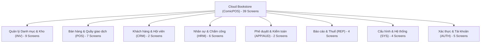
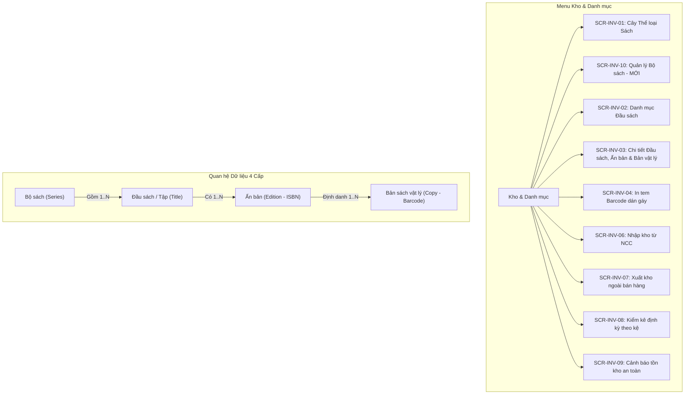
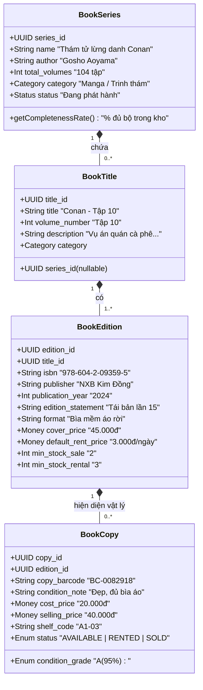
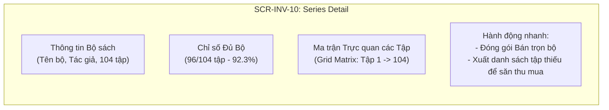
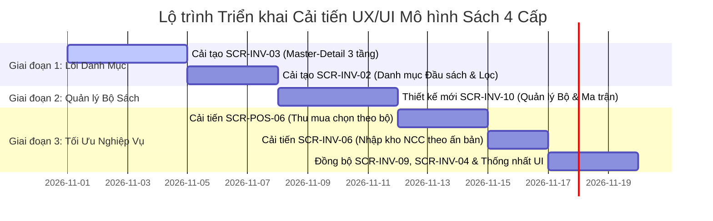

# Báo Cáo Rà Soát UX/UI & Đề Xuất Cải Tiến Mô Hình Dữ Liệu Sách
## Chuẩn hóa theo phân cấp: Bộ sách ➔ Đầu sách ➔ Ấn bản ➔ Bản sách vật lý

> **Dự án:** Cloud Bookstore (ComicPOS)  
> **Người thực hiện:** Senior UX/UI Designer & Product Architect  
> **Tài liệu Figma gốc:** [Figma Design - Cloud Bookstore](https://www.figma.com/design/ylSYDMUTYepn3GJ8eyeImv/Cloud-Bookstore?node-id=0-1&p=f&t=PZmTIUn2nr8536IG-0)  
> **Tài liệu tham chiếu kiến trúc:** [`PDR-005: Tách đầu sách, ấn bản và bản vật lý`](./decisions/PDR-005-title-edition-copy-identification.md), [`DOMAIN_MODEL.md`](./architecture/DOMAIN_MODEL.md), [`DATABASE.txt`](./DATABASE.txt)  
> **Ngày lập báo cáo:** 30/10/2026  
> **Trạng thái:** Đề xuất hoàn thiện (Proposed)

---

## MỤC LỤC
1. [Tóm Tắt Điều Hành (Executive Summary)](#1-tóm-tắt-điều-hành-executive-summary)
2. [Tổng Quan Mô Hình Dữ Liệu Chuẩn 4 Cấp](#2-tổng-quan-mô-hình-dữ-liệu-chuẩn-4-cấp)
3. [Rà Soát Toàn Bộ Danh Sách Màn Hình (Figma Screen Inventory)](#3-rà-soát-toàn-bộ-danh-sách-màn-hình-figma-screen-inventory)
4. [Xác Định Các Màn Hình Liên Quan Đến Sách](#4-xác-định-các-màn-hình-liên-quan-đến-sách)
5. [Phân Tích Chi Tiết Các Bất Cập Trong Thiết Kế Hiện Tại](#5-phân-tích-chi-tiết-các-bất-cập-trong-thiết-kế-hiện-tại)
6. [Đề Xuất Kiến Trúc Thông Tin & Trải Nghiệm Người Dùng (IA & UX Redesign)](#6-đề-xuất-kiến-trúc-thông-tin--trải-nghiệm-người-dùng-ia--ux-redesign)
7. [Đề Xuất Chi Tiết Từng Màn Hình Cải Tiến & Màn Hình Mới](#7-đề-xuất-chi-tiết-từng-màn-hình-cải-tiến--màn-hình-mới)
8. [Quy Chuẩn Hiển Thị & Thiết Kế Component (Design System Guidelines)](#8-quy-chuẩn-hiển-thị--thiết-kế-component-design-system-guidelines)
9. [Lộ Trình Triển Khai Thiết Kế (UI/UX Phasing Roadmap)](#9-lộ-trình-triển-khai-thiết-kế-uiux-phasing-roadmap)

---

## 1. TÓM TẮT ĐIỀU HÀNH (EXECUTIVE SUMMARY)

Hệ thống **Cloud Bookstore (ComicPOS)** được thiết kế dành cho mô hình kinh doanh tiệm sách kết hợp đặc thù: **Bán sách mới, bán sách cũ, cho thuê sách truyện và thu mua sách cũ từ khách hàng**. 

Qua rà soát toàn diện 39 màn hình trên Figma, hệ thống đã xây dựng được một phong cách trực quan chuyên nghiệp, hiện đại, logic quầy giao dịch (POS) chặt chẽ và luồng nghiệp vụ kiểm kho/thu mua rõ ràng.

Tuy nhiên, **tồn tại một lỗ hổng kiến trúc trải nghiệm (UX Gap) và sai lệch mô hình dữ liệu rất nghiêm trọng** tại các màn hình quản lý danh mục và kho:
1. **Khuyết hoàn toàn tầng hiển thị "Ấn bản (Book Edition)":** Thiết kế hiện tại đang gộp chung thông tin của Ấn bản (ISBN, Nhà xuất bản, Năm phát hành, Lần in/tái bản, Định dạng bìa, Giá bìa tham chiếu) vào thẳng cấp **"Đầu sách (Book Title)"**, và liên kết trực tiếp **Đầu sách ➔ Bản sách vật lý**.
2. **Thiếu vắng thực thể và giao diện quản lý "Bộ sách (Book Series)":** Chưa có màn hình quản lý Bộ sách, chi tiết tiến độ đủ bộ của truyện tranh/tủ sách, và không hỗ trợ thao tác theo bộ khi nhập kho, thu mua hoặc bán theo set.
3. **Lỗi logic nghiêm trọng trong luồng thu mua sách cũ (`SCR-POS-06`):** Khi thu mua nhiều tập truyện (ví dụ: Conan 4 tập), hệ thống gom thành 1 dòng gộp và sinh 4 mã ngẫu nhiên, khiến nhân viên không thể định danh cuốn nào là Tập 1, cuốn nào là Tập 5.
4. **Cảnh báo tồn kho tối thiểu (`SCR-INV-09`) bị đặt sai cấp:** Thiết lập min-stock ở cấp Đầu sách thay vì ở cấp Ấn bản phân tách theo hai kênh Bán & Cho thuê (`min_stock_sale`, `min_stock_rental`).

Báo cáo này cung cấp giải pháp tái cấu trúc UX/UI toàn diện để đưa hệ thống về đúng chuẩn mô hình 4 cấp: **Bộ sách ➔ Đầu sách/Tập ➔ Ấn bản ➔ Bản sách vật lý**, đảm bảo dữ liệu toàn vẹn, thao tác quầy nhanh chóng và nâng cao năng lực kinh doanh của tiệm sách.

---

## 2. TỔNG QUAN MÔ HÌNH DỮ LIỆU CHUẨN 4 CẤP

Căn cứ theo quyết định kiến trúc [`PDR-005`](./decisions/PDR-005-title-edition-copy-identification.md) và tài liệu [`DOMAIN_MODEL.md`](./architecture/DOMAIN_MODEL.md), cấu trúc dữ liệu chuẩn của phần mềm quản lý tiệm sách gồm 4 tầng độc lập nhưng có quan hệ cha-con chặt chẽ:

```
[ CẤP 1: BỘ SÁCH (Book Series / Set) ]
   └── [ CẤP 2: ĐẦU SÁCH / TẬP (Book Title / Work) ]
          └── [ CẤP 3: ẤN BẢN (Book Edition / Release / ISBN) ]
                 └── [ CẤP 4: BẢN SÁCH VẬT LÝ (Physical Book Copy / Barcode độc bản) ]
```

| Cấp | Thực thể | Định danh chính | Trách nhiệm dữ liệu | Ví dụ thực tế |
|---|---|---|---|---|
| **1** | **Bộ sách (Book Series)** | `SeriesId` (Mã bộ nội bộ) | Nhóm các đầu sách/tập có cùng cốt truyện, chủ đề hoặc cùng tuyển tập. Quản lý tổng số tập, trạng thái tiến độ phát hành. Sách độc lập có thể không thuộc bộ. | *Thám tử lừng danh Conan*, *Doraemon Truyện ngắn*, *Bộ sách Lịch sử Việt Nam bằng tranh*, *Harry Potter*. |
| **2** | **Đầu sách / Tập (Book Title / Work)** | `TitleId` (Mã đầu sách nội bộ) | Tác phẩm nội dung trừu tượng. Lưu tên tác phẩm, số tập trong bộ, tác giả, người dịch, thể loại, tóm tắt nội dung. **Không gắn ISBN tại đây.** | *Conan – Tập 10*, *Doraemon – Tập 01*, *Nhà giả kim*, *Dế Mèn phiêu lưu ký*. |
| **3** | **Ấn bản (Book Edition)** | `EditionId` (Mã ấn bản nội bộ) | Lần xuất bản cụ thể của tác phẩm ra thị trường. Lưu: Mã vạch **ISBN-13** (có thể trùng hoặc trống), Nhà xuất bản, Năm phát hành, Lần xuất bản/tái bản, Định dạng (bìa mềm, bìa cứng, bản đặc biệt), Giá bìa tham chiếu, Đơn giá thuê mặc định, Ngưỡng tồn min cho Bán & Thuê. | - *Conan Tập 10 - NXB Kim Đồng 2024 (Bìa mềm, ISBN 9786042093595, Giá bìa 45.000đ)*<br>- *Dế Mèn phiêu lưu ký - Bản kỷ niệm bìa cứng minh họa màu NXB Kim Đồng 2020 (ISBN khác, Giá bìa 180.000đ)* |
| **4** | **Bản sách vật lý (Book Copy / Item)** | `CopyBarcode` (Mã vạch nội bộ độc bản dán gáy) | Từng cuốn sách cụ thể đang hiện diện trong tiệm. Quản lý: Tình trạng thực tế (Grade A/B/C/D), Giá vốn nhập, Giá bán niêm yết, Vị trí quầy/kệ kho (`A1-03`), Trạng thái giao dịch (Khả dụng, Đang cho thuê, Khóa kiểm kê, Đã bán, Hỏng, Mất). | Cuốn sách có mã tem `BC-0082918`, Grade B (hơi ố mép), Kệ `A1-03`, Giá bán 32.000đ, Cọc thuê 32.000đ, Đơn giá thuê 1.500đ/ngày. |

> [!IMPORTANT]
> **Quy tắc cốt lõi về Barcode:**
> - **Barcode ISBN:** Do Nhà xuất bản in sẵn trên bìa sau của **Ấn bản**. Dùng để tra cứu metadata từ Google Books / Open Library khi nhập kho hoặc thu mua. **Nhiều bản vật lý có cùng ISBN.**
> - **CopyBarcode:** Do tiệm sách in dán gáy cho từng **Bản sách vật lý**. Là mã duy nhất toàn hệ thống, dùng trong mọi giao dịch quét mã tại quầy: Bán, Cho thuê, Nhận trả, Kiểm kê kho.

---

## 3. RÀ SOÁT TOÀN BỘ DANH SÁCH MÀN HÌNH (FIGMA SCREEN INVENTORY)

Tài liệu Figma hiện có tổng cộng **39 màn hình** trên `Page 1` (được sao lưu nguyên vẹn tại trang `backup`). Dưới đây là phân loại toàn bộ hệ thống:



### Bảng chi tiết 39 màn hình:

| Mã màn hình | Tên màn hình trên Figma | Node ID | Phân hệ |
|---|---|---|---|
| **SCR-INV-01** | Thể loại sách & Cây danh mục | `8:36257` | Quản lý Kho & Danh mục |
| **SCR-INV-02** | Danh mục Đầu sách | `8:36455` | Quản lý Kho & Danh mục |
| **SCR-INV-03** | Chi tiết Đầu sách & Bản sách vật lý | `8:36745` | Quản lý Kho & Danh mục |
| **SCR-INV-04** | In nhãn Barcode độc bản dán gáy | `8:37026` | Quản lý Kho & Danh mục |
| **SCR-INV-05** | Đối tác & Nhà cung cấp | `8:37331` | Quản lý Kho & Danh mục |
| **SCR-INV-06** | Lập & Quản lý Phiếu nhập kho từ NCC | `30:24578` | Quản lý Kho & Danh mục |
| **SCR-INV-07** | Lập Phiếu xuất kho ngoài bán hàng | `30:24710` | Quản lý Kho & Danh mục |
| **SCR-INV-08** | Kiểm kê kho định kỳ & Đối soát sai lệch | `30:24813` | Quản lý Kho & Danh mục |
| **SCR-INV-09** | Giám sát Cảnh báo tồn kho chạm min | `30:24914` | Quản lý Kho & Danh mục |
| **SCR-POS-01** | Ca làm việc & Két tiền mặt | `8:34783` | Quầy giao dịch (POS) |
| **SCR-POS-02** | Bán sách cũ & Hàng bán lẻ tại quầy | `30:24432` | Quầy giao dịch (POS) |
| **SCR-POS-03** | Lập phiếu cho thuê sách | `8:35041` | Quầy giao dịch (POS) |
| **SCR-POS-04** | Tra cứu & Gia hạn phiếu thuê | `8:35291` | Quầy giao dịch (POS) |
| **SCR-POS-05** | Nhận trả sách & Quyết toán tiền cọc | `8:35508` | Quầy giao dịch (POS) |
| **SCR-POS-06** | Thu mua sách cũ từ khách hàng | `8:35761` | Quầy giao dịch (POS) |
| **SCR-POS-07** | Màn hình phụ hướng khách hàng (VietQR) | `8:36013` | Quầy giao dịch (POS) |
| **SCR-CRM-01** | Danh sách Khách hàng & Hạng thành viên | `30:25012` | Khách hàng |
| **SCR-CRM-02** | Hồ sơ Khách hàng & Lịch sử giao dịch 360° | `30:25106` | Khách hàng |
| **SCR-HRM-01** | Danh sách Nhân viên & Whitelist Email | `30:25208` | Nhân sự |
| **SCR-HRM-02** | Lập lịch phân ca làm việc | `30:25302` | Nhân sự |
| **SCR-HRM-03** | Điểm danh & Bảng chấm công tổng thể | `30:25531` | Nhân sự |
| **SCR-HRM-04** | Đơn xin nghỉ / Đổi ca & Giải trình công | `30:25644` | Nhân sự |
| **SCR-HRM-05** | Bảng thanh toán lương | `30:25744` | Nhân sự |
| **SCR-HRM-06** | Phiếu lương cá nhân | `30:25873` | Nhân sự |
| **SCR-APP-01** | Trung tâm Phê duyệt ngoại lệ | `30:25960` | Phê duyệt & Ngoại lệ |
| **SCR-AUD-01** | Nhật ký kiểm toán hệ thống | `30:26082` | Kiểm toán |
| **SCR-REP-01** | Tổng quan kinh doanh | `30:26165` | Báo cáo & Thống kê |
| **SCR-REP-02** | Báo cáo Doanh thu & Chi phí đa nguồn | `30:26345` | Báo cáo & Thống kê |
| **SCR-REP-03** | Báo cáo Đối soát Tiền cọc đang giữ | `30:26460` | Báo cáo & Thống kê |
| **SCR-REP-04** | Báo cáo Kê khai Thuế tự động | `30:26557` | Báo cáo & Thống kê |
| **SCR-SYS-01** | Cấu hình Tham số Thuê, Trả & Khung phạt | `30:26658` | Cấu hình |
| **SCR-SYS-02** | Cấu hình Hạng thành viên & Chiết khấu | `30:26764` | Cấu hình |
| **SCR-SYS-03** | Ma trận phân quyền RBAC | `30:26859` | Cấu hình |
| **SCR-SYS-04** | Cấu hình Tích hợp | `30:27209` | Cấu hình |
| **SCR-AUTH-01** | Đăng nhập hệ thống | `30:24393` | Xác thực |
| **SCR-AUTH-02** | Kích hoạt tài khoản nhân viên | `8:34454` | Xác thực |
| **SCR-AUTH-03** | Quên / Đặt lại mật khẩu | `8:34517` | Xác thực |
| **SCR-AUTH-04** | Đổi mật khẩu lần đầu | `8:34561` | Xác thực |
| **SCR-AUTH-05** | Hồ sơ cá nhân & Bảo mật | `8:34602` | Xác thực |

---

## 4. XÁC ĐỊNH CÁC MÀN HÌNH LIÊN QUAN ĐẾN SÁCH

Từ 39 màn hình trên, có **18 màn hình trực tiếp chứa dữ liệu sách hoặc thao tác trên sách**, được chia thành 3 nhóm nghiệp vụ:

### Nhóm 1: Màn hình Cốt lõi về Danh mục & Quản lý Kho Sách (Core Catalog & Inventory)
1. **`SCR-INV-01` · Thể loại sách & Cây danh mục:** Cây thể loại 3 cấp chứa số lượng đầu sách và bản sách.
2. **`SCR-INV-02` · Danh mục Đầu sách:** Danh sách bảng và bộ lọc các đầu sách trong tiệm.
3. **`SCR-INV-03` · Chi tiết Đầu sách & Bản sách vật lý:** Màn hình trung tâm hiển thị thông tin sách và danh sách các cuốn sách vật lý.
4. **`SCR-INV-04` · In nhãn Barcode độc bản dán gáy:** Tạo và in tem dán gáy cho từng bản sách.
5. **`SCR-INV-06` · Lập & Quản lý Phiếu nhập kho từ NCC:** Nhập sách mới từ nhà xuất bản.
6. **`SCR-INV-07` · Lập Phiếu xuất kho ngoài bán hàng:** Xuất hủy, thanh lý các cuốn bị ướt, mốc, hỏng nặng.
7. **`SCR-INV-08` · Kiểm kê kho định kỳ & Đối soát sai lệch:** Quét kiểm kê các cuốn sách theo dãy kệ.
8. **`SCR-INV-09` · Giám sát Cảnh báo tồn kho chạm min:** Giám sát ngưỡng tồn an toàn và đề xuất nhập bổ sung.

### Nhóm 2: Màn hình Giao dịch Quầy & Vòng đời Sách (POS & Operations)
9. **`SCR-POS-02` · Bán sách cũ & Hàng bán lẻ tại quầy:** Quét CopyBarcode để bán sách cũ/mới.
10. **`SCR-POS-03` · Lập phiếu cho thuê sách:** Quét CopyBarcode để lập hợp đồng thuê sách, tính cọc bằng 100% giá bán.
11. **`SCR-POS-04` · Tra cứu & Gia hạn phiếu thuê:** Tra cứu danh sách các bản sách đang thuê, tính hạn trả.
12. **`SCR-POS-05` · Nhận trả sách & Quyết toán tiền cọc:** Kiểm định tình trạng bản sách khi trả, khấu trừ cọc nếu hư hỏng.
13. **`SCR-POS-06` · Thu mua sách cũ từ khách hàng:** Nhập ISBN tra cứu, thẩm định Grade và sinh mã barcode mới.
14. **`SCR-POS-07` · Màn hình phụ hướng khách hàng (VietQR):** Hiển thị danh mục sách và giá tiền khách đang mua.

### Nhóm 3: Màn hình Báo cáo, Hồ sơ & Cấu hình (Reporting & Admin)
15. **`SCR-CRM-02` · Hồ sơ Khách hàng & Lịch sử 360°:** Danh sách sách khách đang thuê và lịch sử mua bán sách.
16. **`SCR-REP-01` · Tổng quan kinh doanh:** Bảng xếp hạng Top 10 đầu sách được thuê nhiều nhất và cảnh báo tồn kho.
17. **`SCR-REP-02` · Báo cáo Doanh thu & Chi phí đa nguồn:** Báo cáo doanh số bán và thuê theo từng đầu sách/thể loại.
18. **`SCR-APP-01` · Trung tâm Phê duyệt ngoại lệ:** Phê duyệt phiếu thu mua sách giá cao hoặc phiếu xuất kho hủy sách.

---

## 5. PHÂN TÍCH CHI TIẾT CÁC BẤT CẬP TRONG THIẾT KẾ HIỆN TẠI

### 5.1. Bất cập tại `SCR-INV-03` (Chi tiết Đầu sách & Bản sách vật lý) — LỖI NGHIÊM TRỌNG NHẤT
* **Hiện trạng thiết kế:**
  - Tiêu đề màn hình: *"Kho sách / Danh mục đầu sách / TL-0001"*.
  - Khối thông tin đầu sách hiển thị trực tiếp các trường:
    - `ISBN-13`: `9786042227211`
    - `Nhà xuất bản / Năm`: `Kim Đồng · 2024`
    - `Số trang / Ngôn ngữ`: `192 · Tiếng Việt`
    - `Giá bìa tham chiếu`: `40.000đ`
    - `Phí thuê mặc định / ngày`: `2.000đ`
    - `Tồn tối thiểu / tối đa`: `3 / 30 bản`
  - Ngay bên dưới là bảng: `Bản sách vật lý (21)` liệt kê các mã `BC-0082918`, `BC-0082919`...
* **Điểm bất cập:**
  - **Khuyết hoàn toàn tầng Ấn bản (Edition):** Đầu sách là tác phẩm (Work), còn ISBN, NXB, Năm in, Khổ sách, Giá bìa tham chiếu là thuộc tính của Ấn bản (Edition).
  - Một tác phẩm nổi tiếng như *"Dế Mèn phiêu lưu ký"* hay *"Nhà giả kim"* có nhiều ấn bản khác nhau:
    1. Ấn bản phổ thông bìa mềm NXB Kim Đồng tái bản 2024 (Giá bìa 45.000đ, ISBN A).
    2. Ấn bản kỷ niệm 20 năm bìa cứng minh họa màu NXB Kim Đồng 2020 (Giá bìa 180.000đ, ISBN B).
    3. Ấn bản ngoại văn tiếng Anh (Giá bìa 250.000đ, ISBN C).
  - Với thiết kế hiện tại, nhân viên không có cách nào thêm ấn bản mới cho cùng một đầu sách. Nếu tạo thành 2 đầu sách riêng thì danh mục bị phân mảnh, mất tính tổng hợp báo cáo. Nếu gộp chung vào 1 đầu sách thì không biết cuốn sách vật lý `BC-0082919` thuộc ấn bản bìa cứng hay bìa mềm, dẫn đến tính sai giá bìa cọc thuê!
  - Thông tin bộ sách chỉ là dòng chữ mờ: *"Bộ Doraemon · Manga Nhật Bản"*, không có liên kết click để xem cả bộ truyện.

### 5.2. Bất cập tại `SCR-INV-02` (Danh mục Đầu sách)
* **Hiện trạng thiết kế:**
  - Cột bảng: `Đầu sách / ISBN` (Ví dụ: Doraemon · Tập 01 / TL-0001 · 9786042227211), `Tác giả / NXB` (Kim Đồng), `Giá bìa` (40.000đ), `Thuê / ngày` (2.000đ), `Tồn kho (Có / Thuê / Hỏng / Tổng)`.
  - Khung tra cứu nhanh bên phải: *"Thêm đầu sách bằng ISBN"*.
* **Điểm bất cập:**
  - Đang đồng nhất mỗi dòng trong bảng là "1 Đầu sách = 1 ISBN = 1 NXB = 1 Giá bìa". Khi một đầu sách có 2 ấn bản, bảng này không biết thể hiện thế nào.
  - Khung *"Thêm đầu sách bằng ISBN"* dẫn dụ sai hành vi người dùng: Khi nhân viên quét ISBN của một ấn bản mới nhập về, hệ thống lại mở form tạo "Đầu sách mới", thay vì kiểm tra xem Đầu sách đó đã có trong tiệm chưa để gắn thêm Ấn bản mới vào.
  - Thiếu cột thông tin "Bộ sách" và số tập.

### 5.3. Bất cập về "Bộ sách (Series)" trên toàn bộ phân hệ
* **Điểm bất cập:**
  - Không có màn hình riêng để quản lý **"Bộ sách (Series)"** (Ví dụ: `SCR-INV-10 · Quản lý Bộ sách`).
  - Tiệm sách truyện/tiệm thuê sách hoạt động phụ thuộc cực lớn vào truyện bộ (Manga, Comic, Series tiểu thuyết). Chủ tiệm luôn cần biết:
    - Bộ truyện này có bao nhiêu tập? Tiệm đã có những tập nào? Đang khuyết tập nào?
    - Bộ truyện nào đã đủ 100% các tập để đóng combo bán nguyên bộ?
    - Bộ truyện nào đang thiếu tập 3, tập 7 để ưu tiên đặt hàng NCC hoặc thu mua từ khách?
  - Thiết kế hiện tại chỉ có một bộ lọc nhỏ *"Bộ truyện"* trong `SCR-INV-02`, hoàn toàn thiếu công cụ trực quan hóa tiến độ hoàn thành bộ truyện.

### 5.4. Bất cập tại `SCR-POS-06` (Thu mua sách cũ từ khách hàng)
* **Hiện trạng thiết kế:**
  - Trong bảng sách thu mua có dòng ví dụ:  
    `Conan · 4 tập (4 × 95.000đ) | Grade B | Giá mua 380.000đ | Sinh 4 mã riêng`
* **Điểm bất cập:**
  - **Lỗi logic vận hành nghiêm trọng:** Nếu khách bán 4 cuốn Conan gồm Tập 1, Tập 5, Tập 12, Tập 20, nhưng giao diện lại gộp chung thành một dòng `"Conan · 4 tập"`, thì khi hệ thống sinh 4 mã CopyBarcode (`BC-101`, `BC-102`, `BC-103`, `BC-104`), hệ thống không thể biết mã nào ứng với Tập 1, mã nào ứng với Tập 5!
  - Khi mang 4 cuốn này xếp lên kệ hoặc quét bán lẻ cho khách, POS sẽ không thể hiển thị đúng tên tập cho khách hàng.
  - Thiếu giao diện chọn tập nhanh trong bộ sách (Series Volume Quick-Picker) khi thu mua nhiều tập cùng lúc.

### 5.5. Bất cập tại `SCR-INV-06` (Lập & Quản lý Phiếu nhập kho từ NCC)
* **Hiện trạng thiết kế:**
  - Dòng phiếu nhập: *"Đầu sách: Doraemon · Tập 01, Conan · Tập 10"*.
* **Điểm bất cập:**
  - Nhập hàng từ NXB thực tế là nhập theo **Ấn bản** cụ thể (có ISBN xác định trên kiện hàng, năm xuất bản cụ thể trên hóa đơn tài chính của NXB). 
  - Giao diện không cho thấy thông tin Ấn bản (ISBN, năm tái bản, định dạng bìa) trên từng dòng nhập, dễ gây nhầm lẫn khi NXB giao ấn bản mới có giá bìa thay đổi so với bản cũ trong kho.
  - Thiếu chức năng nhập kho theo trọn bộ (Boxset / Series).

### 5.6. Bất cập tại `SCR-INV-09` (Cảnh báo tồn kho chạm min)
* **Hiện trạng thiết kế:**
  - Cấu hình ngưỡng tồn min/max được đặt ở cấp Đầu sách: *"Cấu hình ngưỡng cho đầu sách: Conan · Tập 10"*.
* **Điểm bất cập:**
  - Trong cơ sở dữ liệu (`DATABASE.txt`), `min_stock_sale` (tồn an toàn cho bán) và `min_stock_rental` (tồn an toàn cho thuê) được đặt tại bảng `edition` (Ấn bản).
  - Đặt ngưỡng ở cấp Đầu sách là không thực tế: Một ấn bản bìa mềm phổ thông dùng cho thuê cần duy trì tối thiểu 5 cuốn khả dụng; nhưng ấn bản bìa cứng cao cấp chỉ để bán sưu tầm thì chỉ cần duy trì tồn tối thiểu 1 cuốn. Đặt chung ngưỡng min sẽ gây báo động giả hoặc nhập nhầm ấn bản.

### 5.7. Bất cập tại `SCR-INV-04` (In nhãn Barcode độc bản dán gáy)
* **Hiện trạng thiết kế:**
  - Tem gáy in: `NHÀ SÁCH MÂY · DORAEMON TẬP 01 · BC-0082920 · Grade A · A1-03 · Giá bán 40.000đ`.
* **Điểm bất cập:**
  - Nhãn không thể hiện thông tin tóm tắt của Ấn bản (ví dụ: `KĐ-2024` hoặc `Bìa cứng`). Khi tiệm có nhiều ấn bản của cùng một tập, nhân viên dán tem sẽ không có điểm đối chiếu để đảm bảo dán đúng cuốn sách vật lý với mã barcode đã sinh.

---

## 6. ĐỀ XUẤT KIẾN TRÚC THÔNG TIN & TRẢI NGHIỆM NGƯỜI DÙNG (IA & UX REDESIGN)

### 6.1. Sơ đồ Kiến trúc Thông tin Mới (Information Architecture)



### 6.2. Ma trận Trách nhiệm & Dữ liệu Hiển thị Từng Cấp



---

## 7. ĐỀ XUẤT CHI TIẾT TỪNG MÀN HÌNH CẢI TIẾN & MÀN HÌNH MỚI

### 7.1. CẢI TẠO LỚN: `SCR-INV-03` — Chi tiết Đầu sách, Ấn bản & Bản sách vật lý
Màn hình này được tái cấu trúc từ dạng danh sách phẳng 2 cấp thành mô hình **Master-Detail 3 tầng lồng nhau (Hierarchical Drilldown)**.

#### Bố cục giao diện mới (3 Blocks):
1. **Block 1: Header Tác phẩm / Đầu sách (Cấp 2 - Title Level)**
   - **Breadcrumb:** `Kho sách / Bộ sách: Thám tử lừng danh Conan / Đầu sách: Tập 10`
   - **Tên đầu sách:** *Conan – Tập 10* (Kèm tag: `Tập 10 trong Bộ Conan 104 tập`).
   - **Tác giả:** Gosho Aoyama | **Thể loại:** Manga Trinh thám | **Tình trạng tác phẩm:** Đang kinh doanh.
   - **Tóm tắt nội dung:** Đoạn mô tả nội dung tác phẩm.
   - **Nút hành động:** `+ Thêm Ấn bản mới`, `Chỉnh sửa Đầu sách`, `Xem toàn bộ Series Conan ↗`.

2. **Block 2: Khối Quản lý Ấn bản (Cấp 3 - Edition Level Selector)**
   - Sử dụng dạng **Thẻ chuyển đổi (Edition Cards / Horizontal Segmented Tabs)**:
     - **Thẻ Ấn bản 1 (Đang chọn):** `NXB Kim Đồng · Tái bản 2024 (Bìa mềm)`
       - ISBN: `978-604-2-09359-5` | Giá bìa: `45.000đ` | Giá thuê mặc định: `3.000đ/ngày`.
       - Tồn khả dụng: `8 bản` (5 bán, 3 thuê) | Ngưỡng min: `3 bản`.
       - Badge trạng thái metadata: `✓ Đã xác thực từ NXB`.
     - **Thẻ Ấn bản 2:** `NXB Kim Đồng · Bản kỷ niệm 20 năm (Bìa cứng)`
       - ISBN: `978-604-2-19882-1` | Giá bìa: `120.000đ` | Thuê: `Không cho thuê (Chỉ bán)`.
       - Tồn khả dụng: `2 bản`.
     - **Nút:** `[ + Thêm ấn bản bằng ISBN ]`.

3. **Block 3: Bảng Quản lý Bản sách vật lý (Cấp 4 - Copy Level Table)**
   - Hiển thị danh sách các bản vật lý thuộc **Ấn bản đang được chọn ở Block 2**:
   - **Thanh công cụ:**
     - Ô tìm kiếm CopyBarcode, vị trí kệ.
     - Bộ lọc: Grade (A, B, C, D), Trạng thái (Khả dụng, Đang thuê, Đang khóa kiểm kê, Đã bán, Hỏng, Mất).
     - Nút hành động: `+ Thêm bản sách thủ công`, `In mã vạch cho ấn bản này`, `Chuyển kệ hàng loạt`.
   - **Các cột của bảng:**
     1. `CopyBarcode` (Click xem lịch sử vòng đời của cuốn này).
     2. `Nguồn nhập` (Phiếu nhập NCC hoặc Thu mua từ khách).
     3. `Tình trạng (Grade)` & Ghi chú ngoại quan.
     4. `Giá vốn` (VNĐ).
     5. `Giá bán niêm yết` (Căn cứ thu cọc khi thuê).
     6. `Đơn giá thuê/ngày` (Kế thừa từ ấn bản hoặc tùy biến cho sách cũ).
     7. `Vị trí kệ` (Ví dụ: `A1-03`).
     8. `Kênh phục vụ` (Cả Bán & Thuê / Chỉ Bán / Chỉ Thuê).
     9. `Trạng thái` (Badge màu trực quan).
     10. `Thao tác` (•••: In lại tem, Khóa bảo trì, Báo hỏng, Đổi giá).

---

### 7.2. TẠO MỚI: `SCR-INV-10` — Quản lý Bộ sách & Tiến độ đủ bộ (Series & Set Management)
Đây là màn hình mang lại giá trị vận hành và thương mại cực lớn cho tiệm sách truyện.



#### Chi tiết tính năng của `SCR-INV-10`:
1. **Danh sách Bộ sách (Series Catalog View):**
   - Tìm kiếm theo tên bộ truyện, tác giả, nhà xuất bản.
   - Bảng tổng hợp: Tên bộ sách, Thể loại, Tổng số tập xuất bản, Số tập tiệm đang có, **Thanh tiến độ % hoàn thành bộ (Completeness Bar)**, Tổng số bản vật lý, Doanh thu thuê của bộ.
2. **Trang Chi tiết Bộ sách & Ma trận Tập (Volume Matrix Grid):**
   - Hiển thị một lưới các ô đại diện cho từng tập (Tập 1, Tập 2, ..., Tập 104):
     - **Màu xanh lá (Đầy đủ):** Tập đang có ≥ 2 bản khả dụng (sẵn sàng cho thuê hoặc bán).
     - **Màu vàng/cam (Sắp hết):** Tập chỉ còn đúng 1 bản khả dụng.
     - **Màu đỏ (Hết hàng):** Tập đã từng có nhưng hiện tại 0 bản khả dụng (toàn bộ đang được thuê hoặc đã bán hết).
     - **Màu xám viền nét đứt (Chưa từng có):** Tiệm chưa từng nhập tập này.
   - **Tính năng thương mại đặc thù:**
     - Nút: `Tạo gói bán trọn bộ (Combo Full Set)`: Tự động gom các bản vật lý còn tốt của các tập từ 1 đến N thành một đơn hàng combo với giá chiết khấu.
     - Nút: `Xuất danh sách tập khuyết để thu mua`: Tạo danh sách các tập màu đỏ/xám để gửi nhân viên thu mua ưu tiên mua từ khách hàng vãng lai.

---

### 7.3. CẢI TẠO: `SCR-INV-02` — Danh mục Đầu sách & Tác phẩm
* **Bổ sung cột và thông tin:**
  - Cột `Đầu sách`: Hiển thị rõ `Tên sách · [Tập X]` và kèm nhãn `[Bộ: Tên Bộ Sách]`.
  - Cột `Số ấn bản & Bản vật lý`: Thay vì chỉ hiển thị số lượng tồn phẳng, hiển thị dạng badge phân cấp: `2 ấn bản · 14 bản vật lý`.
  - Cột `Khoảng giá bìa`: Hiển thị `40.000đ – 120.000đ` nếu có nhiều ấn bản bìa mềm và bìa cứng khác nhau.
* **Tối ưu bộ lọc:**
  - Thêm bộ lọc phân cấp 3 tầng: `Thể loại` ➔ `Bộ sách` ➔ `Đầu sách`.
  - Ô tìm kiếm thông minh: Cho phép quét nhanh cả **Barcode ISBN** (để lọc ra các đầu sách có ấn bản chứa ISBN đó) hoặc quét **CopyBarcode** (để nhảy thẳng tới bản vật lý cụ thể).
* **Điều chỉnh khung thao tác bên phải:**
  - Đổi *"Thêm đầu sách bằng ISBN"* thành: **"Tiếp nhận sách bằng ISBN"**:
    - Bước 1: Nhân viên quét mã ISBN.
    - Bước 2: Hệ thống kiểm tra:
      - *Trường hợp A:* ISBN đã tồn tại trong một Ấn bản của Đầu sách X ➔ Hiển thị Đầu sách X và cho phép thêm nhanh bản vật lý.
      - *Trường hợp B:* ISBN chưa có, nhưng Đầu sách X đã có ➔ Cho phép thêm **Ấn bản mới** vào Đầu sách X.
      - *Trường hợp C:* Hoàn toàn mới ➔ Gọi API Google Books/Open Library để tạo Đầu sách mới + Ấn bản đầu tiên.

---

### 7.4. CẢI TẠO: `SCR-POS-06` — Thu mua sách cũ từ khách hàng
* **Giải quyết dứt điểm lỗi gom dòng khi thu mua nhiều tập truyện:**
  - Bổ sung công cụ **"Chọn nhanh theo Bộ sách (Series Volume Picker)"**:
    1. Khi khách hàng mang đến một chồng truyện (ví dụ 5 tập Conan), nhân viên bấm nút `+ Thu mua theo Bộ truyện`.
    2. Gõ tìm bộ `Conan` ➔ Hệ thống mở popup lưới các tập.
    3. Nhân viên click nhanh các tập khách bán: `Tập 01`, `Tập 03`, `Tập 05`, `Tập 08`, `Tập 10`.
    4. Hệ thống tự động tạo **5 dòng riêng biệt** trong bảng thu mua, mỗi dòng gắn đúng với Đầu sách và Ấn bản của tập đó.
    5. Nhân viên chỉ việc thẩm định Grade (A, B, C) và xác nhận giá mua cho từng cuốn.
    6. Khi bấm `Hoàn tất thu mua`: Hệ thống sinh đúng 5 mã `CopyBarcode` độc bản riêng biệt, in tem chính xác tên từng tập!

---

### 7.5. CẢI TẠO: `SCR-INV-06` — Phiếu nhập kho từ Nhà cung cấp
* **Chuẩn hóa dòng nhập kho theo Ấn bản:**
  - Mỗi dòng nhập kho gồm:
    - `Ấn bản / ISBN`: Hiển thị rõ Tên đầu sách, số tập, NXB, Năm tái bản, ISBN và Định dạng bìa.
    - `Giá bìa`: Giá niêm yết của ấn bản.
    - `% Chiết khấu NCC` ➔ `Giá vốn/cuốn`.
    - `Số lượng nhập` ➔ `Thành tiền`.
    - `Dải Barcode sinh ra`.
* **Hỗ trợ nút "Nhập theo Bộ sách (Series / Boxset)":**
  - Cho phép chọn nhập nguyên bộ từ tập X đến tập Y, hệ thống tự động bung thành các dòng ấn bản tương ứng.

---

### 7.6. CẢI TẠO: `SCR-INV-09` — Giám sát Cảnh báo tồn kho chạm min
* **Chuyển cấp quản lý từ Đầu sách sang Ấn bản & Tách kênh:**
  - Thay đổi cấu hình ngưỡng an toàn thành:
    - `Tồn an toàn kênh Bán (min_stock_sale)`: Số lượng tối thiểu cần có sẵn trên kệ bán.
    - `Tồn an toàn kênh Thuê (min_stock_rental)`: Số lượng tối thiểu cần có trong kho thuê.
  - Khi một ấn bản chạm ngưỡng min, hệ thống phân biệt rõ đề xuất nhập để bán hay nhập để bổ sung kho thuê.

---

### 7.7. CẢI TẠO: `SCR-INV-04` — In nhãn Barcode độc bản dán gáy
* **Cải tiến tem in gáy sách (Khổ 50 × 30 mm):**
  - Bố cục tem 3 dòng chuẩn thông tin:
    - **Dòng 1 (Thương hiệu & Vị trí):** `NHÀ SÁCH MÂY · KỆ A1-03`
    - **Dòng 2 (Mã vạch & Mã số):** `|||||||||||||||||||||||||` kèm text `BC-0082920`
    - **Dòng 3 (Tên sách, Số tập & Tóm tắt ấn bản):** `DORAEMON - T.01 (KĐ 2024)`
    - **Dòng 4 (Phân loại & Giá):** `Grade A · Giá bán: 40.000đ · Thuê: 2.000đ/ngày`
  - Nhờ có `T.01 (KĐ 2024)`, nhân viên dán tem không bao giờ bị nhầm lẫn giữa các tập và giữa các lần tái bản khác nhau.

---

### 7.8. CẢI TIẾN: `SCR-POS-02` & `SCR-POS-03` — Bán sách & Lập phiếu thuê tại quầy POS
* **Nguyên tắc quét mã:** Luôn quét `CopyBarcode` dán trên gáy sách. Cấm quét mã Barcode ISBN tại quầy bán và thuê vì ISBN không đại diện cho bản vật lý duy nhất.
* **Hiển thị dòng giỏ hàng (Cart Line Item UX):**
  - **Tên hiển thị:** `[Tên Bộ Sách / Tác Phẩm] – [Tập X]` (Ví dụ: *Thám tử Conan – Tập 10*).
  - **Dòng phụ định danh (Metadata Subline):** `Ấn bản KĐ 2024 (Bìa mềm) · Mã: BC-0082918 · Grade A · Kệ A1-03`.
  - Giúp nhân viên thu ngân nhìn vào màn hình là đối soát ngay được cuốn sách trên tay khách có đúng bản bìa mềm hay bản bìa cứng đặc biệt không.
* **Quy tắc tính Tiền cọc thuê (`SCR-POS-03`):**
  - **Tiền cọc = Đúng 100% Giá bán thực tế của bản sách (`book_copies.selling_price`)**, tuyệt đối không dùng Giá bìa (`cover_price`) của ấn bản.
  - Snapshot giá bán thực tế và đơn giá thuê (`daily_rate`) vào dòng phiếu thuê để bảo vệ quyền lợi tài chính khi sách bị hư hại hoặc mất.

---

### 7.9. CẢI TIẾN: `SCR-POS-05` — Nhận trả sách & Quyết toán tiền cọc
* **Quy trình quét trả:** Quét từng `CopyBarcode` để xác nhận sách hoàn trả.
* **Đối soát tình trạng & Phạt hư hỏng:**
  - Hiển thị Grade ban đầu lúc khách mượn (Ví dụ: `Grade A`).
  - Nhân viên thẩm định Grade lúc nhận lại. Nếu sách bị hư hỏng, chọn mức độ hư hại:
    - *Hư hỏng nhẹ (Light):* Phạt % theo cấu hình (ví dụ 30% giá bán thực tế).
    - *Hư hỏng nặng (Heavy) / Mất sách:* Phạt 100% cọc (giữ toàn bộ cọc của cuốn đó).
  - Khấu trừ tự động từ tiền cọc của cuốn sách cụ thể đó. Hiển thị rõ số tiền cọc hoàn lại (`refund_amount`) hoặc số tiền khách phải nộp thêm (`additional_amount_due`).

---

### 7.10. CẢI TIẾN: `SCR-INV-08` — Kiểm kê kho định kỳ & Đối soát sai lệch
* **Kiểm kê theo dải kệ (Shelf-based Auditing):**
  - Quét `CopyBarcode` từng cuốn trên kệ `A1-03`.
  - Giao diện hiển thị cây liên kết tức thì: `CopyBarcode` ➔ `Ấn bản (ISBN, NXB, Năm)` ➔ `Đầu sách/Tập` ➔ `Bộ sách`.
  - **Ngăn chặn lỗi xếp lẫn kệ:** Nếu nhân viên quét phải một cuốn thuộc ấn bản bìa cứng nhưng lại xếp nhầm vào ngăn bìa mềm, hệ thống sẽ bật cảnh báo thị giác màu cam: `Lạc vị trí kệ quy định`.

---

## 8. QUY CHUẨN HIỂN THỊ & THIẾT KẾ COMPONENT (DESIGN SYSTEM GUIDELINES)

Để đảm bảo tính nhất quán và dễ nhận biết trên toàn bộ các màn hình, Senior UI/UX Designer đề xuất bổ sung các Design Tokens và Components chuyên biệt cho mô hình 4 cấp:

### 8.1. Hệ Thống Badge Phân Cấp (Hierarchy Pills)

| Cấp | Tên Badge | Màu sắc đề xuất (Tailwind / Hex) | Ý nghĩa hiển thị |
|---|---|---|---|
| **Cấp 1** | `Series Badge` | Tím pastel (`bg-purple-50 text-purple-700 border-purple-200`) | Đánh dấu thực thể Bộ sách. Ví dụ: `[Bộ: Conan · 104 tập]` |
| **Cấp 2** | `Title/Vol Badge` | Lam đậm (`bg-indigo-50 text-indigo-700 border-indigo-200`) | Đánh dấu Đầu sách và số tập. Ví dụ: `[Tập 10]` |
| **Cấp 3** | `Edition Badge` | Xanh ngọc (`bg-emerald-50 text-emerald-700 border-emerald-200`) | Đánh dấu Ấn bản/ISBN. Ví dụ: `[ISBN: 978604... · KĐ 2024]` |
| **Cấp 4** | `Copy/Grade Badge` | Cam / Xám (`bg-amber-50 text-amber-700 border-amber-200`) | Đánh dấu Bản vật lý & Grade. Ví dụ: `[BC-0082918 · Grade A]` |

### 8.2. Quy Tắc Hiển Thị Tiêu Đề Rút Gọn Tại Quầy POS & In Hóa Đơn K80
Trên màn hình thu ngân và hóa đơn in nhiệt K80 có diện tích hẹp, áp dụng công thức rút gọn:
```
[Tên Rút Gọn] = [Tên Bộ Sách / Tác Phẩm] + " - T." + [Số Tập] + " (" + [Grade] + ")"
Ví dụ: 
- Conan - T.10 (Grade A)
- Doraemon - T.01 (Grade B)
- Nhà giả kim (Grade A)
```

---

## 9. LỘ TRÌNH TRIỂN KHAI THIẾT KẾ (UI/UX PHASING ROADMAP)

Để đảm bảo tiến độ dự án mà không làm xáo trộn các module đã hoàn thiện (như HRM, AUTH, CRM), lộ trình cập nhật thiết kế được chia làm 3 giai đoạn:



### Kế hoạch cụ thể:
* **Giai đoạn 1 (Ưu tiên P0 - Cốt lõi):**
  - Cải tạo lại giao diện `SCR-INV-03` để thể hiện đầy đủ 3 khối: Đầu sách ➔ Ấn bản ➔ Danh sách bản sách vật lý.
  - Cập nhật bảng `SCR-INV-02` để hiển thị đúng số lượng ấn bản và dải giá bìa.
* **Giai đoạn 2 (Ưu tiên P1 - Đột phá nghiệp vụ):**
  - Thiết kế màn hình mới `SCR-INV-10` dành cho Quản lý Bộ sách và Ma trận tiến độ đủ bộ.
  - Thêm điều hướng `Bộ sách` vào menu bên trái trong nhóm *Kho & Danh mục*.
* **Giai đoạn 3 (Ưu tiên P1 - Nghiệp vụ quầy & Kho):**
  - Tối ưu hóa popup thu mua theo bộ tại `SCR-POS-06`.
  - Cập nhật dòng chi tiết ấn bản và nhập theo bộ tại `SCR-INV-06`.
  - Điều chỉnh cấu hình min/max tại `SCR-INV-09` và layout tem in tại `SCR-INV-04`.

---

## KẾT LUẬN & ĐỀ NGHỊ

Việc tổ chức dữ liệu theo mô hình **Bộ sách ➔ Đầu sách ➔ Ấn bản ➔ Bản sách vật lý** không chỉ là yêu cầu kỹ thuật của cơ sở dữ liệu, mà là **nền tảng sống còn cho trải nghiệm người dùng và hiệu quả kinh doanh của tiệm sách**.

Các đề xuất trên giúp:
1. **Loại bỏ hoàn toàn rủi ro sai sót nghiệp vụ:** Không còn tình trạng tạo trùng đầu sách khi có ấn bản mới, không còn tình trạng nhầm lẫn tập khi thu mua truyện cũ.
2. **Khai thác tối đa doanh thu từ truyện bộ:** Giúp nhân viên và chủ tiệm nắm bắt tức thì tỷ lệ đủ bộ, dễ dàng bán combo trọn bộ hoặc chủ động săn tìm các tập còn thiếu.
3. **Thao tác quầy POS cực nhanh:** Nhân viên thu ngân quét CopyBarcode với độ tin cậy 100%, thông tin hiển thị rõ ràng, chuyên nghiệp.

Tài liệu này đóng vai trò là đặc tả thiết kế UX/UI chính thức để đội ngũ UI Designer tiến hành tinh chỉnh trực tiếp trên Figma và đội ngũ Backend/Frontend triển khai chính xác theo kiến trúc hệ thống.
