# TÀI LIỆU THIẾT KẾ LUỒNG UX/UI TOÀN DIỆN PHÂN HỆ QUẢN LÝ SÁCH
## DỰ ÁN: CLOUD BOOKSTORE (COMICPOS) - HỆ THỐNG QUẢN LÝ BÁN LẺ, CHO THUÊ & THU MUA SÁCH CŨ

> **Vai trò:** Senior UX/UI Designer & Product Architect  
> **Dự án:** Cloud Bookstore — Đề tài "Phần mềm quản lý cửa hàng cho thuê và bán truyện tranh, sách báo cũ"  
> **Cơ sở đào tạo:** Trường Đại học Công nghệ Thông tin - ĐHQG TP.HCM (Khoa Công nghệ Phần mềm)  
> **Tài liệu căn cứ gốc:** File báo cáo nghiệp vụ chi tiết `Báo cáo Cuối kỳ(1).docx` (Được ưu tiên tuyệt đối)  
> **Tài liệu tham chiếu thiết kế:** [Figma Design - Cloud Bookstore](https://www.figma.com/design/ylSYDMUTYepn3GJ8eyeImv/Cloud-Bookstore?node-id=0-1&p=f&t=PZmTIUn2nr8536IG-0)  
> **Tài liệu kiến trúc kỹ thuật:** `DATABASE.txt`, `PDR-003`, `PDR-005`, `PDR-007`, `BOOK_HIERARCHY_UX_PROPOSAL.md`  
> **Trạng thái tài liệu:** Bản phát hành chính thức (Official Specification v1.0)  
> **Ngày ban hành:** 31/10/2026  

---

## MỤC LỤC TỔNG THỂ

1. [PHẦN I: TỔNG QUAN HỆ THỐNG & ĐỐI TƯỢNG NGHIỆP VỤ](#phần-i-tổng-quan-hệ-thống--đối-tượng-nghiệp-vụ)
   - 1.1. Bối cảnh dự án, Mục tiêu nghiệp vụ & Các vấn đề thực tế (Pain Points)
   - 1.2. Chân dung Người dùng (User Personas) & Ma trận Phân quyền RBAC
   - 1.3. Mô hình Dữ liệu Chuẩn 4 Cấp (Bộ sách ➔ Đầu sách ➔ Ấn bản ➔ Bản sách vật lý)
     - 1.3.1. Bảng Ma trận Phân bổ Trách nhiệm Dữ liệu theo Mô hình 4 Cấp (Traceability Matrix)
     - 1.3.2. Sơ đồ Quan hệ Thực thể CSDL Phân hệ Sách (Entity Relationship Diagram - ERD)
     - 1.3.3. Nguyên tắc Vận hành Hai Chiều của Mô hình 4 Cấp (Top-Down & Bottom-Up)
   - 1.4. Cơ chế Hai Kênh Phân phối: Bán lẻ & Cho thuê (Dual-Channel Availability)
2. [PHẦN II: RÀ SOÁT & ĐÁNH GIÁ THỰC TRẠNG FIGMA SO VỚI BÁO CÁO](#phần-ii-rà-soát--đánh-giá-thực-trạng-figma-so-với-báo-cáo)
   - 2.1. Bảng kiểm kê (Inventory) các màn hình liên quan đến sách trên Figma
   - 2.2. Đánh giá ưu điểm của bản thiết kế Figma hiện tại
   - 2.3. Báo cáo Chi tiết các Lỗ hổng UX & Sai lệch nghiêm trọng so với Báo cáo cuối kỳ
3. [PHẦN III: KIẾN TRÚC THÔNG TIN & SƠ ĐỒ ĐIỀU HƯỚNG TỔNG THỂ (IA & SITEMAP)](#phần-iii-kiến-trúc-thông-tin--sơ-đồ-điều-hướng-tổng-thể-ia--sitemap)
   - 3.1. Sơ đồ Cây Phân cấp Thông tin (Information Architecture Tree)
   - 3.2. Sơ đồ Điều hướng Màn hình Tổng thể (Global Navigation Map)
4. [PHẦN IV: THIẾT KẾ CHI TIẾT CÁC LUỒNG UX/UI NGHIỆP VỤ (CORE USER JOURNEYS)](#phần-iv-thiết-kế-chi-tiết-các-luồng-uxui-nghiệp-vụ-core-user-journeys)
   - 4.1. **Luồng 1:** Quản lý Thư mục, Cây Thể loại & Bộ truyện (SCR-INV-01, SCR-INV-10)
   - 4.2. **Luồng 2:** Tra cứu & Quản lý Danh mục Đầu sách - Ấn bản - Bản vật lý (SCR-INV-02, SCR-INV-03)
   - 4.3. **Luồng 3:** Nhập kho Sách từ Nhà cung cấp & In nhãn Barcode độc bản (SCR-INV-06, SCR-INV-04)
   - 4.4. **Luồng 4:** Thu mua Sách cũ từ Khách hàng tại quầy POS (SCR-POS-06, SCR-APP-01)
   - 4.5. **Luồng 5:** Bán sách tại quầy POS (Khách vãng lai & Thành viên) (SCR-POS-02, SCR-POS-07)
   - 4.6. **Luồng 6:** Lập Phiếu cho Thuê sách tại quầy POS (SCR-POS-03, SCR-POS-07)
   - 4.7. **Luồng 7:** Tra cứu & Gia hạn Phiếu thuê (SCR-POS-04)
   - 4.8. **Luồng 8:** Nhận Trả sách, Đánh giá Tình trạng & Quyết toán Tiền cọc (SCR-POS-05, SCR-APP-01)
   - 4.9. **Luồng 9:** Kiểm kê Kho định kỳ, Xử lý Chênh lệch & Cảnh báo Tồn kho (SCR-INV-08, SCR-INV-09)
5. [PHẦN V: QUY CHUẨN THIẾT KẾ GIAO DIỆN & HỆ THỐNG COMPONENT (DESIGN SYSTEM)](#phần-v-quy-chuẩn-thiết-kế-giao-diện--hệ-thống-component-design-system)
   - 5.1. Design Tokens: Màu sắc, Typography, Spacing, Bo góc & Bóng đổ
   - 5.2. Quy chuẩn Trạng thái Bản sách & Tag Phân hạng Tình trạng (Grade A/B/C/D)
   - 5.3. Quy chuẩn Trường Nhập liệu Máy quét Barcode (Barcode Scanner Field)
   - 5.4. Quy chuẩn Bảng Quyết toán Tài chính & Màn hình phụ hướng Khách hàng (VietQR CDS)
   - 5.5. Bảng Phím tắt Thao tác Nhanh tại Quầy (POS Hotkeys Matrix)
   - 5.6. Quy chuẩn Thẻ Định danh Sản phẩm 4 Cấp trên UI (4-Tier Product Identifier Component)
   - 5.7. Quy chuẩn Thanh Tìm kiếm Đa năng 4 Cấp (4-Tier Omni-Search Bar)
6. [PHẦN VI: BẢNG KHUYẾN NGHỊ & KẾ HOẠCH NÂNG CẤP FIGMA (ACTIONABLE CHECKLIST)](#phần-vi-kế-hoạch-hành-động-cải-tiến-thiết-kế-figma-actionable-checklist)
   - 6.1. Bảng ánh xạ từng Screen: Nội dung giữ lại - Nội dung sửa đổi - Thành phần bổ sung
   - 6.2. Hướng dẫn Tích hợp Prototyping & Kiểm thử Khả năng Sử dụng (Usability Testing)

---

## PHẦN I: TỔNG QUAN HỆ THỐNG & ĐỐI TƯỢNG NGHIỆP VỤ

### 1.1. Bối cảnh dự án, Mục tiêu nghiệp vụ & Các vấn đề thực tế (Pain Points)

Dự án **Cloud Bookstore (ComicPOS)** được phát triển nhằm giải quyết bài toán vận hành hỗn hợp đặc thù của mô hình tiệm sách hiện đại kết hợp truyền thống:
1. **Bán sách mới & sách cũ:** Bao gồm truyện tranh, tiểu thuyết, sách văn học và các sản phẩm bán lẻ bổ trợ (văn phòng phẩm, quà tặng).
2. **Cho thuê truyện tranh & sách:** Cho phép độc giả thuê sách mang về với cơ chế ký quỹ (đặt cọc) 100% giá trị sách, tính phí thuê theo ngày, gia hạn linh hoạt và quyết toán khi trả.
3. **Thu mua sách cũ từ khách hàng:** Nhận mua lại sách từ bạn đọc tại quầy, thẩm định tình trạng thực tế, định giá theo công thức chuẩn hóa và xuất hóa đơn chi tiền hợp lệ.
4. **Quản lý kho đa cấp độc bản:** Quản lý hàng nghìn đầu sách với tình trạng ngoại quan khác nhau thông qua tem mã vạch độc bản dán gáy (`CopyBarcode`).

#### Bảng tổng hợp Pain Points thực tế & Giải pháp thiết kế UX/UI

| STT | Vấn đề thực tế (Pain Points từ Báo cáo) | Hệ quả vận hành | Giải pháp Thiết kế UX/UI trong Tài liệu này |
|:---:|---|---|---|
| **1** | Không tổng hợp chính xác tình trạng bản sách vật lý (mới/cũ/rách) | Sai lệch tồn kho, tranh cãi với khách khi trả, thất thoát tài sản | Phân tách mô hình 4 cấp; gắn mã `CopyBarcode` độc bản cho từng cuốn; gán nhãn phân hạng tình trạng Grade A/B/C/D trực quan trên toàn hệ thống |
| **2** | Tính toán tiền thuê, cọc, phạt trễ, phạt hư hỏng thủ công | Tranh chấp tại quầy, nhầm lẫn tiền bạc, mất uy tín tiệm | Tự động hóa 100% công thức quyết toán thời gian thực; hiển thị minh bạch bảng phân rã chi phí; ân hạn trễ 2 giờ; phạt trễ 150% đơn giá thuê |
| **3** | Nhầm lẫn giữa Tiền cọc (Nợ phải trả) và Doanh thu thực tế | Sai lệch báo cáo tài chính, kê khai sai nghĩa vụ thuế | Tách bạch hoàn toàn dòng tiền cọc (ghi nhận nợ) với doanh thu phí thuê/tiền bán sách; cọc chỉ thành doanh thu khi khách làm mất sách |
| **4** | Khó quản lý nguồn gốc, giá vốn sách cũ thu mua từ khách | Định giá tùy tiện, thiếu chứng từ chi phí hợp lệ | Bắt buộc định danh khách hàng khi thu mua; tra cứu ISBN tự động lấy metadata; gợi ý giá mua theo hệ số tình trạng; luồng duyệt giá khi vượt ngưỡng |
| **5** | Khó đối chiếu tiền mặt vào - ra từng ca thu ngân | Thất thoát quỹ tiền mặt, đùn đẩy trách nhiệm | Tích hợp quản lý ca làm việc (SCR-POS-01), đối soát tiền mặt lý thuyết với thực tế kiểm đếm, ghi nhận biên bản giải trình chênh lệch |
| **6** | Nguy cơ gian lận và thiếu kiểm soát thẩm quyền | Nhân viên tự ý giảm tiền phạt, sửa giá bán | Thiết lập Ma trận phân quyền RBAC và Cổng phê duyệt ngoại lệ (SCR-APP-01); ghi nhận Audit Log toàn bộ thao tác nhạy cảm |

---

### 1.2. Chân dung Người dùng (User Personas) & Ma trận Phân quyền RBAC

Hệ thống được thiết kế tối ưu cho 4 nhóm đối tượng người dùng nội bộ và phục vụ trải nghiệm minh bạch cho khách hàng:

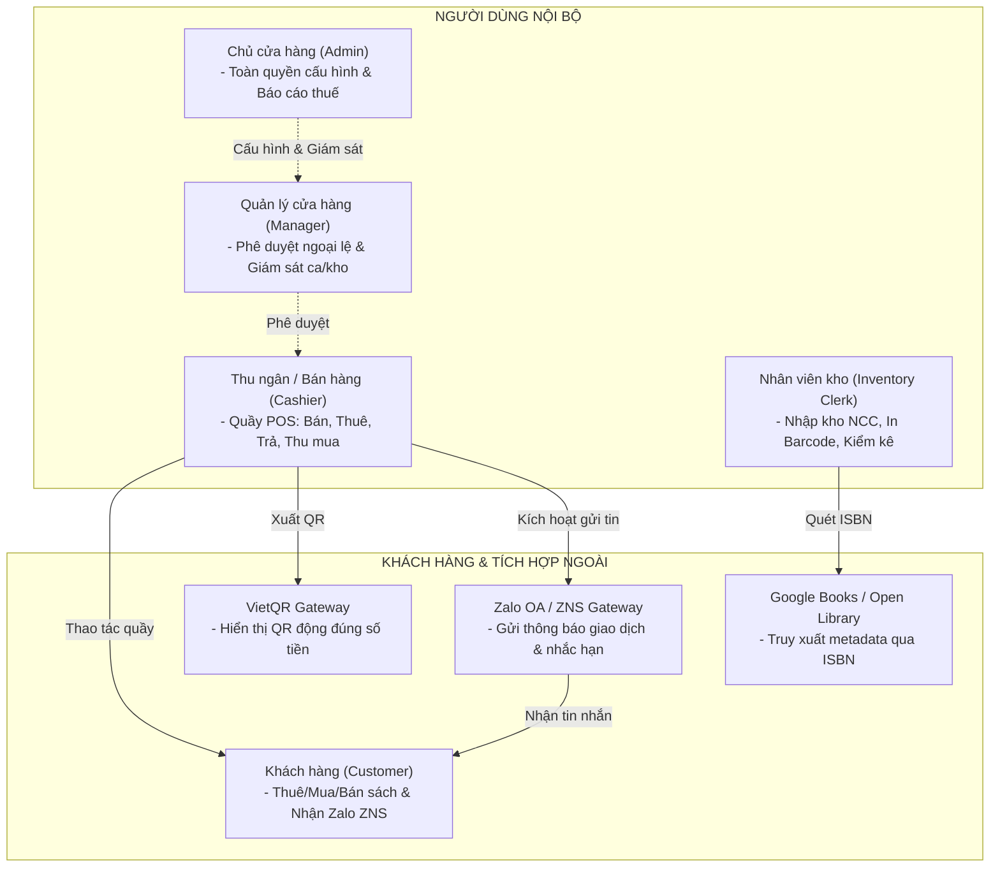

#### Ma trận Phân quyền Chức năng Phân hệ Sách (RBAC Matrix)

| Chức năng / Màn hình | Admin | Manager | Cashier (Thu ngân) | Inventory Clerk (Thủ kho) |
|---|:---:|:---:|:---:|:---:|
| **Quản lý Thể loại sách (`SCR-INV-01`)** | Toàn quyền | Xem, Thêm, Sửa | Chỉ xem | Toàn quyền |
| **Quản lý Danh mục Đầu sách (`SCR-INV-02`)** | Toàn quyền | Toàn quyền | Chỉ xem | Toàn quyền |
| **Chi tiết Đầu sách - Ấn bản - Bản vật lý (`SCR-INV-03`)** | Toàn quyền | Toàn quyền | Chỉ xem | Toàn quyền |
| **In tem Barcode độc bản (`SCR-INV-04`)** | Toàn quyền | Toàn quyền | In lại tem hỏng | Toàn quyền |
| **Quản lý Bộ sách & Tiến độ đủ bộ (`SCR-INV-10`)** | Toàn quyền | Toàn quyền | Chỉ xem | Toàn quyền |
| **Nhập kho từ Nhà cung cấp (`SCR-INV-06`)** | Toàn quyền | Toàn quyền | Không có quyền | Lập & Xác nhận |
| **Kiểm kê kho & Đối soát sai lệch (`SCR-INV-08`)** | Toàn quyền | Duyệt điều chỉnh | Không có quyền | Thực hiện kiểm đếm |
| **Bán sách tại quầy POS (`SCR-POS-02`)** | Toàn quyền | Toàn quyền | Thực hiện | Chỉ xem |
| **Lập phiếu cho thuê sách (`SCR-POS-03`)** | Toàn quyền | Toàn quyền | Thực hiện | Chỉ xem |
| **Tra cứu & Gia hạn phiếu thuê (`SCR-POS-04`)** | Toàn quyền | Toàn quyền | Thực hiện | Chỉ xem |
| **Nhận trả sách & Quyết toán cọc (`SCR-POS-05`)** | Toàn quyền | Toàn quyền | Thực hiện | Không có quyền |
| **Duyệt phạt hư hỏng ngoài khung quy định** | Toàn quyền | Phê duyệt | Đề xuất | Không có quyền |
| **Thu mua sách cũ từ khách (`SCR-POS-06`)** | Toàn quyền | Toàn quyền | Thực hiện (theo hạn mức) | Tham gia thẩm định |
| **Duyệt giá thu mua vượt hạn mức** | Toàn quyền | Phê duyệt | Đề xuất | Không có quyền |
| **Cảnh báo tồn kho chạm min (`SCR-INV-09`)** | Nhận thông báo | Nhận thông báo | Không hiển thị | Theo dõi & Đề xuất |

---

### 1.3. Mô hình Dữ liệu Chuẩn 4 Cấp (Book Hierarchy 4-Tier Model)

Căn cứ quyết định kiến trúc [`PDR-005`](./decisions/PDR-005-title-edition-copy-identification.md) và thực tế nghiệp vụ tiệm truyện tranh, hệ thống chuẩn hóa mô hình dữ liệu sách thành **4 cấp phân tách rạch ròi**:

```
[ CẤP 1: BỘ SÁCH (Book Series / Set) ]
   └── [ CẤP 2: ĐẦU SÁCH / TẬP (Book Title / Work) ]
          └── [ CẤP 3: ẤN BẢN (Book Edition / Release) ]
                 └── [ CẤP 4: BẢN SÁCH VẬT LÝ (Book Copy / Item) ]
```

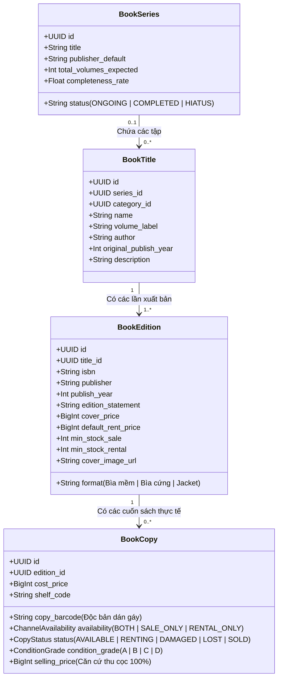

#### Bảng định nghĩa chi tiết 4 Cấp dữ liệu:

1. **Cấp 1 - Bộ sách (Book Series):**
   - **Mục đích:** Quản lý nhóm các tập truyện tranh hoặc bộ tiểu thuyết dài tập (VD: *Thám tử lừng danh Conan*, *Doraemon Truyện ngắn*, *Harry Potter*).
   - **Vai trò UX:** Cho phép nhân viên kiểm tra nhanh tiến độ đủ bộ (Completeness Rate), hỗ trợ khách hàng tìm tập còn thiếu và kích hoạt tính năng **Thu mua theo Bộ truyện (Series Quick-Picker)**.
2. **Cấp 2 - Đầu sách / Tập (Book Title / Work):**
   - **Mục đích:** Đại diện cho nội dung tác phẩm trừu tượng (VD: *Conan – Tập 10*, *Dế Mèn phiêu lưu ký*).
   - **Đặc điểm quan trọng:** **TUYỆT ĐỐI KHÔNG LƯU ISBN TẠI CẤP NÀY.** Lưu tên sách, số thứ tự tập (`volume_label`), tác giả, thể loại và tóm tắt cốt truyện.
3. **Cấp 3 - Ấn bản (Book Edition):**
   - **Mục đích:** Đại diện cho lần xuất bản cụ thể của tác phẩm ra thị trường (VD: *Conan Tập 10 - NXB Kim Đồng 2024, Bìa mềm*, hoặc *Bản kỷ niệm bìa cứng kèm quà tặng*).
   - **Dữ liệu quản lý:** Mã vạch thương mại quốc tế `ISBN-13`, Nhà xuất bản, Năm phát hành, Lần in/tái bản, Định dạng bìa, Giá bìa tham chiếu, Đơn giá thuê mặc định/ngày, Ngưỡng tồn kho tối thiểu cho Bán lẻ (`min_stock_sale`) và Cho thuê (`min_stock_rental`).
4. **Cấp 4 - Bản sách vật lý (Book Copy / Item):**
   - **Mục đích:** Đại diện cho từng cuốn sách cụ thể đang nằm trên kệ tiệm.
   - **Định danh duy nhất:** Mã vạch nội bộ độc bản `CopyBarcode` (VD: `BC-0082918`) in trên tem nhiệt dán gáy sách.
   - **Dữ liệu quản lý:** Phân hạng chất lượng thực tế (Grade A/B/C/D), Giá vốn nhập/thu mua, Giá bán niêm yết (chính là căn cứ thu cọc 100% khi thuê), Vị trí quầy kệ (`shelf_code`), Kênh phân phối và Trạng thái vòng đời.

#### 1.3.1. Bảng Ma trận Phân bổ Trách nhiệm Dữ liệu theo Mô hình 4 Cấp (4-Tier Traceability Matrix)

| Cấp độ Thực thể | Định danh duy nhất (Key) | Thuộc tính Dữ liệu Trọng tâm | Vai trò trong Luồng Nhập kho & Thu mua | Vai trò trong Luồng Bán lẻ, Thuê & Trả sách (POS) | Vai trò trong Luồng Tồn kho & Kiểm kê |
|---|---|---|---|---|---|
| **Cấp 1:<br/>Bộ sách (Series)** | `SeriesId`<br>(UUID nội bộ) | Tên bộ, NXB mặc định, Tổng số tập dự kiến, Tình trạng phát hành, Completeness Rate | Kích hoạt bộ chọn nhanh **Series Quick-Picker** khi thu mua truyện cũ theo bộ | Hiển thị Breadcrumb giúp độc giả và thu ngân nhận diện ngữ cảnh tập truyện | Đánh giá tỷ lệ đủ bộ của tủ sách tiệm; định hướng danh mục cần bổ sung |
| **Cấp 2:<br/>Đầu sách (Title / Work)** | `TitleId`<br>(UUID nội bộ) | Tên tác phẩm/tập, Số thứ tự tập (`volume_label`), Tác giả, Thể loại (`category_id`), Tóm tắt, Năm công bố | Tạo mới khi nhập tác phẩm mới; gán số tập trong bộ; **TUYỆT ĐỐI KHÔNG LƯU ISBN** | Tên hiển thị chính trên giỏ hàng POS, hóa đơn bán lẻ, phiếu thuê và Zalo ZNS | Điểm gom nhóm danh mục và tra cứu theo tác giả/chủ đề |
| **Cấp 3:<br/>Ấn bản (Book Edition)** | `EditionId`<br>(UUID) & **`ISBN-13`** | Mã vạch ISBN, Nhà xuất bản, Năm phát hành, Lần in/tái bản, Định dạng bìa, **Giá bìa tham chiếu**, **Đơn giá thuê mặc định/ngày**, `min_stock_sale`, `min_stock_rental` | Điểm neo khi quét mã vạch thương mại ISBN; tự động trích xuất metadata từ Google Books API; căn cứ gợi ý giá thu mua cũ | Cung cấp đơn giá thuê/ngày mặc định làm cơ sở tính phí thuê; **1 Đầu sách có thể có N Ấn bản** | **Cấp độ quản lý Tồn kho Tối thiểu (Min-Stock)**; kích hoạt cảnh báo thiếu hàng phân tách Bán và Thuê |
| **Cấp 4:<br/>Bản sách vật lý (Book Copy)** | **`CopyBarcode`**<br>(Mã tem độc bản dán gáy) | Tình trạng thực tế (Grade A/B/C/D), Giá vốn nhập, **Giá bán niêm yết (= Tiền cọc 100%)**, Vị trí kệ (`shelf_code`), Cờ kênh (`BOTH`, `SALE_ONLY`, `RENTAL_ONLY`), Trạng thái vòng đời | Sinh mới tức thì $N$ cuốn khi duyệt phiếu nhập/thu mua; dán tem nhiệt độc bản; theo dõi chính xác từng cuốn | **Thực thể duy nhất được quét tại quầy POS** khi bán lẻ, giao sách thuê, nhận trả sách; theo dõi cọc và phạt | **Trung tâm của việc kiểm đếm kho thực tế**; xác định cuốn nào còn, cuốn nào mất, cuốn nào bị tráo |

#### 1.3.2. Sơ đồ Quan hệ Thực thể CSDL Phân hệ Sách (Entity Relationship Diagram - ERD)

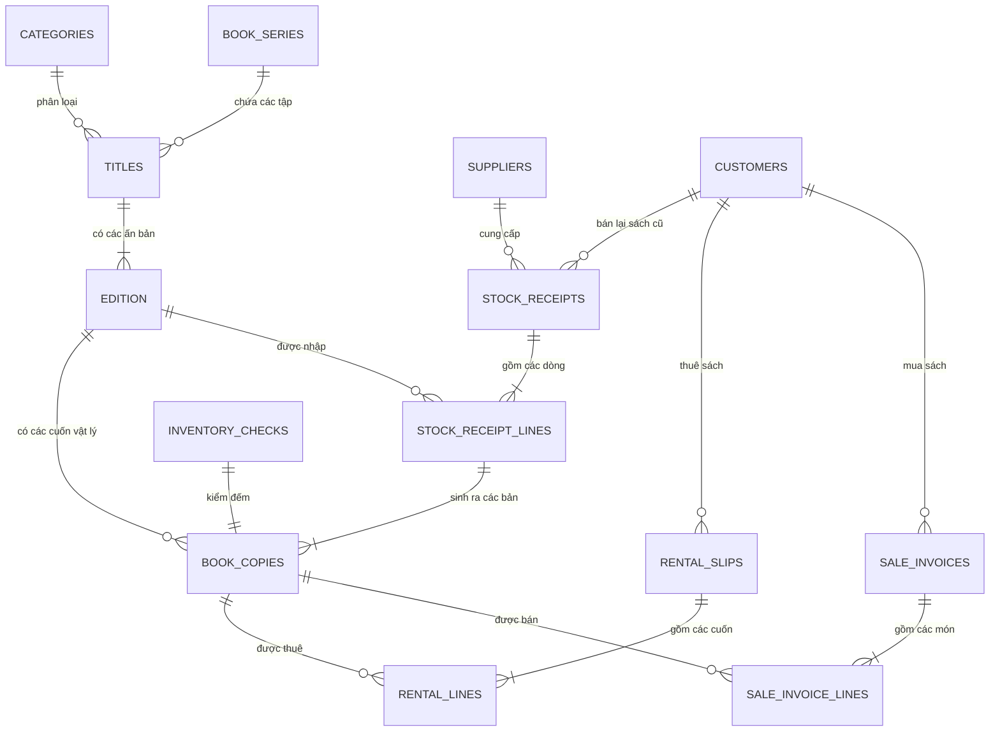

#### 1.3.3. Nguyên tắc Vận hành Hai Chiều của Mô hình 4 Cấp (Top-Down & Bottom-Up)
- **Chiều Xuống (Top-Down - Dành cho Quản lý & Nhập liệu):**
  Khi nhập một cuốn sách mới chưa từng có trong tiệm: Thủ kho đi từ Cây Thể loại ➔ Chọn/Tạo Bộ sách (Cấp 1) ➔ Tạo Đầu sách/Tập (Cấp 2) ➔ Quét ISBN tạo Ấn bản (Cấp 3) ➔ Sinh các Bản sách vật lý dán tem Barcode (Cấp 4).
- **Chiều Lên (Bottom-Up - Dành cho Giao dịch Quầy POS):**
  Tại quầy bán, thuê, trả, thu ngân **chỉ quét duy nhất mã `CopyBarcode` dán gáy (Cấp 4)**. Hệ thống lập tức JOIN ngược lên:
  `CopyBarcode` ➔ lấy `edition_id` (Cấp 3: ISBN, NXB, Đơn giá thuê) ➔ lấy `title_id` (Cấp 2: Tên sách, Tập số) ➔ lấy `series_id` (Cấp 1: Tên bộ truyện). Mọi thông tin 4 tầng được nạp tức thì trong vòng dưới $50$ms.

---

### 1.4. Cơ chế Hai Kênh Phân phối: Bán lẻ & Cho thuê (Dual-Channel Availability)

Theo quy định kiến trúc [`PDR-007`](./decisions/PDR-007-dual-channel-book-copy-availability.md), mỗi bản sách vật lý khi nhập kho có thuộc tính `availability`:
- **`BOTH` (Mặc định):** Cuốn sách vừa có thể bán, vừa có thể cho thuê. Khi lên kệ, nó đóng góp vào số lượng tồn khả dụng của cả kênh Bán và kênh Thuê. Khi một giao dịch phát sinh (bán hoặc thuê), hệ thống khóa bản sách và tự động trừ tồn khả dụng ở cả hai kênh.
- **`SALE_ONLY`:** Chỉ dành để bán lẻ, không cho khách thuê (dành cho sách mới 100%, sách có giá trị sưu tầm cao, ấn bản đặc biệt).
- **`RENTAL_ONLY`:** Chỉ dành cho thuê, không bán đứt (dành cho các tập truyện tranh hiếm, sách phục vụ bạn đọc đọc tại quán).
- **Chuyển đổi kênh:** Nhân viên có thẩm quyền có thể linh hoạt chuyển đổi cờ này trong màn hình Chi tiết Bản sách (`SCR-INV-03`), mọi thao tác đều được ghi vào Audit Log.

---

## PHẦN II: RÀ SOÁT & ĐÁNH GIÁ THỰC TRẠNG FIGMA SO VỚI BÁO CÁO

### 2.1. Bảng kiểm kê (Inventory) các màn hình liên quan đến sách trên Figma

Qua rà soát toàn diện trên tệp Figma chính thức (`Page 1`), nhóm thiết kế đã định danh **16 màn hình** trực tiếp tham gia vào vòng đời vận hành của phân hệ Sách:

| Mã màn hình | Tên màn hình trên Figma | Node ID | Phân hệ nghiệp vụ | Trạng thái hiện tại |
|---|---|:---:|:---:|:---:|
| **`SCR-INV-01`** | Thể loại sách & Cây danh mục | `8:36257` | Kho & Danh mục | Hoàn thiện cơ bản cây phân cấp |
| **`SCR-INV-02`** | Danh mục Đầu sách | `8:36455` | Kho & Danh mục | Cần tái cấu trúc hiển thị Ấn bản |
| **`SCR-INV-03`** | Chi tiết Đầu sách & Bản sách vật lý | `8:36745` | Kho & Danh mục | Cần lồng ghép Master-Detail 3 tầng |
| **`SCR-INV-04`** | In nhãn Barcode độc bản dán gáy | `8:37026` | Kho & Danh mục | Tốt, hỗ trợ preview nhãn in nhiệt |
| **`SCR-INV-05`** | Đối tác & Nhà cung cấp | `8:37331` | Kho & Danh mục | Đầy đủ thông tin đối tác |
| **`SCR-INV-06`** | Lập & Quản lý Phiếu nhập kho từ NCC | `30:24578` | Kho & Danh mục | Cần bổ sung quét ISBN tự động |
| **`SCR-INV-07`** | Lập Phiếu xuất kho ngoài bán hàng | `30:24710` | Kho & Danh mục | Hoàn thiện xuất hủy / chuyển kho |
| **`SCR-INV-08`** | Kiểm kê kho định kỳ & Đối soát sai lệch | `30:24813` | Kho & Danh mục | Cần bổ sung luồng duyệt chênh lệch |
| **`SCR-INV-09`** | Giám sát Cảnh báo tồn kho chạm min | `30:24914` | Kho & Danh mục | Cần chuyển min-stock sang cấp Ấn bản |
| **`SCR-INV-10`** | Quản lý Bộ sách & Tiến độ đủ bộ | `188:555` | Kho & Danh mục | Đã tạo mới, cần gắn kết với POS |
| **`SCR-POS-02`** | Bán sách cũ & Hàng bán lẻ tại quầy | `30:24432` | Quầy POS | Trực quan, cần bổ sung khách vãng lai |
| **`SCR-POS-03`** | Lập phiếu cho thuê sách | `8:35041` | Quầy POS | Cần làm rõ cọc 100% & kiểm tra hạng |
| **`SCR-POS-04`** | Tra cứu & Gia hạn phiếu thuê | `8:35291` | Quầy POS | Cần bổ sung ân hạn 2h & phạt 150% |
| **`SCR-POS-05`** | Nhận trả sách & Quyết toán tiền cọc | `8:35508` | Quầy POS | Cần bổ sung luồng duyệt hỏng ngoài khung |
| **`SCR-POS-06`** | Thu mua sách cũ từ khách hàng | `8:35761` | Quầy POS | Cần sửa lỗi gộp tập & duyệt giá |
| **`SCR-POS-07`** | Màn hình phụ hướng khách hàng (VietQR) | `8:36013` | Quầy POS | Tốt, hiển thị QR động & chi tiết giỏ hàng |

---

### 2.2. Đánh giá ưu điểm của bản thiết kế Figma hiện tại

1. **Bố cục phân vùng công thái học (Ergonomics POS Layout):** Thiết kế quầy POS theo cấu trúc chia 2 cột kinh điển: bên trái là không gian thao tác nghiệp vụ/danh sách sản phẩm, bên phải là bảng tóm tắt tài chính và nút hành động chính (Primary Action Button) to rõ, dễ bấm trên màn hình cảm ứng hoặc phím tắt.
2. **Tích hợp vùng quét Barcode tự động (Auto-focus Scanner Mode):** Có badge trạng thái `● Máy quét đang lắng nghe`, tạo phản hồi thị giác tốt cho thu ngân khi quét mã vạch liên tục bằng súng quét.
3. **Màu sắc và phân cấp thị giác chuyên nghiệp:** Sử dụng hệ màu Design Tokens đồng bộ: Indigo `#4F46E5` cho thương hiệu chính, Emerald `#16A34A` cho thành công/khả dụng, Amber `#D97706` cho cảnh báo/đang thuê, và Rose `#DC2626` cho nguy hiểm/hỏng/mất.
4. **Hỗ trợ đầy đủ màn hình phụ VietQR (`SCR-POS-07`):** Thiết kế riêng màn hình hướng khách giúp minh bạch hóa giá trị giao dịch, hạn trả, tiền cọc và quét mã thanh toán ngân hàng tức thì.

---

### 2.3. Báo cáo Chi tiết các Lỗ hổng UX & Sai lệch nghiêm trọng so với Báo cáo cuối kỳ

Mặc dù giao diện Figma có hình thức đẹp mắt, nhưng khi đối chiếu với các quy tắc nghiệp vụ khắt khe trong **`Báo cáo Cuối kỳ(1).docx`**, tồn tại **6 sai lệch và lỗ hổng kiến trúc trải nghiệm nghiêm trọng**:

#### ❌ Lỗ hổng 1: Gộp phẳng Đầu sách với Ấn bản, triệt tiêu tính linh hoạt của mô hình xuất bản
- **Hiện trạng trên Figma (`SCR-INV-02`, `SCR-INV-03` cũ):** Màn hình Đầu sách lưu trực tiếp ISBN, Nhà xuất bản, Năm phát hành và Giá bìa, sau đó trỏ thẳng xuống danh sách Bản vật lý.
- **Hệ quả thực tế:** Một tác phẩm như *Doraemon Tập 1* hoặc *Hoàng tử bé* có nhiều lần tái bản qua các năm (bìa mềm 25.000đ, bìa cứng kỷ niệm 85.000đ với các ISBN khác nhau). Nếu gộp chung, hệ thống không thể quản lý giá bìa tham chiếu riêng, không phân tách được ngưỡng tồn kho tối thiểu và khiến việc quản lý giá vốn bị sai lệch.
- **Khắc phục theo Báo cáo:** Tách tầng **Ấn bản (Edition)** độc lập làm trung gian giữa Đầu sách và Bản vật lý.

#### ❌ Lỗ hổng 2: Lỗi logic định danh khi Thu mua nhiều tập truyện (`SCR-POS-06`)
- **Hiện trạng trên Figma:** Khi khách hàng bán 4 cuốn truyện thuộc bộ *Conan* (Tập 1, 2, 3, 4), giao diện cho phép nhập số lượng `4` trên 1 dòng sản phẩm duy nhất. Khi bấm hoàn tất, hệ thống tự sinh 4 mã `CopyBarcode` ngẫu nhiên.
- **Hệ quả nghiêm trọng:** Thu ngân và thủ kho không thể biết mã tem nào dán cho Tập 1, mã tem nào dán cho Tập 4! Sách nhập kho bị sai lệch tập nội dung.
- **Khắc phục theo Báo cáo:** Nghiệp vụ thu mua sách cũ **bắt buộc quy tắc 1 dòng = 1 cuốn vật lý cụ thể**. Bổ sung công cụ **Bộ chọn nhanh theo bộ (Series Quick-Picker)**: nhân viên chọn bộ Conan, tích chọn nhanh Tập 1, 2, 3, 4; hệ thống tự bung thành 4 dòng độc lập với số tập chính xác để gán tem dán gáy tương ứng.

#### ❌ Lỗ hổng 3: Khuyết thiếu các Điểm Phê duyệt Ngoại lệ tại Quầy (Missing Approval Gates)
- **Hiện trạng trên Figma:** Tại màn hình Trả sách (`SCR-POS-05`), khi sách bị hư hỏng ngoài khung quy định, hoặc tại màn hình Thu mua (`SCR-POS-06`) khi thỏa thuận giá vượt hạn mức nhân viên, giao diện chưa có trạng thái chờ duyệt và luồng điều hướng sang Trung tâm Phê duyệt (`SCR-APP-01`).
- **Khắc phục theo Báo cáo:** Khi phát sinh ngoại lệ, hệ thống chuyển giao dịch sang trạng thái `PENDING_APPROVAL`, kích hoạt thông báo đẩy thời gian thực cho Quản lý cửa hàng (Manager). Quản lý có thể nhập mã PIN duyệt ngay tại chỗ trên máy POS hoặc phê duyệt từ xa qua tài khoản cá nhân; phiếu giao dịch không được phép đóng trước khi có quyết định phê duyệt kèm lý do bắt buộc.

#### ❌ Lỗ hổng 4: Nhầm lẫn bản chất Tiền cọc vs Doanh thu tại POS Thuê & Trả sách
- **Hiện trạng trên Figma (`SCR-POS-03`):** Cột giá trị chỉ ghi "Thành tiền", chưa làm nổi bật rằng tiền cọc thu vào là **100% giá bán niêm yết của cuốn sách** và là **Khoản nợ phải trả (Chưa ghi nhận doanh thu)**.
- **Khắc phục theo Báo cáo:** 
  - Tại `SCR-POS-03`: Hiển thị rõ cột "Tiền cọc ký quỹ (100% giá bán)" và cột "Phí thuê dự kiến (Tham khảo - Thu khi trả)".
  - Tại `SCR-POS-05`: Thiết kế bảng ma trận quyết toán tài chính minh bạch: $T = \max(0, 	ext{Tiền cọc} - 	ext{Phí thuê} - 	ext{Phạt trễ} - 	ext{Phạt hư hỏng})$. Nếu khách làm mất sách, giữ 100% tiền cọc và tự động chuyển khoản này thành Doanh thu bán sách.

#### ❌ Lỗ hổng 5: Thiếu quy chuẩn Ân hạn trễ 2 giờ và Phạt trễ 150% tại Quầy
- **Hiện trạng trên Figma (`SCR-POS-04`, `SCR-POS-05`):** Chưa hiển thị rõ cơ chế tính phạt lũy tiến và quy định ân hạn.
- **Khắc phục theo Báo cáo:** Hiển thị trực quan thông báo thời gian:
  - Nếu trả hoặc gia hạn trễ $\le 2$ giờ: Hệ thống ghi nhận trạng thái **"Trong thời gian ân hạn (Grace Period)"**, miễn hoàn toàn phạt trễ.
  - Nếu trễ $> 2$ giờ: Tính phạt trễ = $	ext{Số ngày trễ (làm tròn lên)} 	imes 150\% 	imes 	ext{Đơn giá thuê gốc/ngày}$. Tại màn hình gia hạn, phí gia hạn và phạt trễ đã chốt được **cộng dồn vào nghĩa vụ phiếu thuê**, không thu tiền ngay tại quầy mà cấn trừ tiền cọc khi trả sách.

#### ❌ Lỗ hổng 6: Ngưỡng cảnh báo tồn kho tối thiểu (`SCR-INV-09`) bị đặt sai cấp
- **Hiện trạng trên Figma:** Thiết lập min-stock ở cấp Đầu sách.
- **Khắc phục theo Báo cáo:** Thiết lập ngưỡng tồn kho tối thiểu tại cấp **Ấn bản (Book Edition)** và phân tách độc lập theo 2 kênh: `min_stock_sale` (ngưỡng min cho bán lẻ) và `min_stock_rental` (ngưỡng min cho thuê).

---

## PHẦN III: KIẾN TRÚC THÔNG TIN & SƠ ĐỒ ĐIỀU HƯỚNG TỔNG THỂ (IA & SITEMAP)

### 3.1. Sơ đồ Cây Phân cấp Thông tin (Information Architecture Tree)

Kiến trúc thông tin của phân hệ Sách được tổ chức thành hai vùng không gian làm việc chính (Workspaces) với ranh giới trách nhiệm rõ ràng nhưng chia sẻ chung cơ sở dữ liệu thời gian thực:

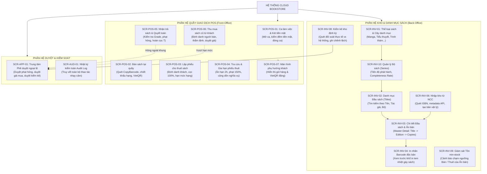

---

### 3.2. Sơ đồ Điều hướng Màn hình Tổng thể (Global Navigation Map)

Sơ đồ thể hiện chu trình điều hướng thực tế giữa các màn hình trong ca làm việc:

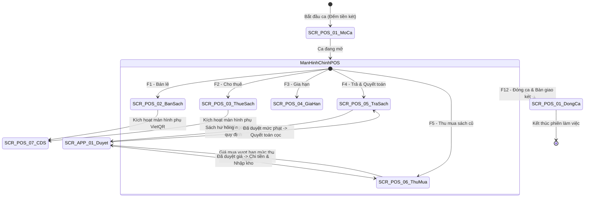

---

## PHẦN IV: THIẾT KẾ CHI TIẾT CÁC LUỒNG UX/UI NGHIỆP VỤ (CORE USER JOURNEYS)

---

### 4.1. Luồng 1: Quản lý Thư mục, Cây Thể loại & Bộ truyện (SCR-INV-01, SCR-INV-10)

#### 4.1.1. Mục tiêu & Điều kiện kích hoạt
- **Mục tiêu:** Xây dựng khung phân loại sách khoa học theo cây phân cấp đa tầng (tối đa 3 cấp) và quản lý tiến độ hoàn thành các bộ truyện tranh/tiểu thuyết nhiều tập (Completeness Rate).
- **Tác nhân:** Thủ kho (Inventory Clerk), Quản lý cửa hàng (Manager), Admin.
- **Điều kiện kích hoạt:** Nhấn "Kho sách ➔ Cây danh mục" (`SCR-INV-01`) hoặc "Kho sách ➔ Bộ sách & Series" (`SCR-INV-10`).

#### 4.1.2. Sơ đồ Luồng Nghiệp vụ (User Flowchart)

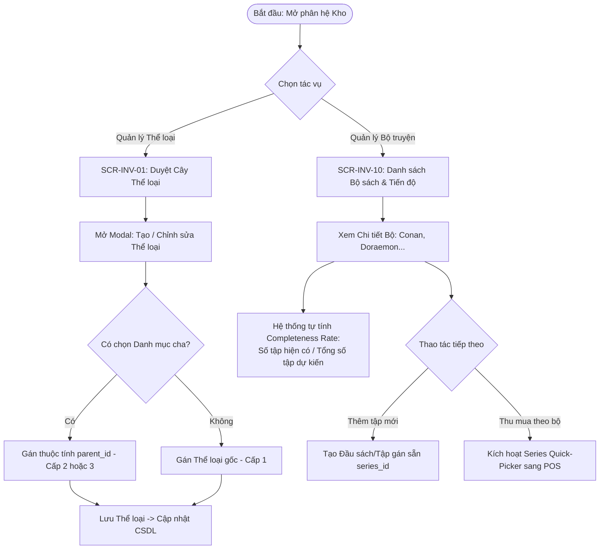

#### 4.1.3. Trải nghiệm Tương tác Giao diện (UI Step-by-Step)
1. **Tại `SCR-INV-01` (Cây Danh mục Thể loại):**
   - **Bố cục 2 cột:** Cột trái là cây thư mục tương tác (Tree View) hỗ trợ gập/mở (Expand/Collapse), hiển thị số lượng đầu sách tương ứng (VD: *Truyện tranh (1.284) ➔ Manga Nhật Bản (936)*). Cột phải là Form chi tiết thể loại đang chọn.
   - **Thao tác nhanh:** Kéo thả (Drag & Drop) để chuyển nhánh danh mục; nút `+ Thêm thể loại con` ngay tại từng node.
2. **Tại `SCR-INV-10` (Quản lý Bộ sách & Tiến độ đủ bộ):**
   - **Thẻ đo lường KPI (Summary Metrics):** Tổng số bộ sách (286), Số bộ đã hoàn thành 100% (142), Số bộ đang dở dang (126), Tỷ lệ đủ bộ trung bình toàn tiệm (78.4%).
   - **Grid Card trực quan:** Mỗi Card bộ sách hiển thị: Ảnh bìa đại diện, Tên bộ, NXB chính, Thanh tiến độ (Progress Bar) trực quan: `Đã có 98/104 tập (94.2%)`, Tag trạng thái: `Đang phát hành (ONGOING)` hoặc `Đã kết thúc (COMPLETED)`.
   - **Bộ lọc thông minh:** Lọc theo: Bộ còn thiếu tập, Bộ đã đủ tập, NXB, Thể loại.
   - **Nút hành động đặc quyền:** `[ + Thu mua theo Bộ truyện ]` để đẩy dữ liệu danh sách tập còn thiếu sang quầy thu mua `SCR-POS-06`.

#### 4.1.4. Quy tắc Dữ liệu & Xử lý Ngoại lệ
- **Xóa thể loại:** Chặn xóa thể loại nếu đang chứa thể loại con hoặc đang có Đầu sách liên kết. Hiển thị thông báo: *"Không thể xóa: Danh mục đang chứa 286 đầu sách. Vui lòng chuyển sách sang danh mục khác trước."*
- **Trùng tên:** Không cho phép tạo trùng tên thể loại trong cùng một nút cha.

---

### 4.2. Luồng 2: Tra cứu & Quản lý Danh mục Đầu sách - Ấn bản - Bản vật lý (SCR-INV-02, SCR-INV-03)

#### 4.2.1. Mục tiêu & Điều kiện kích hoạt
- **Mục tiêu:** Quản lý toàn diện dữ liệu thư mục sách theo đúng mô hình 4 cấp; tra cứu đa tiêu chí; xem trạng thái vòng đời từng cuốn vật lý.
- **Tác nhân:** Thủ kho, Thu ngân (chỉ xem), Quản lý, Admin.
- **Kích hoạt:** Chọn menu "Kho sách ➔ Danh mục Đầu sách" (`SCR-INV-02`).

#### 4.2.2. Sơ đồ Luồng Nghiệp vụ (User Flowchart)

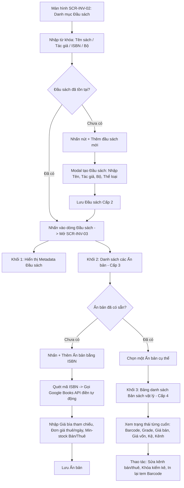

#### 4.2.3. Trải nghiệm Tương tác Giao diện Master-Detail 3 Tầng (`SCR-INV-03`)
Màn hình được tái cấu trúc thành bố cục phân cấp lồng nhau từ trên xuống dưới:
1. **Tầng 1 (Đầu sách / Title Header):**
   - Breadcrumb: `Kho sách / Bộ: Thám tử lừng danh Conan / Đầu sách: Conan · Tập 10`.
   - Tiêu đề: *Conan · Tập 10* | Badge: *Tập 10 / 104* | Badge: *Đang kinh doanh*.
   - Thông tin thư mục: Tác giả Gosho Aoyama, Thể loại Manga/Trinh thám, Tóm tắt nội dung.
   - Nút hành động: `[ Chỉnh sửa tác phẩm ]`, `[ + Thêm Ấn bản mới bằng ISBN ]`.
2. **Tầng 2 (Ấn bản / Editions Carousel / Horizontal Tabs):**
   - Danh sách các card ấn bản nằm ngang đại diện cho các lần xuất bản khác nhau:
     - *Card 1 (Đang chọn):* NXB Kim Đồng · Tái bản 2024 (Bìa mềm áo rời) | ISBN: `978-604-2-09359-5` | Giá bìa: 45.000đ | Thuê: 3.000đ/ngày | Min Bán: 2 / Min Thuê: 3 | Tồn kho: **8 cuốn**.
     - *Card 2:* NXB Kim Đồng · Kỷ niệm 20 năm (Bìa cứng Jacket kèm Artbook) | ISBN: `978-604-2-19882-1` | Giá bìa: 120.000đ | Kênh: Chỉ bán (`SALE_ONLY`) | Tồn kho: **2 cuốn**.
3. **Tầng 3 (Bản sách vật lý / Physical Copies Table):**
   - Hiển thị toàn bộ các cuốn sách thuộc Ấn bản đang chọn:
     - Cột 1: `CopyBarcode` (VD: `BC-0082918`).
     - Cột 2: Phân hạng chất lượng (Badge Grade A / B / C / D có tooltip mô tả tình trạng).
     - Cột 3: Vị trí quầy kệ (`A1-03`).
     - Cột 4: Kênh phân phối (Dropdown chọn: `BOTH`, `SALE_ONLY`, `RENTAL_ONLY`).
     - Cột 5: Giá vốn & Giá bán niêm yết (Tiền cọc khi thuê).
     - Cột 6: Trạng thái vòng đời (`Khả dụng`, `Đang thuê - Hạn trả 17/10`, `Hư hỏng`, `Đã bán`).
     - Cột 7: Thao tác nhanh (Xem lịch sử mượn trả, In lại nhãn dán).

---

### 4.3. Luồng 3: Nhập kho Sách từ Nhà cung cấp & In nhãn Barcode độc bản (SCR-INV-06, SCR-INV-04)

#### 4.3.1. Mục tiêu & Điều kiện kích hoạt
- **Mục tiêu:** Tiếp nhận lô sách mới từ Nhà cung cấp/Nhà xuất bản, ghi nhận giá vốn, tự động sinh mã `CopyBarcode` độc bản và in nhãn dán nhiệt hàng loạt.
- **Tác nhân:** Thủ kho (Inventory Clerk).
- **Kích hoạt:** Chọn "Kho sách ➔ Nhập kho NCC" (`SCR-INV-06`).

#### 4.3.2. Sơ đồ Luồng Nghiệp vụ (User Flowchart)

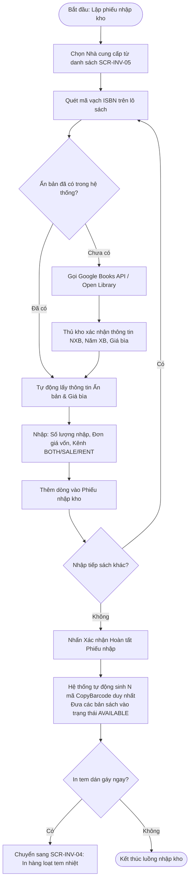

#### 4.3.3. Trải nghiệm Tương tác Giao diện
1. **Tại `SCR-INV-06` (Lập phiếu nhập kho NCC):**
   - Thanh công cụ trên cùng: Chọn Nhà cung cấp (Combobox tìm nhanh theo tên hoặc mã NCC), Ngày nhập, Nhân viên tạo.
   - Vùng nhập nhanh: Ô quét ISBN hỗ trợ tự động nhảy focus. Khi súng quét bíp, hệ thống hiển thị Card sách xem trước kèm ảnh bìa, tên NXB, giá bìa tham chiếu.
   - Bảng chi tiết dòng nhập: Cho phép nhập hàng loạt nhiều đầu sách. Tại mỗi dòng, thiết lập: Số lượng (VD: 10), Đơn giá nhập vốn (VD: 30.000đ), Giá bán đề xuất (VD: 45.000đ), Kênh mặc định `BOTH`.
   - Tóm tắt tài chính phiếu nhập: Tổng số lượng cuốn, Tổng tiền vốn hàng nhập, Trạng thái công nợ NCC.
2. **Tại `SCR-INV-04` (In nhãn Barcode độc bản dán gáy):**
   - Xem trước bản in trực quan (Print Preview) theo kích thước tem nhiệt chuẩn tiệm sách (kích thước 35mm x 22mm hoặc 50mm x 30mm).
   - Nội dung trên mỗi tem dán:
     - Dòng 1: Tên tiệm sách (`CLOUD BOOKSTORE`).
     - Dòng 2: Mã vạch Code 128 / QR Code thể hiện chuỗi `CopyBarcode`.
     - Dòng 3: Tên viết tắt sách + Tập (VD: `CONAN-T10`).
     - Dòng 4: Giá bán niêm yết (VD: `45.000đ`).
   - Nút hành động: `[ In tất cả 10 tem ]` (Phím tắt `Ctrl + P`).

#### 4.3.4. Cơ Chế Vận Hành Dữ Liệu theo Mô hình 4 Cấp trong Luồng Nhập Kho
1. **Khớp nối Cấp 1 (Bộ sách) & Cấp 2 (Đầu sách):**
   - Khi súng quét nhận diện mã vạch ISBN thương mại, hệ thống truy vấn CSDL nội bộ. Nếu mã ISBN này thuộc một tập truyện tranh (VD: *Conan Tập 10*), hệ thống tự động liên kết với Đầu sách (Cấp 2) và định danh Bộ sách cha *Thám tử lừng danh Conan* (Cấp 1).
2. **Khởi tạo hoặc Cập nhật Cấp 3 (Ấn bản - Book Edition):**
   - Mỗi mã ISBN đại diện cho một **Ấn bản cụ thể (Cấp 3)**. Nếu lô hàng là lần tái bản mới (năm 2024, bìa mềm áo rời), hệ thống tạo bản ghi `edition` mới trỏ đến `title_id`, lưu trữ ISBN, NXB, Giá bìa tham chiếu (45.000đ), Đơn giá thuê mặc định (3.000đ/ngày) và 2 ngưỡng tồn kho tối thiểu (`min_stock_sale`, `min_stock_rental`).
   - Dòng chứng từ nhập kho `stock_receipt_lines` **chỉ lưu khóa ngoại `edition_id`**, không lưu trực tiếp `title_id` hay `series_id`.
3. **Sản sinh Cấp 4 (Bản sách vật lý - Book Copy):**
   - Khi thủ kho xác nhận nhập 10 cuốn, hệ thống thực thi Transaction: tự động sinh đúng **10 bản ghi `book_copies` riêng biệt (Cấp 4)** với các mã `CopyBarcode` độc bản duy nhất (VD: `BC-009101` đến `BC-009110`), trạng thái `status = 'AVAILABLE'`, gán tình trạng mặc định `Grade A (Mới 100%)` và lưu giá vốn nhập (`unit_cost`).

---

### 4.4. Luồng 4: Thu mua Sách cũ từ Khách hàng tại quầy POS (SCR-POS-06, SCR-APP-01)

#### 4.4.1. Mục tiêu & Điều kiện kích hoạt
- **Mục tiêu:** Mua lại sách cũ từ khách hàng cá nhân; thẩm định phân hạng chất lượng; định giá chuẩn hóa; xuất chứng từ chi hợp lệ cho kế toán thuế; lập tức sinh mã Barcode độc bản đưa vào kho.
- **Tác nhân:** Thu ngân / Bán hàng (Cashier), Quản lý cửa hàng (Manager - duyệt ngoại lệ), Khách hàng (bán sách).
- **Kích hoạt:** Nhấn phím tắt `F5` hoặc chọn menu "Quầy giao dịch ➔ Thu mua sách cũ" (`SCR-POS-06`).

#### 4.4.2. Sơ đồ Luồng Nghiệp vụ (User Flowchart)

```mermaid
flowchart TD
    Start([Bắt đầu: Mở SCR-POS-06]) --> InputCustomer[BẮT BUỘC: Nhập SĐT khách hàng<br/>Tra cứu hoặc tạo mới hồ sơ người bán]
    InputCustomer --> ChooseMode{Chọn cách thức thu mua}
    
    ChooseMode -->|Từng cuốn lẻ| ScanISBN[Quét mã ISBN hoặc nhập tay]
    ChooseMode -->|Theo Bộ truyện| QuickPicker[Mở Modal: Series Quick-Picker<br/>Chọn Bộ & Tích chọn các Tập khách bán]
    
    QuickPicker --> AutoUnfold[Hệ thống tự bung thành N dòng độc lập<br/>Mỗi dòng ứng với 1 tập cụ thể]
    ScanISBN --> GetMetadata[Truy xuất Giá bìa tham chiếu & Metadata]
    AutoUnfold --> GetMetadata
    
    GetMetadata --> GradeItem[Đánh giá Tình trạng thực tế: Grade A / B / C / D]
    GradeItem --> SuggestPrice[Hệ thống tự gợi ý Khoảng giá thu mua:<br/>Giá bìa x Hệ số Grade]
    SuggestPrice --> InputAgreedPrice[Nhập Giá thỏa thuận thực tế & Giá bán niêm yết dự kiến]
    
    InputAgreedPrice --> CheckLimit{Giá mua cuốn > 200k HOẶC<br/>Tổng phiếu > 1.000k?}
    CheckLimit -->|Có: Vượt hạn mức| NeedApproval[Khóa trạng thái Chờ duyệt PENDING_APPROVAL<br/>Gửi thông báo tới SCR-APP-01]
    NeedApproval --> ManagerReview{Quản lý duyệt?}
    ManagerReview -->|Từ chối| RejectItem[Từ chối mua hoặc điều chỉnh lại giá]
    ManagerReview -->|Đồng ý| ApprovedFlow[Quản lý nhập mã PIN duyệt ngay tại quầy]
    
    CheckLimit -->|Không vượt| ApprovedFlow
    RejectItem --> EndSub([Điều chỉnh lại thông tin])
    
    ApprovedFlow --> CashOutPayment[Thực hiện Luồng Tiền Ra: Chi tiền mặt hoặc VietQR chuyển khoản]
    CashOutPayment --> FinishReceipt[Xác nhận Hoàn tất Phiếu thu mua]
    
    FinishReceipt --> AutoGenCopies[Hệ thống tự sinh N mã CopyBarcode duy nhất<br/>Cập nhật kho trạng thái AVAILABLE]
    AutoGenCopies --> PrintReceipt[In Biên nhận thu mua & In hàng loạt tem Barcode gáy]
    PrintReceipt --> SendZalo[Gửi Zalo ZNS xác nhận thanh toán tiền cho người bán]
```

#### 4.4.3. Trải nghiệm Tương tác Giao diện Chi tiết
1. **Khối Thông tin Người Bán (Bắt buộc theo Luật Kế toán & Thuế):**
   - Ô nhập SĐT người bán (Auto-lookup). Nếu khách mới, hệ thống mở nhanh Drawer tạo hồ sơ: Họ tên, SĐT, Số CCCD (bắt buộc nếu tổng tiền bán $\ge 1.000.000$đ).
2. **Bộ công cụ "Thu mua theo Bộ truyện (Series Quick-Picker)":**
   - Nút nổi bật: `[ + Thu mua theo Bộ truyện (Series Quick-Picker) ]`.
   - **Giao diện Modal chọn nhanh:**
     - Tìm kiếm bộ truyện (VD: *Thám tử lừng danh Conan*).
     - Hiển thị Ma trận các ô số tập từ 1 đến 104.
     - Thu ngân chỉ cần click chọn các tập khách mang tới (VD: Tập `01`, `02`, `05`, `10`).
     - Bấm `Áp dụng`: Hệ thống tự động tạo **4 dòng sản phẩm riêng biệt** với đúng tiêu đề từng tập, không bao giờ gom chung thành một dòng số lượng 4.
3. **Thanh Thẩm định Tình trạng & Định giá:**
   - 4 Nút Toggle chọn Grade:
     - `A · 90–99%` (Sách như mới, không tì vết) $\rightarrow$ Đề xuất $50\% - 60\%$ giá bìa.
     - `B · 70–89%` (Hơi ố mép giấy, gáy vuông vắn) $\rightarrow$ Đề xuất $40\% - 49\%$ giá bìa.
     - `C · 50–69%` (Quăn góc, ngả vàng, có chữ ký) $\rightarrow$ Đề xuất $25\% - 39\%$ giá bìa.
     - `D · <50%` (Bìa sờn, rách nhẹ, cũ nát) $\rightarrow$ Đề xuất $10\% - 24\%$ giá bìa.
   - Trường nhập: **Giá thỏa thuận thực tế** (ô nhập tiền nổi bật) và **Giá bán niêm yết dự kiến** (dùng làm giá bán sau này và căn cứ thu cọc khi cho thuê).
4. **Cảnh báo Ngưỡng Phê duyệt Thời gian thực:**
   - Khi nhân viên nhập giá thu mua $220.000$đ (vượt hạn mức tự quyết $200.000$đ), hệ thống hiển thị ngay Banner màu vàng cảnh báo: `⚠️ Giá 220.000đ/cuốn vượt hạn mức tự quyết 200.000đ. Cần Quản lý phê duyệt tại chỗ (Mã PIN) hoặc duyệt từ xa tại SCR-APP-01`.

#### 4.4.4. Cơ Chế Vận Hành Dữ Liệu theo Mô hình 4 Cấp trong Luồng Thu Mua Sách Cũ
1. **Thao tác từ Cấp 1 (Bộ sách) qua Series Quick-Picker:**
   - Thu ngân chọn Bộ truyện *Thám tử lừng danh Conan* (Cấp 1).
2. **Định danh Cấp 2 (Đầu sách / Tập) độc lập:**
   - Thu ngân tích chọn các tập: Tập `01`, `02`, `05`, `10`. Thay vì gom thành 1 dòng số lượng 4 như lỗi thiết kế cũ trên Figma, hệ thống bung thành **4 dòng nghiệp vụ độc lập tương ứng với 4 Đầu sách (Cấp 2)**.
3. **Xác định Cấp 3 (Ấn bản) để lấy Giá bìa tham chiếu:**
   - Hệ thống tự động gán Ấn bản phổ thông gần nhất của từng tập (hoặc quét ISBN phía sau sách cũ) để lấy **Giá bìa tham chiếu (Cover Price)** của Ấn bản đó làm cơ sở tính tiền đề xuất.
4. **Sản sinh Cấp 4 (Bản sách vật lý) độc bản:**
   - Mỗi cuốn sách cũ được đánh giá tình trạng độc lập (Tập 1 có thể Grade B, Tập 10 có thể Grade A).
   - Khi hoàn tất chi tiền, hệ thống sinh đúng 4 bản ghi `book_copies` với 4 mã `CopyBarcode` khác nhau để in 4 tem dán gáy riêng biệt, bảo đảm không bao giờ bị nhầm lẫn giữa các tập.

---

### 4.5. Luồng 5: Bán sách tại quầy POS (Khách vãng lai & Thành viên) (SCR-POS-02, SCR-POS-07)

#### 4.5.1. Mục tiêu & Điều kiện kích hoạt
- **Mục tiêu:** Bán sách cũ và hàng bán lẻ tại quầy với tốc độ quét mã siêu tốc; hỗ trợ linh hoạt khách vãng lai không cần đăng ký tài khoản; tích lũy chi tiêu nâng hạng thành viên.
- **Tác nhân:** Thu ngân (Cashier), Khách hàng.
- **Kích hoạt:** Nhấn phím tắt `F1` hoặc chọn tab "Bán hàng tại quầy" (`SCR-POS-02`).

#### 4.5.2. Sơ đồ Luồng Nghiệp vụ (User Flowchart)

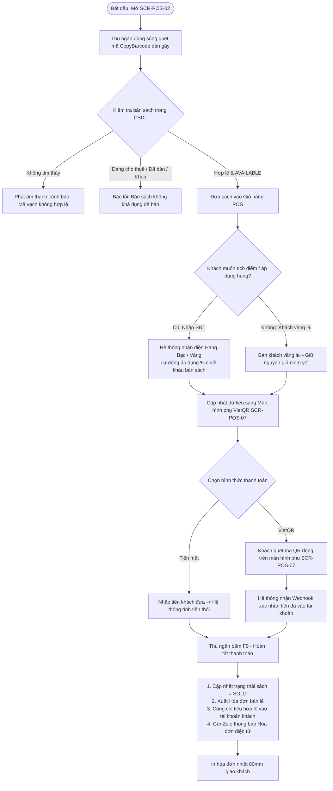

#### 4.5.3. Trải nghiệm Tương tác Giao diện
1. **Tại `SCR-POS-02` (Màn hình Bán lẻ Thu ngân):**
   - Ô nhập Barcode toàn màn hình có thuộc tính tự động giữ focus (`auto-focus`). Thu ngân có thể quét liên tục không cần chạm chuột.
   - Bảng giỏ hàng hiển thị rõ: Mã `CopyBarcode`, Tên sách, Tập, Phân hạng Grade (A/B/C/D), Đơn giá niêm yết, Chiết khấu thành viên, Thành tiền.
   - Thao tác nhanh bằng phím tắt: `F1` (Tìm sách), `F2` (Tìm khách), `F4` (Áp mã voucher), `F8` (Chọn VietQR), `F9` (Xác nhận tiền mặt), `ESC` (Hủy đơn nháp).
2. **Tại `SCR-POS-07` (Màn hình phụ hướng Khách hàng - VietQR Customer Display System):**
   - Cột trái: Danh sách chi tiết các cuốn sách đang được quét lên quầy, giá gốc, số tiền tiết kiệm được nhờ hạng thành viên.
   - Cột phải: Mã **VietQR động** chuẩn NAPAS 247 được sinh tự động với nội dung chuyển khoản mã hóa mã hóa đơn; hướng dẫn khách hàng quét bằng app ngân hàng; hiển thị trạng thái `● Đang chờ thanh toán...` và chuyển xanh `✅ Giao dịch thành công!` ngay khi có webhook.

#### 4.5.4. Cơ Chế Vận Hành Dữ Liệu theo Mô hình 4 Cấp trong Luồng Bán Lẻ
1. **Truy vết Bottom-Up từ Cấp 4:**
   - Súng quét đọc mã tem dán gáy `CopyBarcode = 'BC-2102'` của **Bản sách vật lý (Cấp 4)**.
   - Hệ thống lập tức truy vấn quan hệ:
     `BC-2102` (Bản vật lý: Grade B, Giá bán niêm yết 100.000đ, Kệ A2-01)  
     ➔ thuộc `edition_id` (Cấp 3: NXB Kim Đồng 2024, ISBN 978-604-2-09359-5)  
     ➔ thuộc `title_id` (Cấp 2: Conan · Tập 10, Tác giả Gosho Aoyama)  
     ➔ thuộc `series_id` (Cấp 1: Thám tử lừng danh Conan).
2. **Hiển thị Phân cấp trên Giao diện Quầy:**
   - Dòng giỏ hàng thể hiện đầy đủ cấu trúc: `[Bộ: Conan] Conan · Tập 10 (KĐ 2024) | BC-2102 · Grade B | Đơn giá: 100.000đ`.
3. **Cập nhật Vòng đời Dữ liệu:**
   - Sau khi thanh toán thành công: Cập nhật đúng bản ghi `book_copies` đó thành `status = 'SOLD'`. Số lượng tồn khả dụng của Ấn bản tương ứng tự động giảm 1 cuốn.

---

### 4.6. Luồng 6: Lập Phiếu cho Thuê sách tại quầy POS (SCR-POS-03, SCR-POS-07)

#### 4.6.1. Mục tiêu & Điều kiện kích hoạt
- **Mục tiêu:** Cho khách thuê truyện tranh/sách; bắt buộc định danh hồ sơ khách; kiểm tra nghiêm ngặt hạn mức số cuốn và thời hạn thuê theo hạng thành viên; thu tiền cọc ký quỹ 100% giá bán thực tế; chưa thu phí thuê tại bước này.
- **Tác nhân:** Thu ngân (Cashier), Khách hàng.
- **Kích hoạt:** Nhấn phím tắt `F2` hoặc chọn tab "Cho thuê sách" (`SCR-POS-03`).

#### 4.6.2. Sơ đồ Luồng Nghiệp vụ (User Flowchart)

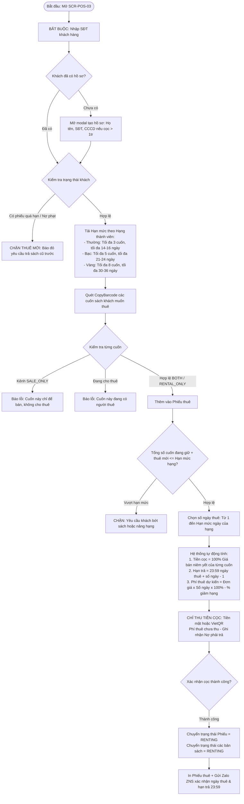

#### 4.6.3. Chi tiết Giao diện & Bảng Tính Toán Tài chính Ký Quỹ
1. **Khối Kiểm tra Hạng & Giới hạn Pháp lý:**
   - Khi nhập SĐT `0909 234 567` (Khách hàng Nguyễn Thu Hà), hệ thống hiển thị:
     - Badge: `Hạng Bạc (Tổng chi tiêu hợp lệ: 1.850.000đ)`.
     - Chỉ số hạn mức: `Đang thuê: 1 cuốn | Đang chọn thuê: 2 cuốn | Tối đa cho phép: 5 cuốn (Hợp lệ ✅)`.
     - Thời hạn thuê tối đa: `Tối đa 24 ngày`.
2. **Bảng Danh sách Sách thuê (Rental Cart Grid):**
   - Cột 1: `CopyBarcode` (VD: `BC-2101`, `BC-2102`).
   - Cột 2: Tên sách + Tập (*Doraemon T1*, *Conan T10*).
   - Cột 3: Tình trạng thực tế (Grade A / B).
   - Cột 4: **Tiền cọc từng cuốn (Bắt buộc = 100% Giá bán niêm yết):** Snapshot cố định vào phiếu (VD: Cuốn 1 cọc `80.000đ`, Cuốn 2 cọc `100.000đ` $\rightarrow$ Tổng cọc: `180.000đ`).
   - Cột 5: Đơn giá thuê mặc định/ngày (VD: `2.000đ/ngày`, `3.000đ/ngày`).
   - Cột 6: Phí thuê dự kiến (Đã trừ ưu đãi hạng Bạc 5%): `(5.000đ x 7 ngày) x 95% = 33.250đ` (Có nhãn chú thích: *Tham khảo - Quyết toán khi trả sách*).
3. **Cột Tóm tắt Quyết toán Thu Ngân (Bên phải):**
   - Dòng 1: **TỔNG TIỀN CỌC CẦN THU (KÝ QUỸ):** `180.000đ` (Font 24px Bold, màu Indigo `#4F46E5`).
   - Dòng 2: Phí thuê tạm tính (Chưa thu): `33.250đ`.
   - Dòng 3: Hạn trả chốt: `17/10/2026 lúc 23:59` (Có đồng hồ đếm ngược).
   - Nút hành động: `[ THU CỌC TIỀN MẶT - F9 ]` và `[ THU CỌC VIETQR - F8 ]`.
   - Sau khi thanh toán cọc thành công, nút in phiếu hiển thị: `[ In Phiếu Cho Thuê · Ctrl + P ]`.

#### 4.6.4. Cơ Chế Vận Hành Dữ Liệu theo Mô hình 4 Cấp trong Luồng Cho Thuê
1. **Trích xuất Dữ liệu Cấp 3 và Cấp 4 khi Quét Mã:**
   - Khi quét mã `CopyBarcode` của Bản sách vật lý (Cấp 4):
     - **Lấy Tiền cọc (100%):** Trích xuất từ trường `book_copies.selling_price` của Bản vật lý (Cấp 4) ➔ Lưu snapshot vào `rental_lines.deposit_amount` và `book_price_snapshot`.
     - **Lấy Đơn giá thuê/ngày:** Trích xuất từ trường `edition.default_rent_price` của Ấn bản (Cấp 3) ➔ Lưu snapshot vào `rental_lines.daily_rate`.
     - **Lấy Tên sách & Bộ truyện:** Trích xuất từ Đầu sách (Cấp 2) và Bộ sách (Cấp 1) để in lên biên nhận và gửi Zalo cho khách.
2. **Khóa Trạng thái Bản vật lý (Cấp 4):**
   - Ngay khi cọc được thanh toán, bản ghi `book_copies` chuyển `status = 'RENTING'`. Cuốn sách vật lý này lập tức bị loại khỏi tồn khả dụng của cả kênh Bán và kênh Thuê, ngăn chặn việc người khác quét bán nhầm.

---

### 4.7. Luồng 7: Tra cứu & Gia hạn Phiếu thuê (SCR-POS-04)

#### 4.7.1. Mục tiêu & Điều kiện kích hoạt
- **Mục tiêu:** Kéo dài thời gian thuê sách cho độc giả; kiểm tra số lần gia hạn (tối đa 2 lần); áp dụng quy tắc ân hạn 2 giờ; tính phạt trễ 150% nếu quá hạn; cộng dồn nghĩa vụ vào tiền cọc mà không thu tiền ngay tại quầy.
- **Tác nhân:** Thu ngân (Cashier), Khách hàng.
- **Kích hoạt:** Nhấn phím tắt `F3` hoặc chọn tab "Gia hạn phiếu thuê" (`SCR-POS-04`).

#### 4.7.2. Sơ đồ Luồng Nghiệp vụ (User Flowchart)

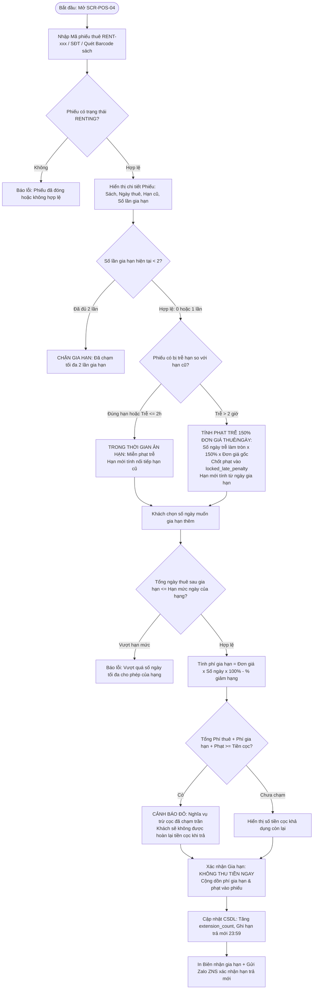

#### 4.7.3. Trải nghiệm Tương tác Giao diện Chi tiết
1. **Thanh Tra cứu Thông minh:** Ô tìm kiếm hỗ trợ tự động nhận diện định dạng: Quét mã vạch trên phiếu thuê `RENT-20261008-0041`, gõ 10 số điện thoại khách hàng, hoặc quét mã `CopyBarcode` bất kỳ cuốn nào trong bộ.
2. **Khối Giám sát Trễ hạn & Ân hạn 2 giờ (Grace Period Widget):**
   - **Kịch bản A (Ân hạn):** Trả hoặc gia hạn lúc 00:45 ngày hôm sau (trễ 45 phút): Hệ thống hiển thị huy hiệu xanh lá: `✅ Đang trong 2 giờ ân hạn miễn phạt (Còn 1 giờ 15 phút)`.
   - **Kịch bản B (Trễ quá 2 giờ):** Hạn cũ 17/10 lúc 23:59, khách đến gia hạn lúc 10:42 ngày 18/10 (trễ 10 giờ 43 phút):
     - Hệ thống hiển thị Banner cảnh báo màu hổ phách: `⚠️ Trễ hạn trên 2 giờ - Đã kích hoạt phạt trễ 150%. Thời gian trễ 10 giờ 43 phút ➔ Làm tròn 1 ngày trễ x 150% x 5.000đ = 7.500đ phạt`.
     - Phạt trễ này được chốt cứng (`locked_late_penalty`) vào phiếu thuê.
3. **Cơ chế Cộng dồn Nghĩa vụ (Không Thu Tiền Quầy):**
   - Giao diện làm rõ bằng chữ to in đậm: `PHÍ GIA HẠN ĐƯỢC CỘNG DỒN VÀO PHIẾU THUÊ - KHÔNG THU TIỀN NGAY TẠI QUẦY. QUYẾT TOÁN CẤN TRỪ TIỀN CỌC KHI TRẢ SÁCH.`
   - Nút hành động duy nhất: `[ XÁC NHẬN GIA HẠN VÀ IN BIÊN NHẬN · Enter ]`.

#### 4.7.4. Cơ Chế Vận Hành Dữ Liệu theo Mô hình 4 Cấp trong Luồng Gia Hạn
1. **Định vị chính xác Bản sách vật lý (Cấp 4):**
   - Quét mã `CopyBarcode` trên gáy sách giúp hệ thống tìm ngược lại dòng `rental_lines` tương ứng trong phiếu thuê đang lưu hành mà không cần gõ mã phiếu.
2. **Kế thừa Đơn giá từ Cấp 3 (Ấn bản):**
   - Phí gia hạn được tính căn cứ theo đơn giá thuê/ngày đã được snapshot từ **Ấn bản (Cấp 3)** lúc lập phiếu, bảo đảm nếu tiệm có tăng giá thuê mặc định của ấn bản trong tương lai thì giao dịch gia hạn của khách cũ vẫn giữ đúng giá cam kết ban đầu.

---

### 4.8. Luồng 8: Nhận Trả sách, Đánh giá Tình trạng & Quyết toán Tiền cọc (SCR-POS-05, SCR-APP-01)

#### 4.8.1. Mục tiêu & Điều kiện kích hoạt
- **Mục tiêu:** Tiếp nhận lại sách thuê từ khách hàng; thẩm định ngoại quan từng cuốn; tính phạt trễ hạn và bồi thường hư hại; thực hiện công thức quyết toán hoàn cọc $T$; chuyển tiền cọc mất sách thành doanh thu bán hàng; kích hoạt cổng duyệt khi hư hỏng ngoài khung.
- **Tác nhân:** Thu ngân (Cashier), Quản lý cửa hàng (Manager - duyệt hư hỏng), Khách hàng.
- **Kích hoạt:** Nhấn phím tắt `F4` hoặc chọn tab "Nhận trả sách & Quyết toán" (`SCR-POS-05`).

#### 4.8.2. Sơ đồ Luồng Nghiệp vụ (User Flowchart)

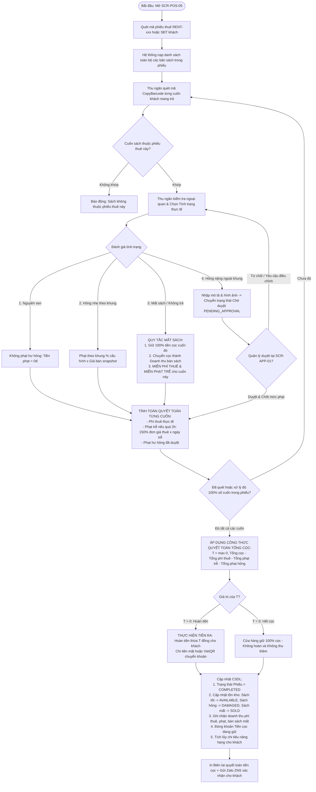

#### 4.8.3. Bảng Ma Trận Quyết Toán Tài Chính Minh Họa (`SCR-POS-05`)
Giả sử Phiếu thuê `RENT-20261008-0038` của khách hàng Nguyễn Thu Hà gồm **3 cuốn sách**, thuê 7 ngày, tổng tiền cọc đã đóng: **$300.000$đ**. Khách mang trả trễ 10 giờ (trễ > 2 giờ ➔ tính 1 ngày trễ phạt 150%).

| Mã Barcode | Tên sách / Tập | Cọc đã giữ | Tình trạng kiểm định | Phí thuê (đã giảm hạng) | Phạt trễ (150%) | Phạt hư hỏng | Số cọc khấu trừ | Số cọc hoàn lại | Ghi chú kế toán |
|---|---|:---:|:---:|:---:|:---:|:---:|:---:|:---:|---|
| **`BC-2101`** | *Doraemon · Tập 01* | 80.000đ | Nguyên vẹn | 13.300đ | 3.000đ | 0đ | 16.300đ | **63.700đ** | Sách về kệ `AVAILABLE` |
| **`BC-2102`** | *Conan · Tập 10* | 100.000đ | Hỏng nhẹ (Ố bìa 20%) | 19.950đ | 4.500đ | 20.000đ | 44.450đ | **55.550đ** | Sách chuyển `DAMAGED` |
| **`BC-2103`** | *Nhà giả kim* | 120.000đ | **Mất sách (Báo mất)** | **0đ (Miễn)** | **0đ (Miễn)** | **0đ (Miễn)** | **120.000đ** | **0đ** | **Cọc chuyển thành Doanh thu Bán sách (`SOLD`)** |
| **TỔNG CỘNG** | **3 cuốn** | **300.000đ** | **2 trả, 1 mất** | **33.250đ** | **7.500đ** | **20.000đ** | **180.750đ** | **119.250đ** | **Hoàn cọc thực tế $T = 119.250$đ** |

> [!IMPORTANT]
> **Điểm đột phá về UX Kế toán:** 
> Cuốn `BC-2103` bị mất sách: Tiền cọc $120.000$đ được giữ lại $100\%$ và tự động kết chuyển sang tài khoản **Doanh thu bán sách cũ**. Khách hàng không phải trả thêm bất kỳ đồng phí thuê hay tiền phạt trễ nào cho cuốn sách đã mất! Trải nghiệm quầy hoàn toàn minh bạch, triệt tiêu tranh chấp.

#### 4.8.4. Cơ Chế Vận Hành Dữ Liệu theo Mô hình 4 Cấp trong Luồng Trả Sách & Quyết Toán
1. **Xác nhận từng Bản sách vật lý (Cấp 4):**
   - Thu ngân quét mã `CopyBarcode` để xác nhận cuốn sách thực tế khách mang trả.
2. **Cập nhật Vòng đời Bản sách (Cấp 4):**
   - *Nếu cuốn sách nguyên vẹn:* `book_copies.status` chuyển từ `RENTING` ➔ `AVAILABLE`. Tồn khả dụng của Ấn bản (Cấp 3) tự động tăng lại 1 cuốn.
   - *Nếu cuốn sách hư hỏng:* `book_copies.status` chuyển thành `DAMAGED`. Bản sách được tách riêng để chuyển sang khu vực sửa chữa hoặc thanh lý.
   - *Nếu khách làm mất sách:* `book_copies.status` chuyển vĩnh viễn thành `LOST` hoặc `SOLD`. Toàn bộ tiền cọc $100\%$ của bản vật lý này được chuyển thành Doanh thu bán hàng của tiệm sách.

---

### 4.9. Luồng 9: Kiểm kê Kho định kỳ, Xử lý Chênh lệch & Cảnh báo Tồn kho (SCR-INV-08, SCR-INV-09)

#### 4.9.1. Mục tiêu & Điều kiện kích hoạt
- **Mục tiêu:** Kiểm đếm thực tế toàn bộ bản sách trên giá kệ; đối soát sai lệch với CSDL; phân loại chênh lệch (thừa/thiếu/sai kệ/sai tình trạng); thiết lập cổng phê duyệt điều chỉnh kho bắt buộc có lý do; cảnh báo tự động ngưỡng tồn kho tối thiểu phân tách theo kênh Bán và Thuê.
- **Tác nhân:** Thủ kho (Inventory Clerk), Quản lý cửa hàng (Manager - duyệt điều chỉnh), Admin.
- **Kích hoạt:** Chọn "Kho sách ➔ Kiểm kê kho" (`SCR-INV-08`) hoặc "Kho sách ➔ Cảnh báo tồn min" (`SCR-INV-09`).

#### 4.9.2. Sơ đồ Luồng Nghiệp vụ (User Flowchart)

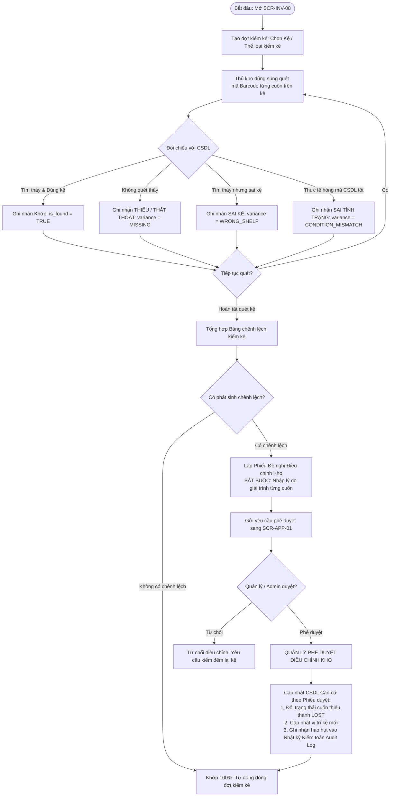

#### 4.9.3. Giao diện Giám sát Cảnh báo Tồn kho Chạm Min (`SCR-INV-09`)
1. **Thiết lập Ngưỡng tại Cấp Ấn bản (Book Edition Level):**
   - Không đặt min-stock chung chung ở Đầu sách.
   - Mỗi Ấn bản có 2 ô cấu hình độc lập:
     - `Min tồn Bán lẻ (min_stock_sale)`: Số bản khả dụng tối thiểu để bán khách.
     - `Min tồn Cho thuê (min_stock_rental)`: Số bản khả dụng tối thiểu để phục vụ độc giả thuê.
2. **Dashboard Cảnh báo Trực quan (`SCR-INV-09`):**
   - Thống kê tổng quan: `18 ấn bản chạm ngưỡng min | 6 ấn bản đã hết hàng hoàn toàn | 42 cuốn đang cho thuê liên quan`.
   - Bảng cảnh báo chia 2 tab:
     - **Tab 1: Cảnh báo Kênh Bán (Sale Channel Alert):** Liệt kê các ấn bản có tồn bán $\le min\_stock\_sale$. Có nút `[ + Tạo Phiếu Nhập NCC ]`.
     - **Tab 2: Cảnh báo Kênh Thuê (Rental Channel Alert):** Liệt kê các tập truyện tranh đang bị độc giả thuê hết sạch trên kệ. Có nút `[ + Thu mua sách cũ theo Bộ ]` để bổ sung ngay tập thiếu từ nguồn bạn đọc.

#### 4.9.4. Cơ Chế Vận Hành Dữ Liệu theo Mô hình 4 Cấp trong Luồng Kiểm Kê & Cảnh Báo
1. **Kiểm đếm tại Cấp 4 (Bản sách vật lý):**
   - Quá trình kiểm kê quét từng mã `CopyBarcode` dán trên gáy sách thực tế trên giá kệ. Sai lệch được gắn trực tiếp vào ID của từng bản sách vật lý.
2. **Tổng hợp Báo cáo theo Cấp 2 (Đầu sách) và Cấp 1 (Bộ sách):**
   - Giao diện báo cáo chênh lệch kiểm kê tổng hợp dữ liệu theo cây phân cấp: `Bộ sách Conan ➔ Tập 10 ➔ Ấn bản KĐ 2024 ➔ Mất 1 cuốn BC-2105`.
3. **Cảnh báo Ngưỡng Min-Stock đặt tại Cấp 3 (Ấn bản):**
   - Hệ thống tự động đếm tổng số cuốn có `status = 'AVAILABLE'` của từng Ấn bản (Cấp 3) và so sánh với `min_stock_sale` và `min_stock_rental`. Nếu chạm ngưỡng, hệ thống kích hoạt cảnh báo mang đầy đủ ngữ cảnh Đầu sách và Bộ truyện để thủ kho dễ dàng lên kế hoạch bổ sung.

---

## PHẦN V: QUY CHUẨN THIẾT KẾ GIAO DIỆN & HỆ THỐNG COMPONENT (DESIGN SYSTEM)

### 5.1. Design Tokens: Màu sắc, Typography, Spacing, Bo góc & Bóng đổ

Hệ thống thiết kế giao diện của Cloud Bookstore tuân thủ các quy chuẩn công thái học (Ergonomics) dành cho ứng dụng quầy POS và quản trị Back-office:

#### 1. Bảng màu thương hiệu & Trạng thái (Color Tokens)
- **Primary Brand (Indigo):** `#4F46E5` | Nhạt: `#EEF2FF` | Đậm: `#3730A3` (Nút bấm chính, tiêu đề thương hiệu, điểm nhấn điều hướng).
- **Surface Background:** `#F5F7FA` (Nền canvas tổng thể) | Surface White: `#FFFFFF` (Nền card, bảng và modal).
- **Text Primary:** `#182337` (Chữ tiêu đề, số tiền, thông tin quan trọng) | Text Muted: `#778295` (Nhãn phụ, chú thích, placeholder).
- **Border Neutral:** `#E8ECF2` (Đường viền ngăn cách giữa các cột và bảng dữ liệu).
- **Success / Available (Emerald):** `#16A34A` | Nền nhạt: `#DCFCE7` (Sách khả dụng, giao dịch thành công, trong hạn).
- **Warning / Renting (Amber):** `#D97706` | Nền nhạt: `#FEF3C7` (Sách đang cho thuê, cảnh báo tồn kho, ân hạn trễ).
- **Danger / Lost / Damaged (Rose):** `#DC2626` | Nền nhạt: `#FEE2E2` (Sách mất, hư hỏng, quá hạn trễ, khóa kiểm kê).
- **Series / Comic Theme (Purple):** `#7C3AED` | Nền nhạt: `#F3E8FF` (Thẻ nhận diện Bộ truyện tranh, Series Progress).

#### 2. Quy chuẩn Typography (`Inter`)
- **POS Display / Total Numbers:** 24px – 28px / Semi Bold – Bold / `#182337` hoặc `#4F46E5` (Hiển thị tổng tiền thanh toán).
- **Page Title:** 20px / Bold / `#182337` (Tiêu đề màn hình).
- **Section Title / Card Header:** 14px – 16px / Semi Bold / `#182337`.
- **Body Regular:** 13px – 14px / Regular / `#182337` (Nội dung văn bản, bảng dữ liệu).
- **Caption / Meta Text:** 11px – 12px / Medium / `#778295` (Mã Barcode, ngày giờ, nhãn phụ).

#### 3. Quy chuẩn Spacing, Bo góc & Elevation
- **Spacing Grid:** Hệ số 4-8px (`4px`, `8px`, `12px`, `16px`, `20px`, `24px`, `32px`).
- **Corner Radius:** `6px` cho tag/badge; `8px` cho nút bấm và input field; `12px` cho card và modal container.
- **Shadows:** `0 1px 3px rgba(0,0,0,0.05)` cho card thông thường; `0 10px 25px -5px rgba(0,0,0,0.1)` cho Modal và Drawer.

---

### 5.2. Quy chuẩn Trạng thái Bản sách & Tag Phân hạng Tình trạng (Grade A/B/C/D)

#### 1. Hệ thống Badge Trạng thái Vòng đời Bản sách (`BookCopyStatus`)

| Mã Trạng thái | Tên hiển thị trên UI | Màu sắc Text / Nền | Icon | Ý nghĩa vận hành |
|---|---|---|:---:|---|
| **`AVAILABLE`** | Khả dụng trên kệ | `#16A34A` / `#DCFCE7` | 🟢 | Sẵn sàng để bán lẻ hoặc cho thuê |
| **`RENTING`** | Đang cho thuê | `#D97706` / `#FEF3C7` | ⏳ | Đang nằm trong tay khách hàng (kèm hạn trả) |
| **`AUDIT_LOCKED`** | Khóa kiểm kê | `#4B5563` / `#F3F4F6` | 🔒 | Đang trong đợt kiểm kê, tạm ngưng giao dịch |
| **`DAMAGED`** | Hư hỏng / Chờ sửa | `#DC2626` / `#FEE2E2` | ⚠️ | Cần phục chế, sửa bìa hoặc thanh lý |
| **`LOST`** | Thất lạc / Đã mất | `#991B1B` / `#FEE2E2` | ❌ | Khách làm mất hoặc kiểm kê thiếu |
| **`SOLD`** | Đã bán | `#6B7280` / `#E5E7EB` | 🏷️ | Đã xuất hóa đơn bán lẻ hoặc kết chuyển cọc mất |

#### 2. Hệ thống Tag Phân hạng Chất lượng Sách cũ (`ConditionGrade`)

```
[ Grade A · 90-99% ] -> Xanh ngọc (#0D9488 / #CCFBF1) -> Sách như mới, không gập gãy, giấy trắng
[ Grade B · 70-89% ] -> Xanh dương (#2563EB / #DBEAFE) -> Sách tốt, gáy thẳng, ố nhẹ mép ngoài
[ Grade C · 50-69% ] -> Vàng cam (#D97706 / #FEF3C7) -> Sách cũ trung bình, sờn bìa, có chữ ký
[ Grade D · < 50%  ] -> Đỏ nâu (#B91C1C / #FEE2E2) -> Sách cũ nát, rách góc, ố vàng nặng
```

---

### 5.3. Quy chuẩn Trường Nhập liệu Máy quét Barcode (Barcode Scanner Field)

Thành phần `BarcodeScannerInput` là trái tim tương tác tại mọi quầy giao dịch POS:
- **Tự động kích hoạt (Auto-listening):** Luôn tự động nhận focus khi thu ngân mở màn hình hoặc nhấn phím tắt `Space` / `F1`.
- **Huy hiệu trực quan:** Hiển thị chấm tròn nhấp nháy xanh lá: `● Máy quét đang sẵn sàng`.
- **Hỗ trợ đa phương thức:**
  - *Quét súng quét mã vạch:* Tự động nhận chuỗi ký tự kết thúc bằng mã `Enter` trong thời gian $\le 50$ms.
  - *Nhập tay từ bàn phím:* Có nút kính lúp tìm kiếm thủ công khi mã vạch bị rách hoặc mờ tem.
- **Phản hồi âm thanh (Audio Feedback):**
  - Âm bíp ngắn cao độ (Short High Beep): Quét thành công, hợp lệ.
  - Âm bíp kép trầm (Double Low Buzz): Lỗi mã vạch (sách đang thuê, không tìm thấy, sách chỉ để bán).

---

### 5.4. Quy chuẩn Bảng Quyết toán Tài chính & Màn hình phụ hướng Khách hàng (VietQR CDS)

#### 1. Bảng Quyết toán Tài chính (Settlement Matrix Component)
Bảng quyết toán tại `SCR-POS-05` được thiết kế theo nguyên tắc phân rã minh bạch:
- Khối 1: **Tổng tiền cọc ban đầu** (Hiển thị số tiền to rõ).
- Khối 2: **Các khoản khấu trừ hợp lệ:**
  - Phí thuê thực tế: Hiển thị rõ công thức `(Đơn giá x Số ngày) - Ưu đãi hạng`.
  - Tiền phạt trễ hạn: Hiển thị số giờ trễ, ngày trễ làm tròn, tỷ lệ phạt 150%.
  - Tiền bồi thường hư hỏng: Hiển thị mức độ hỏng (%) x Giá bán thực tế.
- Khối 3: **Số tiền thực nhận / hoàn lại:**
  - Nếu $T > 0$: Nút hoàn tiền màu xanh lá: `HOÀN LẠI KHÁCH: [ T VNĐ ]`.
  - Nếu $T = 0$: Huy hiệu xám: `CỌC ĐÃ CẤN TRỪ HẾT - KHÔNG HOÀN TIỀN`.

#### 2. Màn hình phụ VietQR hướng Khách hàng (`SCR-POS-07`)
- Tỷ lệ màn hình chuẩn: 16:9 (1920x1080px hoặc 1366x768px).
- Nửa màn hình bên trái: Hiển thị thông tin thương hiệu, hình ảnh bìa các cuốn sách đang giao dịch, số ngày thuê, hạn trả chốt và số tiền cọc.
- Nửa màn hình bên phải: Mã VietQR động độ phân giải cao kèm logo ngân hàng, hướng dẫn khách mở ứng dụng ngân hàng bất kỳ để quét mã thanh toán không cần chạm.

---

### 5.5. Bảng Phím tắt Thao tác Nhanh tại Quầy (POS Hotkeys Matrix)

Để đảm bảo hiệu suất phục vụ độc giả tối đa vào giờ cao điểm, hệ thống thiết lập phím tắt chuẩn quốc tế:

| Phím tắt | Chức năng quầy POS | Màn hình áp dụng |
|:---:|---|---|
| **`F1`** | Chuyển sang màn hình Bán sách lẻ | Toàn hệ thống POS |
| **`F2`** | Chuyển sang màn hình Lập phiếu Cho thuê | Toàn hệ thống POS |
| **`F3`** | Chuyển sang màn hình Tra cứu & Gia hạn phiếu thuê | Toàn hệ thống POS |
| **`F4`** | Chuyển sang màn hình Nhận trả sách & Quyết toán cọc | Toàn hệ thống POS |
| **`F5`** | Chuyển sang màn hình Thu mua sách cũ từ khách | Toàn hệ thống POS |
| **`F8`** | Kích hoạt phương thức thanh toán VietQR động | Quầy Bán, Thuê, Trả |
| **`F9`** | Xác nhận thanh toán Tiền mặt & Mở két tiền | Quầy Bán, Thuê, Trả |
| **`Ctrl + P`** | In hóa đơn / In phiếu thuê / In tem Barcode | Các màn hình giao dịch |
| **`ESC`** | Đóng Modal / Hủy thao tác nhập nháp hiện tại | Toàn hệ thống |
| **`Enter`** | Xác nhận dòng quét Barcode / Đăng nhập | Ô nhập liệu máy quét |

---

### 5.6. Quy chuẩn Thẻ Định danh Sản phẩm 4 Cấp trên UI (4-Tier Product Identifier Component)

Để đảm bảo thu ngân và thủ kho không bao giờ bị nhầm lẫn giữa các tập truyện hoặc giữa các lần tái bản khác nhau, toàn bộ các bảng danh sách và giỏ hàng POS đều áp dụng thành phần hiển thị chuẩn hóa 4 tầng:

```
┌────────────────────────────────────────────────────────────────────────────────────────┐
│ [BỘ SÁCH: Thám tử lừng danh Conan] ➔ Conan · Tập 10                                   │
│  ├─ Ấn bản: NXB Kim Đồng · Tái bản 2024 (Bìa mềm áo rời) · ISBN 978-604-2-09359-5     │
│  └─ Bản vật lý: [ BC-2102 ] · Kệ A2-01 · [ Grade B (70-89%) ] · Kênh: [ Cả Bán & Thuê ] │
└────────────────────────────────────────────────────────────────────────────────────────┘
```

#### Quy tắc hiển thị trên các màn hình:
1. **Tại Quầy POS (Bán, Thuê, Trả):**
   - Dòng tiêu đề chính: Tên Đầu sách/Tập (Cấp 2) kèm Tag màu tím đại diện cho Bộ sách (Cấp 1).
   - Dòng phụ (Sub-text): Tên Ấn bản & Năm phát hành (Cấp 3) để thu ngân biết đây là bản thường hay bản kỷ niệm.
   - Nhãn định danh (Badges): Mã `CopyBarcode` đóng khung monospace nổi bật kèm Tag màu phân hạng `Grade A/B/C/D` (Cấp 4).
2. **Tại Màn hình Phụ hướng Khách hàng (`SCR-POS-07`):**
   - Khách hàng nhìn thấy rõ ràng: Tên truyện, Số tập, Năm xuất bản và Tình trạng thực tế (Grade) để hoàn toàn yên tâm về sự minh bạch của tiệm.

---

### 5.7. Quy chuẩn Thanh Tìm kiếm Đa năng 4 Cấp (4-Tier Omni-Search Bar)

Thanh tìm kiếm tại `SCR-INV-02`, `SCR-POS-02`, `SCR-POS-03` được tích hợp bộ phân giải đa tầng (Multi-tier Parser):
- **Trường hợp 1 (Nhập ký tự văn bản):** Tìm kiếm song song theo Tên Bộ sách (Cấp 1), Tên Đầu sách (Cấp 2) và Tên Tác giả. Dropdown gợi ý phân tách rõ thành các nhóm: `📚 Bộ sách`, `📖 Đầu sách / Tập`.
- **Trường hợp 2 (Nhập hoặc quét chuỗi số 10 hoặc 13 chữ số):** Tự động nhận diện là mã thương mại **ISBN** ➔ Trực tiếp lọc ra **Ấn bản (Cấp 3)** tương ứng.
- **Trường hợp 3 (Quét chuỗi mã vạch tem nhiệt dán gáy có tiền tố BC-xxx):** Tự động nhận diện là **`CopyBarcode` (Cấp 4)** ➔ Lập tức mở màn hình chi tiết đúng cuốn sách đó hoặc đưa ngay vào giỏ hàng POS trong vòng dưới 50ms.

---

## PHẦN VI: BẢNG KHUYẾN NGHỊ & KẾ HOẠCH NÂNG CẤP FIGMA (ACTIONABLE CHECKLIST)

### 6.1. Bảng ánh xạ từng Screen: Nội dung giữ lại - Nội dung sửa đổi - Thành phần bổ sung

Căn cứ vào khảo sát chi tiết tệp Figma và đối chiếu với **`Báo cáo Cuối kỳ(1).docx`**, nhóm thiết kế lập bảng chỉ dẫn hành động (Actionable Roadmap) cho từng Frame trên Figma:

| Frame Name & ID | Nội dung giữ lại | Nội dung cần SỬA ĐỔI | Thành phần cần BỔ SUNG thêm |
|---|---|---|---|
| **`SCR-INV-01`**<br>`8:36257` | Cây thư mục bên trái, token màu sắc, bố cục 2 cột | Tăng độ phân cấp tối đa lên 3 cấp thể loại | Modal tạo nhanh thể loại con, tính năng kéo thả node |
| **`SCR-INV-02`**<br>`8:36455` | Card thống kê KPI, thanh tìm kiếm | Không gộp ISBN vào Đầu sách; hiển thị tóm tắt: Số ấn bản, Tổng bản vật lý | Cột "Bộ truyện", Bộ lọc đa tiêu chí theo Bộ sách (Series) |
| **`SCR-INV-03`**<br>`8:36745` | Bảng bản sách vật lý, giao diện chi tiết | **Tái cấu trúc thành Master-Detail 3 Tầng**: Tầng 1 Đầu sách ➔ Tầng 2 Ấn bản (ISBN) ➔ Tầng 3 Bản vật lý | Tabs ngang chọn Ấn bản; Drawer thêm Ấn bản mới bằng ISBN qua API; Dropdown đổi cờ kênh `BOTH/SALE/RENT` |
| **`SCR-INV-04`**<br>`8:37026` | Giao diện xem trước tem in nhiệt | Chuẩn hóa nội dung nhãn: Tên tiệm, Barcode Code 128, Tên sách viết tắt, Giá bán | Tùy chọn in theo lô phiếu nhập kho hoặc in lại 1 tem hỏng |
| **`SCR-INV-06`**<br>`30:24578` | Chọn NCC, bảng chi tiết nhập hàng | Thêm bước quét mã ISBN để tự động điền metadata từ Google Books API | Nút chuyển hướng tức thì sang `SCR-INV-04` in tem nhiệt sau khi hoàn tất phiếu nhập |
| **`SCR-INV-08`**<br>`30:24813` | Bố cục quét đối soát mã vạch | Phân loại rõ 4 loại chênh lệch: Thừa, Thiếu, Sai kệ, Sai tình trạng | Form giải trình lý do chênh lệch bắt buộc; Nút gửi duyệt sang `SCR-APP-01` |
| **`SCR-INV-09`**<br>`30:24914` | Danh sách cảnh báo tồn kho | **Chuyển min-stock xuống cấp Ấn bản**; phân tách 2 tab Bán lẻ và Cho thuê | Nút kích hoạt nhập hàng NCC hoặc thu mua theo bộ ngay trên cảnh báo |
| **`SCR-INV-10`**<br>`188:555` | Grid card các bộ truyện, thanh tiến độ | Chuẩn hóa công thức tính Completeness Rate theo số tập thực có | Nút `[ + Thu mua theo Bộ truyện ]` liên kết dữ liệu sang `SCR-POS-06` |
| **`SCR-POS-02`**<br>`30:24432` | Giỏ hàng POS, cột tóm tắt thanh toán | Cho phép thanh toán khách vãng lai (không bắt buộc nhập hồ sơ) | Ô quét Barcode auto-focus; Hiển thị tiền tiết kiệm thành viên |
| **`SCR-POS-03`**<br>`8:35041` | Khối nhập SĐT khách, chọn sách | **Bắt buộc định danh khách**; Snapshot cố định cọc 100% giá bán; Phí thuê chỉ ghi tham khảo | Widget kiểm tra hạn mức hạng (số cuốn, số ngày tối đa); Banner cảnh báo nợ xấu / quá hạn |
| **`SCR-POS-04`**<br>`8:35291` | Tra cứu phiếu thuê, lịch sử gia hạn | **Không thu tiền ngay tại quầy**; cộng dồn nghĩa vụ vào cọc; Chặn nếu đã gia hạn 2 lần | Widget Ân hạn trễ 2 giờ; Banner cảnh báo phạt trễ 150%; Cảnh báo chạm trần cọc |
| **`SCR-POS-05`**<br>`8:35508` | Quét barcode cuốn trả, tính cọc hoàn | **Quy tắc mất sách: Giữ 100% cọc thành Doanh thu bán, miễn phí thuê/phạt trễ cho cuốn mất** | Bảng phân rã tài chính minh bạch; Luồng gửi duyệt Quản lý khi sách hỏng ngoài khung |
| **`SCR-POS-06`**<br>`8:35761` | Form thông tin người bán, thẩm định | **Xóa bỏ lỗi gom dòng khi mua theo bộ: bắt buộc 1 dòng = 1 cuốn**; Thêm duyệt giá | Modal **Series Quick-Picker** chọn bộ & tích chọn tập; Banner cảnh báo vượt hạn mức thu ngân |
| **`SCR-POS-07`**<br>`8:36013` | Bố cục màn hình phụ VietQR | Hiển thị đồng bộ giỏ hàng Bán và giỏ hàng Thuê (ghi rõ cọc và hạn trả) | Hiệu ứng trạng thái Webhook: Đang chờ ➔ Đã nhận tiền thành công |

---

### 6.2. Hướng dẫn Tích hợp Prototyping & Kiểm thử Khả năng Sử dụng (Usability Testing)

Để kiểm chứng tính tối ưu của thiết kế mới trước khi bàn giao cho đội ngũ Lập trình viên Frontend (React), nhóm UX/UI khuyến nghị thực hiện các kịch bản kiểm thử:
1. **Kiểm thử Tốc độ Quầy POS (POS Speed Benchmark):**
   - *Kịch bản:* Thu ngân thực hiện lập phiếu thuê 3 cuốn truyện cho khách mới từ lúc nhập SĐT đến khi in xong phiếu thuê.
   - *Mục tiêu:* Thời gian thao tác $\le 45$ giây với súng quét mã vạch.
2. **Kiểm thử Xử lý Ngoại lệ Trả sách & Tranh chấp:**
   - *Kịch bản:* Khách mang trả 1 cuốn bình thường, 1 cuốn bị rách bìa ngoài khung và 1 cuốn báo mất.
   - *Mục tiêu:* Bảng quyết toán tài chính giải thích rõ ràng lý do khấu trừ trong vòng 10 giây; thông báo Zalo gửi tức thì đến điện thoại khách hàng; không xảy ra tranh cãi tại quầy.
3. **Kiểm thử Thu mua theo Bộ truyện:**
   - *Kịch bản:* Khách mang bán 12 tập truyện Conan không liên tục.
   - *Mục tiêu:* Sử dụng *Series Quick-Picker* chọn xong 12 tập trong vòng $\le 20$ giây; hệ thống tự động sinh 12 mã tem dán gáy độc bản chính xác từng tập.

---
**Tài liệu được biên soạn và chuẩn hóa bởi Senior UX/UI Designer & Product Architect.**  
*Bản quyền thuộc về Dự án Cloud Bookstore (ComicPOS) — 2026.*
