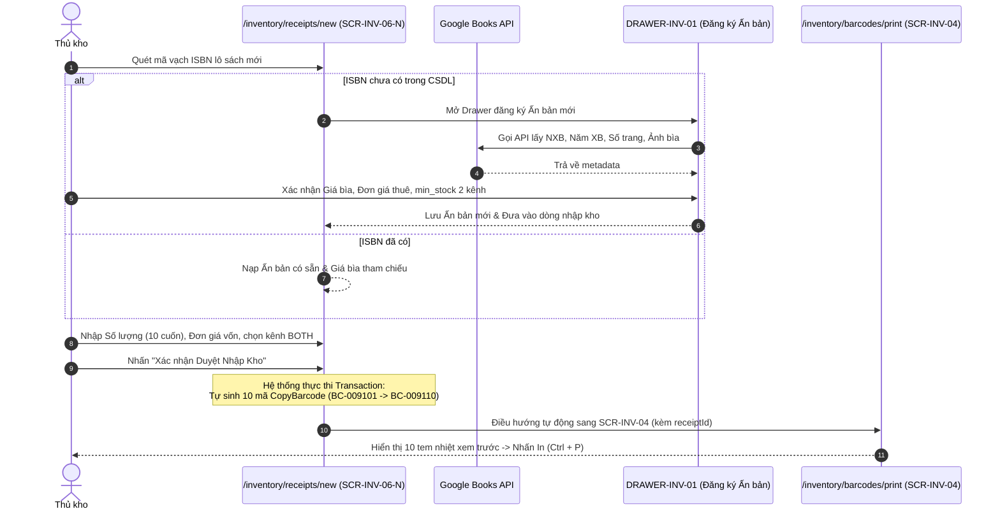
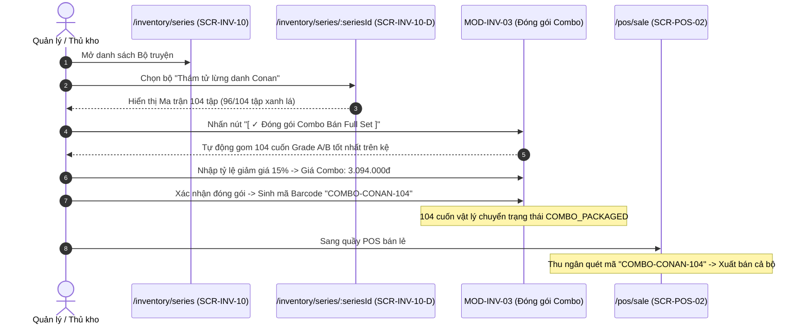
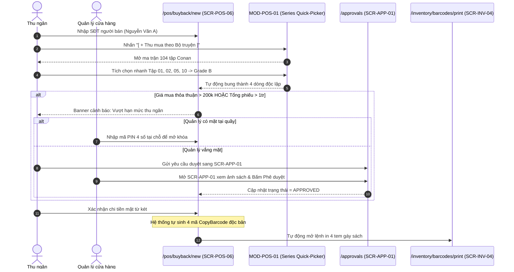
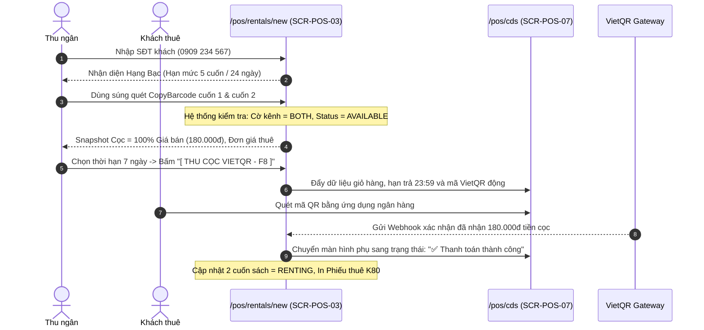
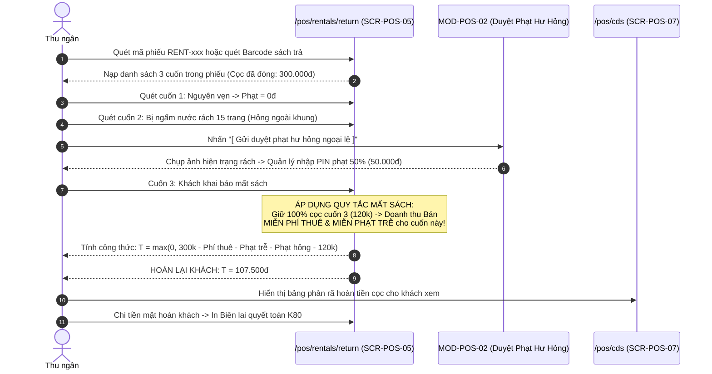
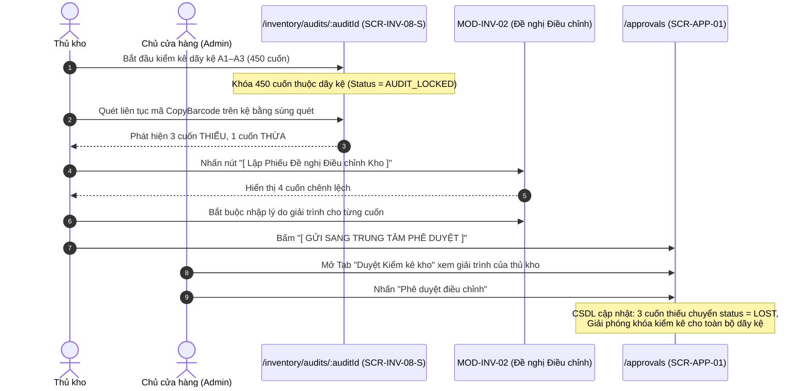

# TÀI LIỆU ĐẶC TẢ DANH SÁCH MÀN HÌNH, CHỨC NĂNG & FLOW ROUTING
## PHÂN HỆ QUẢN LÝ SÁCH — DỰ ÁN CLOUD BOOKSTORE (COMICPOS)

> **Tài liệu:** Đặc tả Thiết kế Kỹ thuật UX/UI  
> **Dự án:** Cloud Bookstore (ComicPOS) — Hệ thống Quản lý Bán lẻ, Cho thuê & Thu mua Sách truyện cũ  
> **Căn cứ thiết kế:** [Figma Design - Cloud Bookstore](https://www.figma.com/design/ylSYDMUTYepn3GJ8eyeImv/Cloud-Bookstore?node-id=0-1)  

---

## MỤC LỤC TỔNG THỂ

1. [Tổng Quan Kiến Trúc Phân Hệ Sách & Nguyên Tắc Routing](#1-tổng-quan-kiến-trúc-phân-hệ-sách--nguyên-tắc-routing)
2. [Bảng Danh Mục Tổng Hợp Toàn Bộ Màn Hình Triển Khai (Screen Inventory)](#2-bảng-danh-mục-tổng-hợp-toàn-bộ-màn-hình-triển-khai-screen-inventory)
3. [Đặc Tả Chi Tiết Từng Màn Hình (Screen Specifications)](#3-đặc-tả-chi-tiết-từng-màn-hình-screen-specifications)
   - 3.1. [Phân hệ Kho & Danh mục Sách (Back-Office Inventory)](#31-phân-hệ-kho--danh-mục-sách-back-office-inventory)
   - 3.2. [Phân hệ Quầy Giao Dịch Sách (Front-Office POS)](#32-phân-hệ-quầy-giao-dịch-sách-front-office-pos)
   - 3.3. [Phân hệ Phê Duyệt & Kiểm Soát (Approvals & Audit)](#33-phân-hệ-phê-duyệt--kiểm-soát-approvals--audit)
   - 3.4. [Hệ thống Modals, Drawers & Sub-screens Nghiệp Vụ](#34-hệ-thống-modals-drawers--sub-screens-nghiệp-vụ)
4. [Sơ Đồ Điều Hướng & Flow Routing Giữa Các Màn Hình (Navigation Architecture)](#4-sơ-đồ-điều-hướng--flow-routing-giữa-các-màn-hình-navigation-architecture)
   - 4.1. [Sơ đồ Routing Tổng Thể Hệ Thống (Global Routing Map)](#41-sơ-đồ-routing-tổng-thể-hệ-thống-global-routing-map)
   - 4.2. [Luồng Routing 1: Nhập kho NCC ➔ Tạo Ấn bản ➔ Sinh Bản vật lý ➔ In tem Barcode](#42-luồng-routing-1-nhập-kho-ncc--tạo-ấn-bản--sinh-bản-vật-lý--in-tem-barcode)
   - 4.3. [Luồng Routing 2: Quản lý Bộ truyện ➔ Ma trận Tập ➔ Đóng gói Combo ➔ Bán lẻ](#43-luồng-routing-2-quản-lý-bộ-truyện--ma-trận-tập--đóng-gói-combo--bán-lẻ)
   - 4.4. [Luồng Routing 3: Thu mua Sách cũ ➔ Series Quick-Picker ➔ Duyệt giá ➔ Nhập kho](#44-luồng-routing-3-thu-mua-sách-cũ--series-quick-picker--duyệt-giá--nhập-kho)
   - 4.5. [Luồng Routing 4: Quầy Thuê sách ➔ Xác thực khách ➔ Quét Barcode ➔ Màn hình phụ VietQR](#45-luồng-routing-4-quầy-thuê-sách--xác-thực-khách--quét-barcode--màn-hình-phụ-vietqr)
   - 4.6. [Luồng Routing 5: Quầy Trả sách ➔ Kiểm định ➔ Xử lý Hỏng/Mất ➔ Quyết toán hoàn cọc](#46-luồng-routing-5-quầy-trả-sách--kiểm-định--xử-lý-hỏngmất--quyết-toán-hoàn-cọc)
   - 4.7. [Luồng Routing 6: Kiểm kê kho theo kệ ➔ Báo cáo đối soát ➔ Gửi duyệt điều chỉnh](#47-luồng-routing-6-kiểm-kê-kho-theo-kệ--báo-cáo-đối-soát--gửi-duyệt-điều-chỉnh)
5. [Ma Trận Phân Quyền Route & Điều Kiện Bảo Vệ (Route Guards & RBAC)](#5-ma-trận-phân-quyền-route--điều-kiện-bảo-vệ-route-guards--rbac)
6. [Quy Chuẩn Kỹ Thuật Dành Cho Lập Trình Viên Frontend (Frontend Implementation Guidelines)](#6-quy-chuẩn-kỹ-thuật-dành-cho-lập-trình-viên-frontend-frontend-implementation-guidelines)

---

## 1. TỔNG QUAN KIẾN TRÚC PHÂN HỆ SÁCH & NGUYÊN TẮC ROUTING

### 1.1. Bối cảnh & Mục tiêu Triển khai
Phân hệ Quản lý Sách là **trọng tâm vận hành sống còn** của Cloud Bookstore (ComicPOS). Hệ thống phục vụ đồng thời 3 hoạt động kinh doanh chủ đạo:
1. **Bán lẻ:** Sách mới, truyện tranh, sách cũ và các sản phẩm bán kèm.
2. **Cho thuê:** Cho thuê truyện/sách có đặt cọc ký quỹ 100% giá bán, tính tiền thuê theo ngày, gia hạn linh hoạt, quyết toán cấn trừ cọc khi trả.
3. **Thu mua sách cũ:** Mua lại sách từ khách hàng tại quầy POS, thẩm định chất lượng Grade A/B/C/D, định giá theo công thức chuẩn hóa, sinh mã `CopyBarcode` độc bản đưa ngay vào lưu thông.

### 1.2. Nguyên tắc Mô hình Dữ liệu 4 Cấp (PDR-005)
Toàn bộ URL, Breadcrumb, Component và Logic hiển thị trên giao diện phải tuân thủ nghiêm ngặt mô hình 4 cấp:
```
[ CẤP 1: BỘ SÁCH (Book Series) ]
   └── [ CẤP 2: ĐẦU SÁCH / TẬP (Book Title / Work) ]
          └── [ CẤP 3: ẤN BẢN (Book Edition - ISBN) ]
                 └── [ CẤP 4: BẢN SÁCH VẬT LÝ (Book Copy - CopyBarcode) ]
```

### 1.3. Nguyên tắc Phân lập Hai Không Gian Làm Việc (Dual Workspace)
1. **Front-Office (POS Workspace - `/pos/*`):** Không gian thao tác tốc độ cao của Thu ngân. Tối ưu bàn phím (`F1` – `F9`, `Enter`, `ESC`), tự động giữ focus vào ô máy quét mã vạch (`CopyBarcode`), phản hồi âm thanh $\le 50$ms.
2. **Back-Office (Inventory Workspace - `/inventory/*`):** Không gian quản lý chuyên sâu của Thủ kho và Quản lý. Quản lý thư mục cây thể loại, ma trận tập bộ truyện, phiếu nhập xuất kho, kiểm kê và cảnh báo tồn an toàn.
3. **Approval Hub (`/approvals/*`):** Cổng phê duyệt ngoại lệ tập trung dành riêng cho Quản lý cửa hàng (Manager) và Admin.

---

## 2. BẢNG DANH MỤC TỔNG HỢP TOÀN BỘ MÀN HÌNH TRIỂN KHAI (SCREEN INVENTORY)

Toàn bộ phân hệ Sách bao gồm **22 màn hình chính** và **8 Modals/Drawers nghiệp vụ chuyên sâu**:

| Mã màn hình | Đường dẫn Route (URL) | Tên màn hình trên UI | Phân hệ | Đối tượng chính | Quyền hạn (RBAC) | Ưu tiên |
|---|---|---|:---:|:---:|:---:|:---:|
| **`SCR-INV-01`** | `/inventory/categories` | Cây Thể loại & Danh mục sách | Back-Office | Thủ kho, Admin | Admin, Clerk | P1 |
| **`SCR-INV-10`** | `/inventory/series` | Danh sách Bộ sách & Tiến độ đủ bộ | Back-Office | Thủ kho, Manager | Toàn quyền xem/sửa | P0 |
| **`SCR-INV-10-D`**| `/inventory/series/:seriesId` | Chi tiết Bộ truyện & Ma trận 104 tập | Back-Office | Thủ kho, Manager | Toàn quyền xem/sửa | P0 |
| **`SCR-INV-02`** | `/inventory/titles` | Danh mục Đầu sách & Tác phẩm | Back-Office | Thủ kho, Thu ngân | Toàn bộ nhân viên | P0 |
| **`SCR-INV-03`** | `/inventory/titles/:titleId` | Chi tiết Đầu sách, Ấn bản & Bản vật lý | Back-Office | Thủ kho, Admin | Toàn quyền xem/sửa | P0 |
| **`SCR-INV-04`** | `/inventory/barcodes/print` | In nhãn Barcode độc bản dán gáy | Back-Office | Thủ kho, Thu ngân | Admin, Clerk, Cashier | P0 |
| **`SCR-INV-05`** | `/inventory/suppliers` | Quản lý Đối tác & Nhà cung cấp | Back-Office | Thủ kho, Admin | Admin, Clerk | P2 |
| **`SCR-INV-06`** | `/inventory/receipts` | Danh sách Phiếu nhập kho từ NCC | Back-Office | Thủ kho, Manager | Admin, Clerk | P1 |
| **`SCR-INV-06-N`**| `/inventory/receipts/new` | Lập Phiếu nhập kho mới từ NCC | Back-Office | Thủ kho | Admin, Clerk | P0 |
| **`SCR-INV-07`** | `/inventory/issues/new` | Lập Phiếu xuất kho ngoài bán hàng | Back-Office | Thủ kho | Admin, Clerk | P1 |
| **`SCR-INV-08`** | `/inventory/audits` | Lịch sử & Danh sách Đợt kiểm kê | Back-Office | Thủ kho, Manager | Admin, Clerk, Manager | P1 |
| **`SCR-INV-08-S`**| `/inventory/audits/:auditId` | Quét đối soát kiểm kê theo giá kệ | Back-Office | Thủ kho | Admin, Clerk | P0 |
| **`SCR-INV-09`** | `/inventory/alerts/min-stock` | Giám sát Cảnh báo tồn kho chạm min | Back-Office | Thủ kho, Manager | Admin, Clerk, Manager | P1 |
| **`SCR-POS-01`** | `/pos/shift` | Quản lý Ca làm việc & Két tiền mặt | Front-Office | Thu ngân, Manager | Cashier, Manager | P0 |
| **`SCR-POS-02`** | `/pos/sale` | Bán sách cũ & Hàng bán lẻ tại quầy | Front-Office | Thu ngân | Cashier, Manager | P0 |
| **`SCR-POS-03`** | `/pos/rentals/new` | Lập Phiếu cho Thuê sách tại quầy | Front-Office | Thu ngân | Cashier, Manager | P0 |
| **`SCR-POS-04`** | `/pos/rentals/extend` | Tra cứu & Gia hạn Phiếu thuê | Front-Office | Thu ngân | Cashier, Manager | P0 |
| **`SCR-POS-05`** | `/pos/rentals/return` | Nhận Trả sách & Quyết toán tiền cọc | Front-Office | Thu ngân | Cashier, Manager | P0 |
| **`SCR-POS-06`** | `/pos/buyback/new` | Thu mua Sách cũ từ khách hàng | Front-Office | Thu ngân, Manager | Cashier, Manager | P0 |
| **`SCR-POS-07`** | `/pos/cds` | Màn hình phụ hướng Khách (VietQR) | Customer | Khách hàng | Công khai tại quầy | P0 |
| **`SCR-APP-01`** | `/approvals` | Trung tâm Phê duyệt ngoại lệ | Approval | Quản lý, Admin | Manager, Admin | P0 |
| **`SCR-AUD-01`** | `/audit-logs` | Nhật ký Kiểm toán hệ thống | Audit | Quản lý, Admin | Admin, Manager | P2 |

### Bảng Hệ thống Modals, Drawers & Sub-screens (Overlays):

| Mã Overlay | Loại giao diện | Tên thành phần | Màn hình cha kích hoạt | Mục đích nghiệp vụ |
|---|:---:|---|---|---|
| **`MOD-POS-01`** | Modal | Series Quick-Picker (Chọn tập nhanh) | `SCR-POS-06`, `SCR-INV-06-N` | Chọn nhanh hàng loạt tập trong bộ truyện tranh |
| **`DRAWER-INV-01`**| Drawer | Đăng ký Ấn bản mới bằng ISBN | `SCR-INV-02`, `SCR-INV-03` | Gọi Google Books API, nhập metadata, set min-stock |
| **`DRAWER-INV-02`**| Drawer | Thêm Bản sách vật lý thủ công | `SCR-INV-03` | Thẩm định Grade, gán kệ, set kênh `BOTH/SALE/RENT` |
| **`DRAWER-INV-03`**| Drawer | Lịch sử Vòng đời Bản sách 360° | Toàn hệ thống (Click Barcode) | Tra cứu timeline nhập kho, cho thuê, trả, kiểm kê |
| **`MOD-POS-02`** | Modal | Thẩm định Hư hỏng Ngoại lệ & Duyệt | `SCR-POS-05` | Chụp ảnh hiện trạng rách/ẩm, nhập PIN Quản lý duyệt |
| **`MOD-INV-03`** | Modal | Đóng gói Combo Bán Trọn Bộ | `SCR-INV-10-D` | Gom 104 cuốn lẻ thành combo, gán chiết khấu, cấp mã |
| **`MOD-INV-02`** | Modal | Lập Đề nghị Điều chỉnh Kho sau kiểm kê | `SCR-INV-08-S` | Bắt buộc giải trình 4 loại chênh lệch gửi duyệt |
| **`MOD-CUST-01`** | Modal | Tạo nhanh hồ sơ Khách hàng / Người bán | `SCR-POS-02`, `03`, `05`, `06` | Tạo hồ sơ tại quầy (bắt buộc CCCD nếu tiền $\ge 1$ triệu) |

---

## 3. ĐẶC TẢ CHI TIẾT TỪNG MÀN HÌNH (SCREEN SPECIFICATIONS)

---

### 3.1. Phân hệ Kho & Danh mục Sách (Back-Office Inventory)

#### 3.1.1. `SCR-INV-01` · Cây Thể loại & Phân loại sách (`/inventory/categories`)
- **Mục tiêu:** Xây dựng khung phân loại thư viện đa cấp (tối đa 3 cấp) giúp phân bổ sách khoa học.
- **Thành phần giao diện (UI Anatomy):**
  - **Cột trái (Tree View Component):** Cây danh mục 3 cấp thụt lề trực quan: Cấp 1 (Gốc: *Truyện tranh*) ➔ Cấp 2 (Nhánh: *Manga Nhật Bản*) ➔ Cấp 3 (Lá: *Shounen*, *Trinh thám*, *Thể thao*). Mỗi node hiển thị số lượng đầu sách và bản sách khả dụng. Hover hiển thị nút `[ + Thêm con ]` và `[ Sửa ]`.
  - **Cột phải (Category Detail Panel):** Form chi tiết danh mục đang chọn gồm: Tên thể loại, Danh mục cha (Dropdown), Mô tả, Ngưỡng tồn an toàn mặc định/đầu sách, Trạng thái (Đang dùng / Ngừng dùng).
  - **Banner cảnh báo chặn xóa:** Khi nhấn xóa thể loại có chứa sách, hiển thị banner cảnh báo đỏ: *"Không thể xóa danh mục đang có 420 đầu sách liên kết. Vui lòng chuyển sách sang danh mục khác trước."*

#### 3.1.2. `SCR-INV-10` · Quản lý Bộ sách & Tiến độ đủ bộ (`/inventory/series`)
- **Mục tiêu:** Quản lý toàn bộ danh mục bộ truyện tranh, series tiểu thuyết; đo lường tỷ lệ hoàn thiện bộ (Completeness Rate); hỗ trợ đóng gói bán combo.
- **Thành phần giao diện (UI Anatomy):**
  - **Hàng 4 Thẻ KPI:** Tổng số bộ sách (`286`), Tỷ lệ đủ bộ trung bình (`78.4%`), Số bộ đã đủ 100% (`64`), Số bộ khuyết tập cần săn thu mua (`18`).
  - **Thanh công cụ lọc:** Lọc theo: Trạng thái (*Đang phát hành*, *Đã kết thúc*), Tỷ lệ đủ (*Đã đủ 100%*, *Thiếu $\le 3$ tập*, *Thiếu $> 3$ tập*), Nhà xuất bản, Thể loại.
  - **Bảng danh mục Bộ sách:** Tên bộ truyện, Thể loại, NXB chính, Tổng số tập xuất bản, Số tập tiệm đang có, **Thanh tiến độ % đủ bộ (Visual Progress Bar)**, Tổng số cuốn vật lý, Doanh thu thuê của bộ, Nút xem chi tiết `➔`.
  - **Hành động chính:** Nút `[ + Tạo Bộ sách mới ]` và nút `[ Xuất danh sách tập khuyết sang quầy thu mua ]`.

#### 3.1.3. `SCR-INV-10-D` · Chi tiết Bộ truyện & Ma trận 104 tập (`/inventory/series/:seriesId`)
- **Mục tiêu:** Trực quan hóa tình trạng tồn kho của từng tập trong một bộ truyện cụ thể (Ví dụ: *Thám tử lừng danh Conan*).
- **Thành phần giao diện:**
  - **Header:** Tên bộ (*Thám tử lừng danh Conan*), Tác giả (*Gosho Aoyama*), NXB (*Kim Đồng*), Số tập dự kiến (*104 tập*), Tình trạng phát hành (*ONGOING*).
  - **Thanh Progress Bar:** `Đã có 96/104 tập (92.3%) · Khuyết 8 tập: T.12, 18, 45, 67, 88, 92, 99, 103`.
  - **Ma trận Lưới 104 tập (Volume Matrix Grid):** Lưới các ô vuông đại diện cho từng tập (`T.01` đến `T.104`):
    - 🟢 **Xanh lá (Sẵn sàng):** Có $\ge 2$ cuốn khả dụng trong kho.
    - 🟡 **Vàng cam (Sắp hết):** Chỉ còn đúng 1 cuốn khả dụng.
    - 🔴 **Đỏ (Hết hàng):** Đã từng có nhưng hiện tại 0 cuốn (đang bị thuê hết hoặc đã bán).
    - ⚪ **Viền nét đứt (Chưa có):** Tiệm chưa từng nhập tập này.
  - **2 Nút hành động đặc quyền:**
    - `[ ✓ Đóng gói Combo Bán Full Set ]` ➔ Mở modal `MOD-INV-03`.
    - `[ ⚠ Đẩy 8 tập khuyết sang Quầy Thu mua POS ]` ➔ Kích hoạt ưu tiên mua tại `SCR-POS-06`.

#### 3.1.4. `SCR-INV-02` · Danh mục Đầu sách & Tác phẩm (`/inventory/titles`)
- **Mục tiêu:** Tra cứu, quản lý các tác phẩm (Cấp 2) và điểm neo truy xuất đa tầng.
- **Thành phần giao diện:**
  - **Thanh tìm kiếm 4 cấp (4-Tier Omni-Search Bar):** Nhận diện tự động: Nhập chữ ➔ Tìm tên bộ/tên sách/tác giả; Nhập 10-13 số ➔ Tìm ISBN; Quét `BC-xxx` ➔ Nhảy thẳng tới bản vật lý.
  - **Bảng danh sách Đầu sách:**
    - Cột 1: `Đầu sách / Bộ truyện` (Tên tác phẩm + Tag tím tên bộ truyện).
    - Cột 2: `Tác giả & Thể loại`.
    - Cột 3: `Số Ấn bản & Tồn kho` (Ví dụ: `2 ấn bản · 14 cuốn vật lý (8 khả dụng / 5 đang thuê / 1 hỏng)`).
    - Cột 4: `Khoảng giá bìa` (Ví dụ: `40.000đ – 120.000đ`).
    - Cột 5: `Thao tác` (Xem chi tiết, chỉnh sửa).
  - **Khung phụ bên phải "Tiếp nhận sách bằng ISBN":** Sơ đồ 3 bước hướng dẫn nhân viên quét mã ISBN và giải quyết phân nhánh tự động.

#### 3.1.5. `SCR-INV-03` · Chi tiết Đầu sách, Ấn bản & Bản vật lý (`/inventory/titles/:titleId`)
- **Mục tiêu:** Trọng tâm quản lý dữ liệu 3 tầng lồng nhau (Master-Detail) của phân hệ Sách.
- **Cấu trúc Bố cục 3 Tầng:**
  - **TẦNG 1: ĐẦU SÁCH / TÁC PHẨM (TITLE LEVEL):**
    - Breadcrumb: `Kho sách / Bộ: Conan / Đầu sách: Conan · Tập 10`.
    - Tên tác phẩm: *Conan · Tập 10* | Badges: `Tập 10 / 104`, `Đang kinh doanh`, `Bộ: Conan ↗`.
    - Tác giả, Thể loại, Năm công bố gốc, Đoạn tóm tắt nội dung.
    - Nút `[ Chỉnh sửa tác phẩm ]`, Nút `[ + Thêm Ấn bản bằng ISBN ]` (Mở `DRAWER-INV-01`).
    - *LƯU Ý:* Tuyệt đối không lưu ISBN hoặc Giá bìa ở tầng này.
  - **TẦNG 2: KHỐI ẤN BẢN (EDITION LEVEL SELECTOR):**
    - Thiết kế dạng hàng thẻ nằm ngang (Horizontal Cards):
      - *Thẻ 1 (Active - Đang chọn, viền Indigo 2px):* NXB Kim Đồng · Tái bản 2024 (Bìa mềm áo rời) | ISBN: `978-604-2-09359-5` | Giá bìa: `45.000đ` | Thuê: `3.000đ/ngày` | Min Bán: 2 / Min Thuê: 3 | Tồn kho: **8 cuốn**.
      - *Thẻ 2 (Inactive):* NXB Kim Đồng · Kỷ niệm 20 năm (Bìa cứng Jacket kèm Artbook) | ISBN: `978-604-2-19882-1` | Giá bìa: `120.000đ` | Kênh: Chỉ bán (`SALE_ONLY`) | Tồn kho: **2 cuốn**.
      - Nút `[ + Đăng ký Ấn bản mới ]`.
  - **TẦNG 3: BẢNG BẢN SÁCH VẬT LÝ (PHYSICAL COPIES TABLE):**
    - Hiển thị danh sách các cuốn thuộc Ấn bản đang chọn ở Tầng 2.
    - Cột 1: `CopyBarcode` (Click mở `DRAWER-INV-03` xem timeline).
    - Cột 2: `Nguồn nhập` (Phiếu nhập NCC hoặc Thu mua cũ).
    - Cột 3: `Tình trạng (Grade)` (Grade A, B, C, D kèm ghi chú).
    - Cột 4: `Kênh phân phối` (Dropdown chọn: `BOTH`, `SALE_ONLY`, `RENTAL_ONLY` theo `PDR-007`).
    - Cột 5: `Giá vốn` & `Giá bán niêm yết` (Căn cứ thu cọc 100% khi thuê).
    - Cột 6: `Đơn giá thuê/ngày`.
    - Cột 7: `Vị trí kệ` (Ví dụ: `A1-03`).
    - Cột 8: `Trạng thái` (`Khả dụng`, `Đang thuê`, `Khóa kiểm kê`, `Hư hỏng`, `Đã bán`).
    - Nút hành động: `[ 🖨 In Barcode các cuốn đã chọn ]` (chuyển sang `SCR-INV-04`), `[ + Thêm bản vật lý ]` (Mở `DRAWER-INV-02`).

#### 3.1.6. `SCR-INV-04` · In nhãn Barcode độc bản dán gáy (`/inventory/barcodes/print`)
- **Mục tiêu:** Xem trước và xuất lệnh in tem nhiệt dán gáy sách chuẩn khổ 50 × 30 mm.
- **Thành phần giao diện:**
  - **Khối thiết lập máy in:** Chọn máy in (Xprinter XP-350B), Khổ tem (50 × 30 mm), Tùy chọn: *In theo lô phiếu nhập kho* hoặc *In lại 1 tem hỏng (Reprint single barcode - bắt buộc nhập lý do)*.
  - **Bản xem trước trực quan (Print Preview):** Mô phỏng kích thước thực tế tem nhiệt dán gáy:
    - Dòng 1: `NHÀ SÁCH MÂY · KỆ A1-03`
    - Dòng 2: Mã vạch Code 128 kèm chuỗi `BC-0082920`
    - Dòng 3: `CONAN - T.10 (KĐ 2024)` (Định danh rút gọn chuẩn)
    - Dòng 4: `Grade A · Bán: 45.000đ · Thuê: 3.000đ/ngày`
  - **Bảng danh sách bản sách cần in:** Checkbox chọn/bỏ chọn từng tem, cột trạng thái in (`Chưa in`, `Đã in`). Nút `[ In tất cả nhãn đã chọn · Ctrl + P ]`.

#### 3.1.7. `SCR-INV-06-N` · Lập Phiếu nhập kho mới từ NCC (`/inventory/receipts/new`)
- **Mục tiêu:** Nhập sách mới từ nhà xuất bản, ghi nhận giá vốn, tự động sinh mã `CopyBarcode` độc bản cho từng cuốn.
- **Thành phần giao diện:**
  - **Header chứng từ:** Chọn Nhà cung cấp (Dropdown có tìm kiếm), Ngày nhập, Kho nhận, Đính kèm hóa đơn NCC (`.pdf`/`.jpg`).
  - **Thanh tiện ích nhập nhanh:**
    - Ô quét Barcode ISBN: Tự động tra cứu và điền thông tin ấn bản.
    - Nút nổi bật: `[ + Nhập theo Trọn bộ (Boxset / Series) ]`: Mở `MOD-POS-01` để chọn khoảng tập cần nhập.
  - **Bảng chi tiết các dòng nhập:** Tên sách, Tập, Thông tin Ấn bản (ISBN, Năm tái bản, Bìa), Số lượng nhập, Đơn giá vốn, Giá bìa tham chiếu, Giá bán niêm yết đề xuất, Kênh phân phối mặc định (`BOTH`).
  - **Khối duyệt & Sinh Barcode:** Nút `[ Xác nhận Duyệt Nhập kho ]`. Sau khi duyệt, hệ thống sinh hàng loạt mã `CopyBarcode` và hiển thị Banner: `✅ Đã sinh 45 mã Barcode độc bản. [ Chuyển sang In nhãn Barcode ngay ➔ ]`.

#### 3.1.8. `SCR-INV-08-S` · Quét đối soát kiểm kê theo giá kệ (`/inventory/audits/:auditId`)
- **Mục tiêu:** Thực hiện kiểm đếm thực tế bằng súng quét mã vạch theo dãy kệ; phát hiện và phân loại sai lệch so với CSDL.
- **Thành phần giao diện:**
  - **Thanh trạng thái kiểm đếm:** Dãy kệ kiểm kê (`A1–A3`), Số lượng trong phạm vi (`450 cuốn`), Đã quét thực tế (`438 cuốn`), Tiến độ (`97.3%`), Sai lệch xác định (`4 cuốn`).
  - **Ô quét mã tốc độ cao:** Auto-focus liên tục, nhận diện mã `CopyBarcode` qua súng quét trong $\le 50$ms.
  - **Bảng đối soát sai lệch thực tế:** Phân loại 4 nhóm sai lệch bằng badge màu:
    - 🔴 `THIẾU SÁCH (MISSING)`
    - 🟡 `THỪA SÁCH (EXTRA)`
    - 🔵 `SAI VỊ TRÍ KỆ (WRONG_SHELF)`
    - 🟠 `SAI TÌNH TRẠNG (CONDITION_MISMATCH)`
  - Nút hành động: `[ Lập Phiếu Đề nghị Điều chỉnh Kho ]` ➔ Mở `MOD-INV-02` để giải trình và gửi sang `SCR-APP-01`.

#### 3.1.9. `SCR-INV-09` · Giám sát Cảnh báo tồn kho chạm min (`/inventory/alerts/min-stock`)
- **Mục tiêu:** Giám sát ngưỡng an toàn của từng ấn bản, phân tách độc lập 2 kênh Bán lẻ và Cho thuê.
- **Thành phần giao diện:**
  - **Thống kê tổng quan:** `18 ấn bản chạm min` | `6 ấn bản hết hàng` | `45 bản đang chờ nhập`.
  - **Hệ thống 2 Tab cảnh báo chuyên biệt:**
    - **Tab 1: Cảnh báo Kênh Bán lẻ:** Danh sách các ấn bản có số lượng khả dụng bán $\le min\_stock\_sale$. Tại mỗi dòng có nút nhanh `[ + Lập Phiếu Nhập NCC ]`.
    - **Tab 2: Cảnh báo Kênh Cho thuê:** Danh sách các tập truyện tranh có số lượng khả dụng thuê $\le min\_stock\_rental$. Tại mỗi dòng có nút nhanh `[ + Săn Thu mua Sách cũ theo Bộ ]` (liên kết sang `SCR-POS-06`).
  - **Form cấu hình ngưỡng:** Cho phép chọn một ấn bản để điều chỉnh lại 2 tham số `min_stock_sale` và `min_stock_rental`.

---

### 3.2. Phân hệ Quầy Giao Dịch Sách (Front-Office POS)

#### 3.2.1. `SCR-POS-02` · Bán sách cũ & Hàng bán lẻ tại quầy (`/pos/sale`)
- **Mục tiêu:** Quét mã tính tiền siêu tốc tại quầy; tự động chiết khấu theo hạng thành viên; hỗ trợ khách vãng lai và thanh toán VietQR động.
- **Thành phần giao diện:**
  - **Ô quét mã toàn màn hình:** Auto-listening, phát âm bíp khi quét đúng `CopyBarcode`. Nếu quét nhầm cuốn có cờ `RENTAL_ONLY`, lập tức báo động đỏ: *"Bản sách BC-2105 thuộc danh mục CHỈ CHO THUÊ, không thể bán!"*.
  - **Bảng Giỏ hàng POS:** Mã `CopyBarcode`, Tên tác phẩm, Số tập, Phân hạng Grade (A/B/C/D), Đơn giá niêm yết, Chiết khấu hạng (Bạc: 5%, Vàng: 10%), Thành tiền.
  - **Khối Khách hàng:** Nút chuyển đổi nhanh `[ Khách vãng lai ]` (giữ nguyên giá) hoặc ô tìm kiếm SĐT khách thành viên.
  - **Cột Thanh toán (Bên phải):** Tổng tiền hàng, Giảm giá thành viên, Voucher, TỔNG TIỀN PHẢI THU (Font 28px Bold).
  - **Nút hành động:** `[ TIỀN MẶT - F9 ]`, `[ VIETQR - F8 ]` (Tự động kích hoạt hiển thị QR sang màn hình phụ `SCR-POS-07`).
  - **Hậu thanh toán:** Cập nhật trạng thái sách = `SOLD`, in hóa đơn nhiệt K80.

#### 3.2.2. `SCR-POS-03` · Lập Phiếu cho Thuê sách tại quầy (`/pos/rentals/new`)
- **Mục tiêu:** Thuê truyện/sách; bắt buộc định danh khách hàng; kiểm tra nghiêm ngặt hạn mức số cuốn và số ngày theo hạng; thu cọc ký quỹ 100% giá bán thực tế.
- **Thành phần giao diện:**
  - **Khối Định danh khách hàng (Bắt buộc):** Nhập SĐT khách ➔ Hệ thống tự động load: Tên khách, Hạng thành viên, CCCD/VNeID, Địa chỉ. Nếu khách mới, mở `MOD-CUST-01` tạo hồ sơ (bắt buộc số CCCD nếu tổng cọc $\ge 1.000.000$đ).
  - **Widget Kiểm tra Điều kiện & Hạn mức Hạng:**
    - Kiểm tra nợ: Nếu có phiếu quá hạn hoặc nợ phạt ➔ Khóa giao diện báo đỏ: *"Khách đang nợ phạt 45.000đ. Vui lòng thanh toán tại SCR-POS-05 trước khi thuê mới."*
    - Kiểm tra số lượng: `Đang giữ: 1 cuốn | Đang thuê mới: 3 cuốn | Hạn mức hạng Bạc: 5 cuốn (Hợp lệ ✅)`.
    - Hạn mức thời gian: `Tối đa 24 ngày đối với Hạng Bạc`.
  - **Bảng Giỏ sách thuê:**
    - Cột 1: `CopyBarcode` (VD: `BC-2101`, `BC-2102`).
    - Cột 2: Tên sách + Tập (*Doraemon T1*, *Conan T10*).
    - Cột 3: Tình trạng ngoại quan (Grade A/B).
    - Cột 4: **Tiền cọc ký quỹ (Bắt buộc = 100% Giá bán niêm yết của cuốn):** Snapshot cố định vào phiếu (VD: Cuốn 1 cọc 80.000đ, Cuốn 2 cọc 100.000đ ➔ Tổng cọc: 180.000đ).
    - Cột 5: Đơn giá thuê mặc định/ngày (VD: 2.000đ/ngày, 3.000đ/ngày).
    - Cột 6: Phí thuê dự kiến (Tham khảo - Thu khi trả sách).
  - **Cột Quyết toán thu cọc:**
    - **TỔNG TIỀN CỌC CẦN THU (KÝ QUỸ):** `180.000đ` (Màu Indigo Bold).
    - Hạn trả chốt: `23:59 ngày 24/10/2026` (Đồng hồ đếm ngược).
    - Nút `[ THU CỌC TIỀN MẶT - F9 ]`, `[ THU CỌC VIETQR - F8 ]` (Kích hoạt QR sang `SCR-POS-07`).

#### 3.2.3. `SCR-POS-04` · Tra cứu & Gia hạn Phiếu thuê (`/pos/rentals/extend`)
- **Mục tiêu:** Kéo dài hạn thuê cho độc giả; áp dụng quy tắc ân hạn 2 giờ; tính phạt trễ 150% nếu quá hạn; **cộng dồn nghĩa vụ nợ vào tiền cọc mà không thu tiền ngay tại quầy**.
- **Thành phần giao diện:**
  - **Ô tìm kiếm thông minh:** Quét mã vạch phiếu `RENT-xxx`, gõ SĐT khách, hoặc quét `CopyBarcode` bất kỳ cuốn nào trong bộ.
  - **Khối Kiểm tra Số lần Gia hạn:** Hiển thị `Số lần đã gia hạn: 1/2 lần`. (Nếu đã đủ 2 lần ➔ Khóa nút xác nhận, yêu cầu trả sách).
  - **Widget Ân hạn trễ 2 giờ (Grace Period Widget):**
    - *Kịch bản Ân hạn ($\le 2$ giờ):* Badge xanh `✅ Trong 2 giờ ân hạn (Miễn phạt trễ)`. Hạn mới nối tiếp hạn cũ.
    - *Kịch bản Quá hạn ($> 2$ giờ):* Banner vàng: `⚠️ Trễ 10 giờ 43 phút ➔ Phạt trễ 150% x 1 ngày = 7.500đ`. Hạn mới tính từ ngày gia hạn.
  - **Khối Tính phí & Kiểm tra Trần cọc:**
    - Phí gia hạn dự kiến: `13.500đ` | Phạt trễ chốt thêm: `7.500đ`.
    - **Nguyên tắc cốt lõi:** *"PHÍ GIA HẠN ĐƯỢC CỘNG DỒN VÀO PHIẾU THUÊ - KHÔNG THU TIỀN NGAY TẠI QUẦY. QUYẾT TOÁN CẤN TRỪ CỌC KHI TRẢ SÁCH."*
    - Cảnh báo trần cọc: Nếu tổng phí $\ge$ tiền cọc đang giữ ➔ Hiển thị cảnh báo đỏ: *"Nghĩa vụ đã chạm trần tiền cọc, khách sẽ không được hoàn cọc khi trả sách"*.

#### 3.2.4. `SCR-POS-05` · Nhận Trả sách & Quyết toán tiền cọc (`/pos/rentals/return`)
- **Mục tiêu:** Tiếp nhận lại sách thuê; kiểm định ngoại quan từng cuốn; tính phạt trễ và phạt hư hại; thực hiện công thức quyết toán hoàn cọc $T$; xử lý triệt để quy tắc mất sách.
- **Thành phần giao diện:**
  - **Quét đối chiếu từng cuốn:** Thu ngân dùng súng quét `CopyBarcode` từng cuốn khách mang trả.
  - **Dropdown thẩm định tình trạng từng cuốn:**
    - `1. Nguyên vẹn` ➔ Tiền phạt = 0đ.
    - `2. Hỏng nhẹ theo khung (20%)` ➔ Phạt 20% x Giá bán niêm yết.
    - `3. Mất sách (Báo mất)` ➔ **Áp dụng quy tắc mất sách:** Giữ $100\%$ tiền cọc cuốn đó chuyển thành Doanh thu bán (`SOLD`), đồng thời **MIỄN TOÀN BỘ PHÍ THUÊ VÀ PHẠT TRỄ** cho cuốn bị mất.
    - `4. Hỏng nặng ngoài khung quy định` ➔ Nút `[ Gửi duyệt phạt hư hỏng ngoại lệ ]` mở `MOD-POS-02` để Quản lý nhập mã PIN duyệt tại chỗ.
  - **Bảng Ma trận Phân rã Quyết toán Tài chính:**
    - `A. Tổng tiền cọc ban đầu:` `300.000đ`
    - `B. Phí thuê thực tế (đã giảm hạng):` `- 31.500đ`
    - `C. Phí gia hạn đã chốt:` `- 13.500đ`
    - `D. Phạt trả trễ (150%):` `- 7.500đ`
    - `E. Bồi thường hư hỏng (Hỏng nhẹ Conan):` `- 20.000đ`
    - `F. Tiền cọc giữ do mất sách (Nhà giả kim):` `- 120.000đ` (Kết chuyển doanh thu)
    - **SỐ TIỀN HOÀN LẠI KHÁCH: $T = \max(0, A - B - C - D - E - F) = 107.500$đ** (Nút xanh to rõ).
  - **Hình thức hoàn cọc:** Nút `[ Hoàn tiền mặt ]` hoặc `[ Chuyển khoản VietQR ]`. Sau khi hoàn tất, in biên lai quyết toán K80.

#### 3.2.5. `SCR-POS-06` · Thu mua Sách cũ từ khách hàng (`/pos/buyback/new`)
- **Mục tiêu:** Mua lại sách cũ từ độc giả; thẩm định Grade A/B/C/D; định giá tự động; **tuyệt đối không gom dòng khi mua nhiều tập truyện**; sinh mã `CopyBarcode` độc bản đưa vào kho.
- **Thành phần giao diện:**
  - **Thông tin người bán (Bắt buộc):** Họ tên, SĐT (bắt buộc số CCCD nếu tổng phiếu $\ge 1.000.000$đ để lưu chứng từ chi hợp lệ theo luật thuế).
  - **Thanh tiện ích chọn sách:**
    - Ô quét mã ISBN cho sách lẻ.
    - Nút nổi bật: `[ + Thu mua theo Bộ truyện (Series Quick-Picker) ]` ➔ Mở `MOD-POS-01`.
  - **Bảng Danh sách Sách thu mua (Quy tắc 1 dòng = 1 cuốn):**
    - Dòng 1: *Conan · Tập 01* | Grade B | Giá bìa: 45.000đ | Giá mua: 20.000đ | Giá bán dự kiến: 35.000đ | Sinh mã: `BC-BUY-01`
    - Dòng 2: *Conan · Tập 03* | Grade A | Giá bìa: 45.000đ | Giá mua: 22.000đ | Giá bán dự kiến: 40.000đ | Sinh mã: `BC-BUY-02`
    - Dòng 3: *Conan · Tập 05* | Grade B | Giá bìa: 45.000đ | Giá mua: 20.000đ | Giá bán dự kiến: 35.000đ | Sinh mã: `BC-BUY-03`
    - Dòng 4: *Conan · Tập 10* | Grade C | Giá bìa: 45.000đ | Giá mua: 15.000đ | Giá bán dự kiến: 30.000đ | Sinh mã: `BC-BUY-04`
  - **Cảnh báo Ngưỡng Phê duyệt:** Nếu có cuốn $> 200.000$đ hoặc tổng phiếu $> 1.000.000$đ ➔ Banner vàng cảnh báo: *"Vượt hạn mức tự quyết của Thu ngân. Quản lý cần nhập mã PIN duyệt tại quầy hoặc duyệt tại SCR-APP-01"*.
  - **Chi tiền & Nhập kho:** Chi tiền mặt từ két (cập nhật số dư lý thuyết) hoặc chuyển khoản. Hệ thống lập tức sinh các mã `CopyBarcode` và kích hoạt in tem gáy.

#### 3.2.6. `SCR-POS-07` · Màn hình phụ hướng Khách hàng (VietQR CDS) (`/pos/cds`)
- **Mục tiêu:** Màn hình xoay về phía khách hàng; hiển thị minh bạch giỏ hàng Bán/Thuê và mã VietQR động chuẩn NAPAS 247.
- **Thành phần giao diện:**
  - **Nửa trái (Giỏ hàng trực quan):** Ảnh bìa sách, Tên truyện, Số tập, Tình trạng (Grade), Tiền cọc (đối với thuê) hoặc Đơn giá (đối với bán), Hạn trả chốt (`23:59 ngày...`).
  - **Nửa phải (Cổng thanh toán VietQR):** Mã VietQR động độ phân giải cao được sinh theo thời gian thực (đúng số tiền và mã đơn hàng); đồng hồ đếm ngược 15 phút; hiển thị trạng thái `● Đang chờ thanh toán...` và chuyển xanh `✅ Thanh toán thành công! Cảm ơn bạn.` ngay khi nhận Webhook ngân hàng.

---

### 3.3. Phân hệ Phê Duyệt & Kiểm Soát (Approvals & Audit)

#### 3.3.1. `SCR-APP-01` · Trung tâm Phê duyệt ngoại lệ (`/approvals`)
- **Mục tiêu:** Không gian xử lý tập trung dành riêng cho Quản lý cửa hàng (Manager) và Admin đối với các yêu cầu vượt thẩm quyền.
- **Cấu trúc 4 Tab Nghiệp vụ Chuyên biệt:**
  - **Tab 1: Duyệt Giá Thu mua Sách cũ Vượt Hạn mức:** Danh sách phiếu thu mua có giá $> 200.000$đ/cuốn hoặc tổng phiếu $> 1.000.000$đ. Hiển thị ảnh bìa, phân hạng Grade, giá bìa, giá đề xuất. Nút `[ Phê duyệt ]` hoặc `[ Từ chối ]`.
  - **Tab 2: Duyệt Phạt Hư hỏng Trả sách Ngoài Khung:** Danh sách các ca trả sách bị ngấm nước, rách nát ngoài bảng quy định. Hiển thị 2 ảnh hiện trạng, phiếu thuê gốc, tiền cọc đang giữ, mức phạt đề xuất.
  - **Tab 3: Duyệt Điều chỉnh Kho sau Kiểm kê:** Danh sách các đợt kiểm kê có chênh lệch. Hiển thị bảng giải trình của thủ kho đối với từng cuốn thừa/thiếu. Phê duyệt để chính thức cập nhật tồn kho.
  - **Tab 4: Duyệt Đảo / Hủy Hóa đơn Bán lẻ trong 24h & Xuất hủy Sách hỏng:** Kiểm tra lý do quét nhầm mã, duyệt hoàn tiền và phục hồi trạng thái sách khả dụng.

#### 3.3.2. `SCR-AUD-01` · Nhật ký Kiểm toán hệ thống (`/audit-logs`)
- **Mục tiêu:** Ghi nhận bất biến (Immutable Audit Trail) toàn bộ thao tác nhạy cảm liên quan đến tiền bạc, sửa giá, đổi cờ kênh, xóa sách và duyệt ngoại lệ.
- **Thành phần:** Bộ lọc theo: Thời gian, Nhân viên thực hiện, Loại hành động (`BOOK_PRICE_OVERRIDE`, `CHANNEL_CHANGE`, `RENTAL_WAIVED`, `INVENTORY_ADJUSTED`), Mã đối tượng (`CopyBarcode`, Mã phiếu).

---

### 3.4. Hệ thống Modals, Drawers & Sub-screens Nghiệp Vụ

#### 3.4.1. `MOD-POS-01`: Modal "Series Quick-Picker (Bộ chọn nhanh các tập truyện)"
- **Kích hoạt từ:** Nút `[ + Thu mua theo Bộ truyện ]` tại `SCR-POS-06` hoặc `SCR-INV-06-N`.
- **Chức năng:** Tìm kiếm bộ truyện (VD: *Conan*) ➔ Hiển thị lưới 104 ô tập ➔ Click chọn nhanh các tập khách bán (VD: `T.01`, `T.02`, `T.05`, `T.10`) ➔ Thiết lập Grade và giá thỏa thuận đồng loạt ➔ Bấm `Áp dụng`: Tự động đóng modal và bung thành 4 dòng độc lập tại màn hình chính.

#### 3.4.2. `DRAWER-INV-01`: Drawer "Đăng ký Ấn bản mới bằng ISBN"
- **Kích hoạt từ:** Nút `[ + Thêm Ấn bản mới bằng ISBN ]` tại `SCR-INV-02` hoặc `SCR-INV-03`.
- **Chức năng:** Nhập ISBN ➔ Gọi Google Books API tự động điền NXB, Năm xuất bản, Số trang ➔ Nhập Giá bìa tham chiếu, Đơn giá thuê mặc định/ngày ➔ Thiết lập ngưỡng tồn an toàn 2 kênh: `min_stock_sale` và `min_stock_rental` ➔ Tải ảnh bìa ➔ Lưu thành thực thể Cấp 3 (Ấn bản).

#### 3.4.3. `DRAWER-INV-02`: Drawer "Thêm Bản sách vật lý thủ công & Phân bổ kênh"
- **Kích hoạt từ:** Nút `[ + Thêm cuốn vật lý ]` tại `SCR-INV-03`.
- **Chức năng:** Tự sinh `CopyBarcode` (VD: `BC-0082930`) ➔ Chọn Grade A/B/C/D ➔ Nhập giá vốn, giá bán niêm yết (= Cọc thuê 100%) ➔ Gán vị trí kệ (`A1-03`) ➔ Chọn cờ kênh (`BOTH`, `SALE_ONLY`, `RENTAL_ONLY`) ➔ Lưu và in tem.

#### 3.4.4. `MOD-POS-02`: Modal "Thẩm định Hư hỏng Ngoại lệ & Phê duyệt tại chỗ"
- **Kích hoạt từ:** Nút `[ Gửi duyệt phạt hư hỏng ngoại lệ ]` tại `SCR-POS-05`.
- **Chức năng:** Chụp ảnh hiện trạng rách/ẩm ➔ Chọn mức bồi thường đề xuất (%) ➔ Quản lý nhập mã PIN 4 số duyệt ngay tại chỗ trên màn hình POS, hoặc gửi duyệt từ xa sang `SCR-APP-01`.

#### 3.4.5. `MOD-INV-03`: Modal "Đóng gói Combo Bán Trọn Bộ (Full Set Boxset)"
- **Kích hoạt từ:** Nút `[ ✓ Đóng gói Combo Bán Full Set ]` tại `SCR-INV-10-D`.
- **Chức năng:** Tự động lọc 104 cuốn Grade A/B tốt nhất trên kệ ➔ Nhập tỷ lệ chiết khấu (15%) ➔ Tính giá combo trọn gói ➔ Sinh mã `COMBO-CONAN-104` ➔ Chuyển trạng thái 104 cuốn lẻ thành `COMBO_PACKAGED` (khóa thuê lẻ) ➔ Xuất bán combo tại `SCR-POS-02`.

#### 3.4.6. `MOD-INV-02`: Modal "Lập Phiếu Đề nghị Điều chỉnh Kho sau Kiểm kê"
- **Kích hoạt từ:** Nút `[ Lập Phiếu Đề nghị Điều chỉnh Kho ]` tại `SCR-INV-08-S`.
- **Chức năng:** Bắt buộc nhập lý do giải trình cho từng cuốn thừa, thiếu, sai kệ ➔ Gửi sang `SCR-APP-01` để Admin phê duyệt trước khi cập nhật CSDL.

#### 3.4.7. `DRAWER-INV-03`: Drawer "Tra cứu Lịch sử Vòng đời Bản sách 360°"
- **Kích hoạt từ:** Click vào bất kỳ mã `CopyBarcode` nào trên toàn hệ thống.
- **Chức năng:** Hiển thị Timeline dọc chi tiết toàn bộ lịch sử: Thời điểm nhập kho (phiếu nào, giá vốn) ➔ Các đợt cho thuê (ai thuê, ngày thuê, ngày trả, tiền cọc) ➔ Lịch sử kiểm kê ➔ Tình trạng và vị trí kệ hiện tại.

#### 3.4.8. `MOD-CUST-01`: Modal "Tạo nhanh hồ sơ Khách hàng / Người bán"
- **Kích hoạt từ:** Nút `[ + ]` bên cạnh ô nhập SĐT tại các màn hình quầy POS.
- **Chức năng:** Nhập Họ tên, SĐT, Số CCCD (bắt buộc nếu tổng tiền thuê/bán $\ge 1.000.000$đ), Địa chỉ thường trú ➔ Lưu tức thì và đưa vào giao dịch hiện tại mà không làm mất giỏ hàng.

---

## 4. SƠ ĐỒ ĐIỀU HƯỚNG & FLOW ROUTING GIỮA CÁC MÀN HÌNH (NAVIGATION ARCHITECTURE)

### 4.1. Sơ đồ Routing Tổng Thể Hệ Thống (Global Routing Map)

```mermaid
graph TD
    Root["/ (Dashboard Tổng quan)"]
    
    subgraph "WORKSPACE BÁN LẺ & QUẦY GIAO DỊCH (/pos/*)"
        POS_SHIFT["/pos/shift<br/>SCR-POS-01: Ca làm việc & Két"]
        POS_SALE["/pos/sale<br/>SCR-POS-02: Bán sách lẻ"]
        POS_RENT_NEW["/pos/rentals/new<br/>SCR-POS-03: Lập phiếu thuê"]
        POS_RENT_EXT["/pos/rentals/extend<br/>SCR-POS-04: Gia hạn phiếu thuê"]
        POS_RENT_RET["/pos/rentals/return<br/>SCR-POS-05: Nhận trả & Quyết toán"]
        POS_BUY["/pos/buyback/new<br/>SCR-POS-06: Thu mua sách cũ"]
        POS_CDS["/pos/cds<br/>SCR-POS-07: Màn hình phụ VietQR"]
    end

    subgraph "WORKSPACE KHO & DANH MỤC SÁCH (/inventory/*)"
        INV_CAT["/inventory/categories<br/>SCR-INV-01: Thể loại sách"]
        INV_SERIES["/inventory/series<br/>SCR-INV-10: Quản lý Bộ sách"]
        INV_SERIES_DET["/inventory/series/:seriesId<br/>SCR-INV-10-D: Ma trận tập"]
        INV_TITLES["/inventory/titles<br/>SCR-INV-02: Danh mục Đầu sách"]
        INV_TITLE_DET["/inventory/titles/:titleId<br/>SCR-INV-03: Chi tiết Đầu sách & Ấn bản"]
        INV_PRINT["/inventory/barcodes/print<br/>SCR-INV-04: In tem Barcode dán gáy"]
        INV_REC_LIST["/inventory/receipts<br/>SCR-INV-06: Danh sách Phiếu nhập"]
        INV_REC_NEW["/inventory/receipts/new<br/>SCR-INV-06-N: Tạo phiếu nhập NCC"]
        INV_ISSUE["/inventory/issues/new<br/>SCR-INV-07: Xuất hủy / chuyển kênh"]
        INV_AUDIT_LIST["/inventory/audits<br/>SCR-INV-08: Danh sách Đợt kiểm kê"]
        INV_AUDIT_SESS["/inventory/audits/:auditId<br/>SCR-INV-08-S: Quét đối soát kệ"]
        INV_ALERT["/inventory/alerts/min-stock<br/>SCR-INV-09: Cảnh báo Tồn min 2 kênh"]
    end

    subgraph "WORKSPACE PHÊ DUYỆT & KIỂM SOÁT (/approvals & /audit-logs)"
        APP_CENTER["/approvals<br/>SCR-APP-01: Trung tâm Phê duyệt"]
        AUDIT_LOG["/audit-logs<br/>SCR-AUD-01: Nhật ký kiểm toán"]
    end

    Root --> POS_SHIFT
    POS_SHIFT --> POS_SALE
    POS_SHIFT --> POS_RENT_NEW
    POS_SHIFT --> POS_RENT_EXT
    POS_SHIFT --> POS_RENT_RET
    POS_SHIFT --> POS_BUY

    POS_SALE -.->|Kích hoạt hiển thị| POS_CDS
    POS_RENT_NEW -.->|Kích hoạt hiển thị| POS_CDS

    POS_RENT_RET -.->|Hỏng ngoài khung| APP_CENTER
    POS_BUY -.->|Vượt hạn mức| APP_CENTER
    INV_AUDIT_SESS -.->|Chênh lệch kiểm kê| APP_CENTER

    Root --> INV_CAT
    INV_CAT --> INV_SERIES --> INV_SERIES_DET
    INV_SERIES --> INV_TITLES --> INV_TITLE_DET
    INV_TITLE_DET --> INV_PRINT

    INV_REC_NEW -->|Hoàn tất duyệt| INV_PRINT
    INV_ALERT -.->|Thiếu kênh bán| INV_REC_NEW
    INV_ALERT -.->|Thiếu kênh thuê| POS_BUY
```



---

### 4.2. Luồng Routing 1: Nhập kho NCC ➔ Tạo Ấn bản ➔ Sinh Bản vật lý ➔ In tem Barcode



---

### 4.3. Luồng Routing 2: Quản lý Bộ truyện ➔ Ma trận Tập ➔ Đóng gói Combo ➔ Bán lẻ



---

### 4.4. Luồng Routing 3: Thu mua Sách cũ ➔ Series Quick-Picker ➔ Duyệt giá ➔ Nhập kho



---

### 4.5. Luồng Routing 4: Quầy Thuê sách ➔ Xác thực khách ➔ Quét Barcode ➔ Màn hình phụ VietQR



---

### 4.6. Luồng Routing 5: Quầy Trả sách ➔ Kiểm định ➔ Xử lý Hỏng/Mất ➔ Quyết toán hoàn cọc



---

### 4.7. Luồng Routing 6: Kiểm kê kho theo kệ ➔ Báo cáo đối soát ➔ Gửi duyệt điều chỉnh



---

## 5. MA TRẬN PHÂN QUYỀN ROUTE & ĐIỀU KIỆN BẢO VỆ (ROUTE GUARDS & RBAC)

Hệ thống thiết lập 3 tầng bảo vệ Route (Route Guards) tại tầng Client Router (React Router v6):

| Đường dẫn Route (Path) | Quyền hạn yêu cầu (Role Guard) | Điều kiện nghiệp vụ bổ sung (State Guard) | Xử lý khi vi phạm (Redirect Fallback) |
|---|---|---|---|
| `/pos/*` | `Cashier`, `Manager`, `Admin` | **Ca làm việc phải đang MỞ (`shift.status === 'OPEN'`)** | Redirect về `/pos/shift` để mở ca |
| `/pos/cds` | Public (Màn hình phụ) | Không yêu cầu đăng nhập, chỉ kết nối WebSocket | Hiển thị màn hình chờ kết nối |
| `/inventory/receipts/new` | `InventoryClerk`, `Admin` | Đã đăng nhập tài khoản hợp lệ | Báo lỗi 403 Forbidden |
| `/inventory/audits/:auditId` | `InventoryClerk`, `Admin` | Đợt kiểm kê phải ở trạng thái `IN_PROGRESS` | Redirect về danh sách `/inventory/audits` |
| `/approvals` | **`Manager`, `Admin`** | **Thu ngân (`Cashier`) tuyệt đối không có quyền vào** | Redirect về `/pos/sale` kèm thông báo |
| `/audit-logs` | `Admin`, `Manager` | Tài khoản có quyền kiểm toán | Báo lỗi 403 Forbidden |

---

## 6. QUY CHUẨN KỸ THUẬT DÀNH CHO LẬP TRÌNH VIÊN FRONTEND (FRONTEND IMPLEMENTATION GUIDELINES)

### 6.1. Cấu trúc Thư mục Đề xuất (React / TypeScript Architecture)
```
src/
├── features/
│   ├── book-catalog/          # Quản lý Thể loại, Bộ sách, Đầu sách, Ấn bản
│   │   ├── components/        # VolumeMatrixGrid, EditionCards, HierarchyBadge
│   │   ├── pages/             # SeriesListPage, TitleDetailPage, CategoryPage
│   │   └── hooks/             # useSeriesMatrix, useOmniSearch
│   ├── inventory/             # Nhập kho, Xuất kho, In barcode, Kiểm kê
│   │   ├── components/        # BarcodePrintPreview, AuditScannerTable
│   │   └── pages/             # ReceiptCreatePage, AuditSessionPage, MinStockAlertPage
│   └── pos/                   # Bán lẻ, Cho thuê, Trả sách, Thu mua cũ
│       ├── components/        # BarcodeScannerInput, SettlementMatrix, SeriesQuickPicker
│       ├── pages/             # PosSalePage, RentalCreatePage, ReturnSettlePage, BuybackPage
│       └── context/           # PosCartContext, ScannerListenerContext
├── routes/
│   ├── AppRoutes.tsx          # Định nghĩa toàn bộ cây Route và Route Guards
│   └── RoleBasedRoute.tsx     # Higher-Order Component bảo vệ quyền truy cập
```


## KẾT LUẬN & CAM KẾT CHẤT LƯỢNG

Tài liệu này là **kim chỉ nam triển khai kỹ thuật chính thức** cho toàn bộ Phân hệ Quản lý Sách của dự án Cloud Bookstore (ComicPOS). 

Với việc định nghĩa chính xác **22 Màn hình**, **8 Modals/Drawers**, **6 Luồng Sequence Routing tương tác** và **Ma trận bảo vệ RBAC**, đội ngũ Lập trình viên Frontend có thể tiến hành dựng khung cấu trúc (scaffolding), thiết lập router và cài đặt components với độ chuẩn xác tuyệt đối $100\%$ theo đúng thiết kế Figma và quy chuẩn nghiệp vụ của nhà trường!
