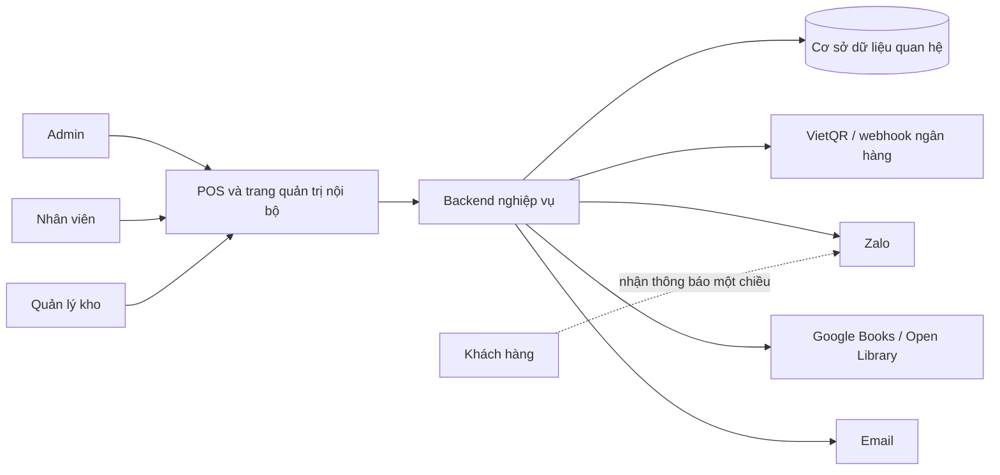

# Bối cảnh hệ thống

**Trạng thái:** Proposed  
Tài liệu này mô tả ranh giới logic, không quyết định framework backend.

## Trong biên hệ thống

- Xác thực, ba vai trò và audit log.
- Toàn bộ quy tắc danh mục, bản sách, kho, bán, thuê–trả và thu mua.
- Hồ sơ khách hàng và hạng thành viên.
- Sổ giao dịch nội bộ, két, đối soát và giao dịch đảo.
- Nhân sự, chấm công theo ca và lương theo ca.
- Outbox/hàng đợi logic cho thông báo và webhook idempotency.
- Báo cáo và cấu hình có lịch sử.

## Ngoài biên hệ thống

- Ngân hàng là nguồn xác nhận tiền vào; hệ thống không ra lệnh chuyển tiền.
- Zalo/email chịu trách nhiệm vận chuyển thông báo; hệ thống giữ trạng thái gửi.
- Google Books/Open Library chỉ cung cấp metadata tham khảo; nhân viên xác nhận trước khi lưu.
- Khách hàng không gọi API hoặc đăng nhập.

## Nguyên tắc tích hợp

- Mỗi tích hợp nằm sau adapter và có timeout, retry cùng circuit-breaking phù hợp.
- Dữ liệu nội bộ được commit trước hoặc cùng outbox; không phụ thuộc phản hồi gửi thông báo để hoàn tất giao dịch.
- Webhook được xác thực, lưu định danh sự kiện và xử lý idempotent.
- Payload gốc nhạy cảm được bảo vệ theo chính sách retention, không log tràn lan.
- Fallback phải hiển thị rõ cho người vận hành và tạo dữ liệu phục vụ xử lý tiếp.

## Ranh giới chưa quyết định

- Framework backend và persistence chính thức (`OQ-001`).
- Cơ chế authentication/session (`OQ-002`).
- Nhà cung cấp và hợp đồng API cụ thể (`OQ-006`, `OQ-007`).
- Hạ tầng triển khai, job scheduler, queue và storage cho file báo cáo.

Các nội dung trên phải có ADR trước khi trở thành ràng buộc triển khai.
